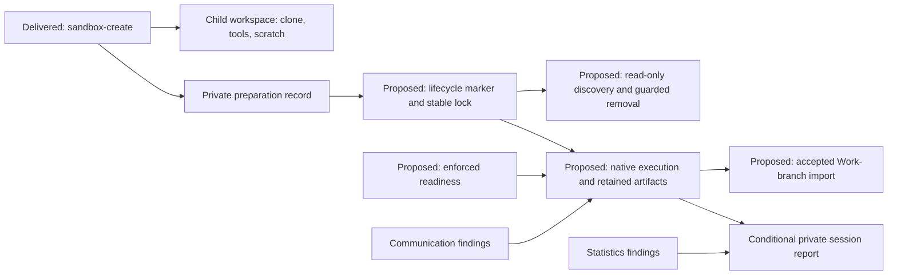

# Managed evaluation sandboxes

## Purpose

Provide project-scoped temporary workspaces whose preparation, restricted
execution, retained output and accepted import have one coherent ownership
contract.

## Goals

- Compose delivered creation with native runtime readiness and execution.
- Share safe root, ownership and lifecycle rules across sandbox commands.
- Retain attributable output for accepted Work-branch delivery.
- Provide supported session reports or an explicit reviewed no-fit disposition.
- Promote lasting command usage and supported-condition limits to their owner.

## Non-Goals

- Authorize sandbox probes, model runs, host-auth reads or statistics adoption.
- Change ordinary linked-worktree or Work delivery policy.
- Adopt a default sandbox or statistics policy from a recommendation.
- Run duplicate implementations of the retired runtime contracts.

## Mechanisms

`script/sandbox.py` and the Make interface deliver managed creation;
[usage guidance](../../evaluation-sandboxes.md) owns its current interface and
limits. The remaining children extend that machinery using native Codex
controls rather than a new sandbox framework or controller service.

### Shared root and ownership

The default child location is `<system temp>/<project name>/sandboxes/<NAME>`.
Resolve system temp with `tempfile.gettempdir()` using its native
TMPDIR/TEMP/TMP and platform-default selection, and read the project name from
`pyproject.toml` `[project].name`; do not hardcode a macOS path or project name.
An optional `SANDBOX_ROOT` Make argument overrides the managed root. Create,
list, remove and exec share one authoritative resolution and ownership
validation. The [active-state owner](lifecycle/active-state-exclusion/README.md)
extends the existing private ownership record into a persistent uncommitted
lifecycle marker and delivers creation participation in a stable OS-held
per-name lock. Listing only observes existing locks; execution and removal
acquire exclusion automatically. Reject unsafe
resolved roots, including an unsuitable current-directory fallback, unsafe
project-name path components and invalid overrides, under the existing
containment, symlink, collision, ownership and permission safeguards.

Discover children locally, with per-child ownership metadata and no global
registry. Each lifecycle marker includes an opaque unique generation ID and
the native identity of its created child directory; its Evaluation ownership,
session/run provenance, retained output and explicit orchestrator cleanup
disposition are defined at that active-state owner. No existing sandboxes need
migration; unsupported records are rejected safely. Bind repository ownership
to the canonical Git common directory: linked worktrees agree, while independent
checkouts sharing a project name cannot manage each other's children. A
conflicting owner blocks creation, removal and execution rather than
reassigning an existing child.
Keep a stable root-private per-name lock object across successful removal and
same-name recreation. It is coordination state rather than an ownership record
or registry, and direct-child listing ignores it.
The private control side remains inaccessible
to child commands even if physically beneath that root. A prepared workspace
does not itself enforce isolation. Source/history and command-network denial
remain distinct from the host transport needed to call the model service.

## Visuals

At verified revision `44f40de`, creation prepares an independent shallow clone,
performs native setup/readiness and retains failed preparation state. Runtime,
lifecycle locks, discovery, removal, import and reporting below are proposed:

The private side contains auth, Codex state, raw sessions and reviewer outputs;
child commands cannot read it. Statistics may conclude that no method fits.

## Acceptance criteria

### **AC-1 TODO** Compose owned sandbox delivery

Reviewed child outcomes compose from owned preparation to enforced execution,
retained output and accepted Work-branch import, with supported trustworthy
reports or an explicit independently reviewed unsupported/no-fit reporting
disposition. Root/owner resolution agrees across commands; failed preparation,
denied launch, exact resume, retained work and accepted tip/base import retain
their child-owned boundaries. Ordinary Work delivery and independent review
remain governed by [their owners](../../orchestrator.md#review-and-return).

A no-fit finding establishes no report implementation or automatic adoption;
any unsatisfied integration outcome receives a reviewed
[Work lifecycle disposition](../../workflow.md#lifecycle).

### **AC-2 TODO** Publish discoverable command usage and limits

As real commands deliver, lasting usage and supported-condition limits are
promoted from Work-owned inputs to one
[focused owner](../../evaluation-sandboxes.md), discoverable from Make help,
documentation, orchestrator and evaluation routes before Work cleanup.
Measurement limits stay explicit. CONTRIBUTING continues to route tool discovery
without gaining a sandbox procedure section; recommendations and estimates do
not become policy.

## Children

- **DONE** Preparation and ownership reconciliation: preserved manual input,
  moved import and communication into direct children and superseded the empty
  implementation Work without completing its undelivered outcomes.
- **DONE** Delivered managed sandbox creation: online independent shallow
  clone, native setup/hooks/readiness, and retained failed state.
- **TODO** [Discover and safely remove sandboxes](lifecycle/README.md):
  shared lifecycle safety with creation integration, then read-only discovery
  and removal after explicit reviewed disposition.
- **TODO** [Enforced runtime readiness](enforcement/README.md): reuse native
  boundary controls, private state separation and effective start/resume gates;
  after creation.
- **TODO** [Native execution and retained artifacts](execution/README.md):
  `sandbox-exec` initial/exact-session resume and failure preservation; after
  enforcement and lifecycle active-state guards.
- **TODO**
  [Executor communication Investigation](executor-communication/README.md):
  investigate native exec/resume behavior, routing, failure/recovery and whether
  app-server control is needed; findings inform native execution without owning
  its implementation.
- **TODO** [Accepted executor commit import](artifact-import/README.md):
  accepted output into a designated full-history Work branch after reviewed
  execution.
- **TODO** [Session statistics Investigation](statistics/README.md): compare
  tokenuse, suitable Python alternatives and native CLI data; independent of
  model execution.
- **TODO** [Conditional report integration](reporting/README.md): only after
  reviewed statistics findings, integrate a fitting method using declared data
  or record an explicit reviewed unsupported/no-fit disposition; no tool
  adoption is predetermined.

## Additional context

Historical planning baseline: `master` at
`21d22e7847842d41aa34800593b6b193129c55f8` (#314) has manual clone-preparation,
runtime and import contracts, existing `worktree-create` and native Make setup,
but no managed sandbox targets. Frozen
[#315](https://github.com/msitarz/ataraxia/pull/315) at
`a8fd90ccb62f9593df499082e19a1a8c17eddb13` is frozen comparison input.
Historical integration base was merged #316 at
`a1a9c1dbbc5be6ccfad7a2914be4f0feb6255b67`. The maintainer approved reconciling
PR #315 onto it, retaining useful manual inputs at the
[Work-owned inputs](preparation-input.md). Those inputs preserve immutable
provenance. The additional [isolation findings](isolation-input.md) retain the
bounded standalone model result and separate project setup evidence from the
retired shallow-clone tree. Preparation evidence supports only the tested Darwin
Intel deterministic condition; it establishes neither filtered-answer exclusion
nor model-session isolation, and did not capture the full effective environment.

Before ownership reconciliation at `0a83600a6be11daa369ddbfd2ca3d421fae75e1c`,
managed preparation/runtime planning existed while import and communication
remained in the shallow-clone tree. The delivered reconciliation moved their
owners and retained Work-owned inputs; later creation delivery supplied the
managed command. Claims in the preparation input that no managed commands exist
refer to its historical baseline.

The maintainer-authorized #315 correction assigned artifact import and executor
communication directly here. Creation supersedes manual clone preparation;
enforcement/execution supersede the old runtime. The residual shallow-clone
tree was abandoned at maintainer request, with selector cleanup retained in its
[historical map](https://github.com/msitarz/ataraxia/blob/ea784d4dbf02a87486842a2012ca9da852b94379/doc/feat/reviewable-workflow-v2/trial-preparation/workflow-efficiency/shallow-executor-clones/README.md#implementation-follow-up).

Runtime evidence requires separately approved frozen conditions and
model/effort/budget. [Empirical evaluation](../../evaluation.md) owns execution
conditions; [Work sizing](../../workflow.md#scope-and-sizing) owns expected and
actual review scope, and [publication](../../pull-requests.md#publishing) and
[latest-head CI](../../validation.md) retain their independent/maintainer gates.
Consequential policy changes follow the [WDR route](../../wdr-workflow.md).
