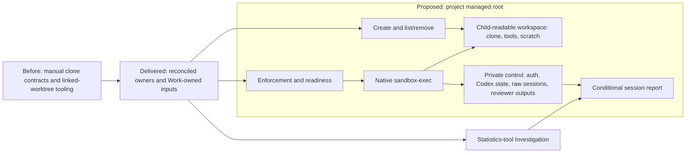

# Managed evaluation sandboxes

Preserve the approved direction for project-scoped temporary sandboxes: trusted
online workspace preparation, enforced native Codex execution, retained output
and session-scoped measurements. This is a new planning parent with direct
leaves, rather than another level beneath the existing shallow-clone tree.
It changes no executable behavior or current linked-worktree policy.

Historical planning baseline: `master` at
`21d22e7847842d41aa34800593b6b193129c55f8` (#314) has manual clone-preparation,
runtime and import contracts, existing `worktree-create` and native Make setup,
but no managed sandbox targets. Frozen
[#315](https://github.com/msitarz/ataraxia/pull/315) at
`a8fd90ccb62f9593df499082e19a1a8c17eddb13` is frozen comparison input. Current
integration base is merged #316 at `a1a9c1dbbc5be6ccfad7a2914be4f0feb6255b67`.
The maintainer approved reconciling #315 onto it, retaining useful manual inputs
at the [Work-owned inputs](preparation-input.md).
Those inputs preserve immutable provenance.
Preparation evidence supports only the tested Darwin Intel deterministic
condition; it establishes neither filtered-answer exclusion nor model-session
isolation, and did not capture the full effective environment.

## Shared root and ownership

The default child location is `<system temp>/<project name>/sandboxes/<NAME>`.
Resolve system temp with `tempfile.gettempdir()` using its native
TMPDIR/TEMP/TMP and platform-default selection, and read the project name from
`pyproject.toml` `[project].name`; do not hardcode a macOS path or project name.
An optional `SANDBOX_ROOT` Make argument overrides the managed root. Create,
list, remove and exec share one authoritative resolution and validation path.
Reject unsafe resolved roots, including an unsuitable current-directory
fallback, unsafe project-name path components and invalid overrides, under the
existing containment, symlink, collision, ownership and permission safeguards.

Discover children locally, with only necessary per-child project/base ownership
metadata and no global registry. Bind repository ownership to the canonical Git
common directory: linked worktrees agree, while independent checkouts sharing a
project name cannot manage each other's children. A conflicting owner blocks
creation, removal and execution rather than reassigning an existing child.
The private control side remains inaccessible
to child commands even if physically beneath that root. A prepared workspace
does not itself enforce isolation. Source/history and command-network denial
remain distinct from the host transport needed to call the model service.

## Children and gates

- **DONE** Preparation and ownership reconciliation: preserved useful manual
  inputs inside this Work in [preparation input](preparation-input.md), with
  managed creation/enforcement/execution replacing the unimplemented old
  contracts and artifact import retaining its existing owner and TODO outcomes.
- **TODO** [Create prepared sandboxes](creation/README.md): online independent
  clone, native setup/hooks/readiness and retained failed state.
- **TODO** [Discover and safely remove sandboxes](lifecycle/README.md):
  trustworthy local discovery and preservation-aware removal; after creation.
- **TODO** [Enforced runtime readiness](enforcement/README.md): reuse native
  boundary controls, private state separation and effective start/resume gates;
  after creation.
- **TODO** [Native execution and retained artifacts](execution/README.md):
  `sandbox-exec` initial/exact-session resume and failure preservation; after
  enforcement and lifecycle active-state guards.
- **TODO** [Session statistics Investigation](statistics/README.md): compare
  tokenuse, suitable Python alternatives and native CLI data; independent of
  model execution.
- **TODO** [Conditional report integration](reporting/README.md): only after
  reviewed statistics findings, integrate a fitting method using declared data
  or record an explicit reviewed unsupported/no-fit disposition; no tool
  adoption is predetermined.

Reviewed reconciliation resolved overlap with the
[existing implementation](../reviewable-workflow-v2/trial-preparation/workflow-efficiency/shallow-executor-clones/implementation/README.md)
under the approved #315 disposition: creation supersedes manual clone
preparation, enforcement/execution supersede the old runtime, and artifact
import stays active in its existing tree. Do not run concurrent duplicate
runtime implementations. Each leaf is one coherent review outcome; reassess its
complete expected and actual diff against the
[five-minute review target](../../workflow.md#scope-and-sizing), splitting
before execution/publication when required.

No implementation, sandbox probes, model runs, statistics adoption, host-auth
reads, trial authorization or default-policy adoption is included here. Runtime
validation needs separately approved frozen conditions and model/effort/budget;
existing import, publication, independent review and latest-head CI gates
remain. Consequential policy changes follow the
[WDR route](../../wdr-workflow.md).

## Acceptance

- **AC-1 TODO** The reviewed child outcomes compose from owned preparation to
  enforced execution and retained output, with trustworthy supported reports or
  an explicit independently reviewed unsupported/no-fit reporting disposition,
  without duplicate owners or changes to ordinary Work delivery.

  Validation: independent integration review of child evidence and owner links,
  including consistent root/owner resolution, failed preparation, denied launch,
  exact resume and retained work;
  reuse leaf evidence rather than repeat probes or model runs. A no-fit finding
  does not fake report implementation or automatic adoption; follow reviewed
  Work lifecycle disposition for any unsatisfied integration outcome.
- **AC-2 TODO** On real command delivery, lasting usage and supported-condition
  limits are promoted from Work-owned inputs to one focused owner, discoverable
  from Make help, documentation, orchestrator and evaluation routes; measurement
  limits remain explicit.

  Validation: independently walk those routes and verify promotion before Work
  cleanup. CONTRIBUTING routes existing tool discovery and gains no sandbox
  procedure section; recommendations and estimates do not become policy.
