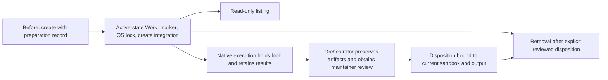

# Sandbox lifecycle

Own local discovery and safe disposal of children created by
[managed sandbox creation](../../../evaluation-sandboxes.md). Reuse the existing
private ownership record as the persistent, uncommitted lifecycle marker; the
[delivered lifecycle safety rules](../../../evaluation-sandboxes.md#delivered-lifecycle-safety)
cover the private marker, exclusive OS-held lock, creation integration, bound
execution attempt/recovery protocol and reviewed cleanup disposition. Listing
and removal consume that shared protocol rather than define another registry or
proof owner. Native execution consumes the attempt/recovery boundary but
supplies its own containment supervisor. The maintainer selected explicit
orchestrator disposition after artifact preservation and maintainer review; no
disposability Investigation is required.

At planning baseline `1b31bba`, creation writes preparation ownership/state;
there is no execution or removal command and no lifecycle lock. No sandboxes
currently need migration. Proposed behavior follows:

## Child outcomes

- **DONE** Delivered active-state exclusion: lock and marker, creation
  integration, bound execution recovery and reviewed disposition compose into
  the shared safety protocol. Consumer command integration remains pending.
- **TODO** [Read-only sandbox discovery](listing/README.md): report direct
  children and observed lifecycle state without filesystem mutation; after
  active-state delivery.
- **TODO** [Preservation-aware sandbox removal](removal/README.md): delete
  only an exclusively locked, owned child with a current explicit disposition;
  after active-state delivery.

[Native execution](../execution/README.md) also depends on active-state
delivery. Active-state maps its own bounded short-review children; listing and
removal remain observation and guarded-deletion leaves. Reassess complete
expected and actual review effort before implementation or publication under
[Work sizing](../../../workflow.md#scope-and-sizing). This plan does not deliver
commands, run probes or models, or complete criteria.

## Parent acceptance

- **AC-1 TODO** Creation, execution and removal share exclusion; listing stays
  observational. Persistent ownership and execution results survive inactivity,
  and removal requires current orchestrator disposition after preservation and
  maintainer review. Unknown execution, unsupported records, foreign ownership
  and unsafe paths preserve the child. Same-name reuse cannot redirect waiters.

  Validation: independently review child evidence and shared owner links,
  including crash/descendant handling, failed preparation cleanup, disposition
  invalidation, read-only probes and check/delete exclusion. Verify successful
  removal retains the stable lock and permits a fresh generation; reuse leaf
  evidence without repeating probes or model runs.
