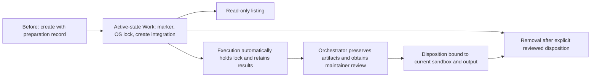

# Sandbox lifecycle

## Purpose

Let orchestrators discover managed sandboxes and dispose of them only when
shared lifecycle safety and reviewed preservation permit it.

## Goals

- Share creation, execution and removal exclusion through one lifecycle owner.
- Report local children without mutation or inferred cleanup authority.
- Remove only the current owned generation with reviewed disposition.

## Mechanisms

- Existing [managed creation](../../../evaluation-sandboxes.md) supplies
  prepared children and their private ownership records.
- The active-state children extend that record into the shared marker, exclusion
  and disposition protocol consumed by listing and removal.

## Visuals

At verified revision `44f40de`, creation writes preparation ownership/state;
there is no execution or removal command and no lifecycle lock. No sandboxes
currently need migration. The proposed lifecycle adds the following:

## Acceptance criteria

### **AC-1 TODO** Compose observational discovery and safe disposal

Lifecycle children compose shared exclusion, read-only discovery and reviewed
disposal.

- The [active-state protocol](active-state-exclusion/README.md) preserves
  ownership/results through inactivity, failures, descendant stoppage and
  same-name reuse.
- Listing stays observational, and removal requires current orchestrator
  disposition after preservation and maintainer review.
- Unknown execution, unsupported records, foreign ownership and unsafe paths
  preserve the child.
- Removal closes the check/delete race, retains the stable lock and permits a
  fresh generation only after successful cleanup.

## Children

- **TODO** [Active-state exclusion](active-state-exclusion/README.md): deliver
  the shared safety outcome through serial lock/marker, execution recovery and
  reviewed disposition children. This Work builds on delivered creation; its own
  creation update has no prerequisite on a later consumer.
- **TODO** [Read-only sandbox discovery](listing/README.md): report direct
  children and observed lifecycle state without filesystem mutation; after
  active-state delivery.
- **TODO** [Preservation-aware sandbox removal](removal/README.md): delete
  only an exclusively locked, owned child with a current explicit disposition;
  after active-state delivery.

## Links

- [Native execution](../execution/README.md): consumes completed active-state
  safety and owns native command integration.
- [Work sizing](../../../workflow.md#scope-and-sizing): governs expected and
  actual review effort before implementation or publication.

## Additional context

The maintainer selected explicit orchestrator disposition after artifact
preservation and maintainer review, so no disposability Investigation is
required. Listing and removal consume the shared protocol rather than define
another registry or proof owner. This contract authorizes no probes or model
runs.
