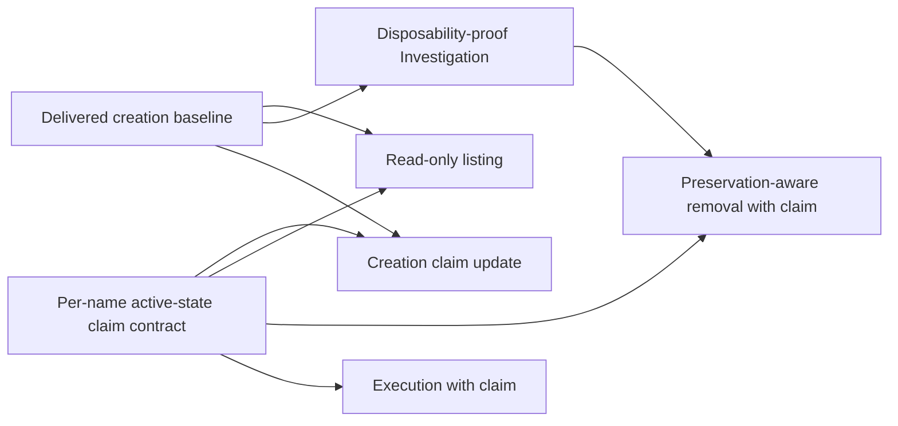

# Sandbox lifecycle

Own local discovery and safe disposal of children created by
[managed sandbox creation](../../../evaluation-sandboxes.md). This parent maps
one prerequisite Investigation, one shared active-state exclusion contract,
and two independently reviewable command outcomes. Both commands reuse the one
[root and ownership contract](../README.md#shared-root-and-ownership); neither
defines a second root resolver, owner record, or registry.

## Child outcomes

- **TODO** [Disposability proof Investigation](disposability-proof/README.md):
  compare evidence and ownership choices for when executor commits and private
  output may be discarded. This must complete and merge before removal
  implementation begins; its result informs the removal contract.
- **TODO** [Active-state exclusion](active-state-exclusion/README.md):
  define the stable per-name claim, opaque generation identity, and safe reuse
  protocol. Creation, listing, removal, and execution consume it; complete and
  merge this contract before updating those commands.
- **TODO** [Read-only sandbox discovery](listing/README.md): list direct
  children with trustworthy identity/state classification, including malformed
  and symlink entries, without changing the filesystem.
- **TODO** [Preservation-aware sandbox removal](removal/README.md): remove
  only an owned, inactive child after guarding workspace changes, meaningful
  commits and private output; refusal preserves the child and its diagnostics.

All lifecycle outcomes build on the delivered creation/ownership contract and
its shared root resolution. The active-state exclusion also specifies the
required creation reservation claim, and is an independent prerequisite for
that create update, listing's read-only transient probe, removal's exclusive
delete claim, and [native execution](../execution/README.md)'s execution claim.
The disposability Investigation is a separate prerequisite only for removal
implementation; its findings must be completed and merged, then reflected in
the removal contract before implementation. A child belonging to another
canonical Git common-directory owner is identified but never managed.
Parent-owned root/owner semantics remain linked above.

## Parent acceptance

- **AC-1 TODO** The Investigation resolves evidence source, owner, trust
  boundary, and preservation semantics for disposability; the active-state
  contract prevents concurrent create/execution/removal claims; listing never
  mutates; removal deletes only a child proven disposable under the reviewed
  result and preserves all evidence on refusal. Invalid ownership and symlink
  paths cannot be followed into trusted children.

  Validation: review the completed Investigation decision and its link from
  removal and active-state dependencies, then independently review command
  evidence and shared root/owner links. Confirm listing has no mutation path
  and removal's guarded delete uses the same resolved root and ownership as
  creation. Confirm successful removal retains the lock object and permits a
  fresh generation ID on reuse. Reuse leaf evidence; do not repeat probes or
  model runs.
