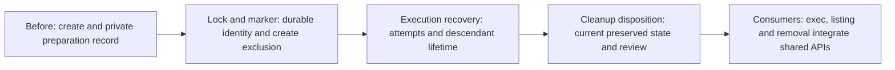

# Per-sandbox active-state exclusion

Deliver shared lifecycle safety by extending the existing private marker and
integrating exclusive per-name OS-held locks into `sandbox-create`. Reuse
[root and ownership resolution](../../README.md#shared-root-and-ownership).
There is no global registry, manual active bit, or controller service.

Verified baseline `5577cbb`: `script/sandbox.py` has `ownership`,
`reserve_destination`, `update_state` and `create`; creation records canonical
Git common directory, project, base, preparation state and failure diagnostics.
`update_state` truncates its existing file; there is no lifecycle lock,
execution-attempt protocol or disposition recorder. Existing creation/root
machinery remains the owner; children fill these gaps rather than add another
record or resolver. Private control remains inaccessible to child commands.

## Child outcomes and dependencies

- **TODO** [Stable lock and durable marker](lock-and-marker/README.md):
  reserve an absent name, persist its generation/destination identity and
  serialize creation; expose safe acquisition, validated updates and read-only
  probes. Depends only on delivered creation.
- **TODO** [Execution attempts and recovery](execution-recovery/README.md):
  bind Evaluation ownership, retain attempts/results and protect descendant
  lifetime with fail-closed unknown recovery. After lock and marker delivery.
- **TODO** [Reviewed cleanup disposition](cleanup-disposition/README.md):
  record host authority bound to exact current preserved state and review;
  invalidate it on execution or state changes. After execution recovery.

Implement and independently review these children serially in this order. Their
shared marker/helper edits are deliberate dependencies, not parallel surfaces.
Creation never waits for later execution, disposition or removal implementation.
The first child supports creation with absent execution provenance; subsequent
children extend its validated record rather than rewrite its ownership.

[Native execution](../../execution/README.md),
[listing](../listing/README.md) and [removal](../removal/README.md) depend on
completion of this shared parent and own their command integration. Shared
children exercise real APIs with process/host fixtures; they deliver no native
`sandbox-exec`, listing or removal command. Removal owns deletion, marker-last
cleanup and guarded retry; the first child supplies the identity/reservation
rules it consumes. No model run or sandbox probe is authorized by this plan.

Each child targets one short review outcome: safe named ownership, safe
execution lifetime, or current cleanup authority. Reassess complete expected and
actual review effort under
[Work sizing](../../../../workflow.md#scope-and-sizing). This adds one Work
level (children are level 4), within the five-level guidance. Expanded
implementation waits for maintainer steering and the concrete planning PR merge
under [pause rules](../../../../workflow.md#decisions-and-new-splits).

## Shared interfaces

These are required behaviors, not prescribed Python names or a new service.
Local signatures and fields belong to the child linked below; use a small
shared helper and existing Make routing where needed.

| Owner | Input and observable result |
| --- | --- |
| [Lock and marker](lock-and-marker/README.md) | Root/name, captured generation or create absence, native destination identity; acquired and revalidated exclusive scope or refusal. Supported validated marker updates persist durably; observational probes return activity/unknown without mutation. |
| [Execution recovery](execution-recovery/README.md) | Locked sandbox, source Work/orchestrator binding, optional exact resume UUID and process attempt; retained identity/outcome/artifacts, or unknown refusal until safe host recovery. |
| [Cleanup disposition](cleanup-disposition/README.md) | Host owner/review, exact current identity/workspace/output inventory, retained destinations and retain/discard decisions; validated persisted disposition or refusal without approval. |

## Parent acceptance

- **AC-1 TODO** Reviewed child outcomes compose to the original shared safety
  outcome: automatic same-name exclusion, stable lock/fresh generation, durable
  ready/failed preparation, retained execution through descendant stoppage and
  results, and current explicit orchestrator disposition after preservation and
  maintainer review. Unsupported/unsafe/stale identity and unknown execution
  fail closed; listing observations grant no cleanup authority.

  Validation: independently review child evidence and shared APIs together,
  including create without execution binding and consumer ownership boundaries;
  reuse process and host fixture evidence without repeating probes or model
  runs. Original leaf AC-1 and AC-3 are owned by lock-and-marker AC-1 through
  AC-3; original AC-2 by lock-and-marker AC-2/AC-3 and execution-recovery AC-2;
  original AC-4 by execution-recovery AC-1 and cleanup-disposition AC-1/AC-2.
  Consumer command integration remains verified in its existing Work.
