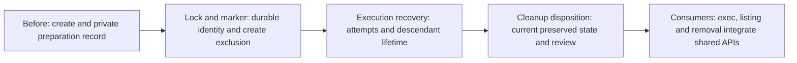

# Per-sandbox active-state exclusion

Deliver shared lifecycle safety by extending the existing private marker and
integrating exclusive per-name OS-held locks into `sandbox-create`. Reuse
[root and ownership resolution](../../README.md#shared-root-and-ownership).
There is no global registry, manual active bit, or controller service.

Verified baseline `5577cbb`: `script/sandbox.py` has `ownership`,
`reserve_destination`, `update_state` and `create`; creation records canonical
Git common directory, project, base, preparation state and failure diagnostics.
`update_state` truncates its existing file; there is no lifecycle lock,
execution-attempt protocol or disposition recorder. Existing creation/root
machinery remains the owner; serial child deliveries fill these gaps rather than
add another record or resolver. Enforced execution must deny sandboxed child
access to private control paths; trusted preparation is not isolated by modes.

## Child outcomes and dependencies

- **DONE** Delivered lock and marker foundation: a versioned private identity
  marker, fresh generation and native destination identity; stable per-name OS
  locking retained across reuse; durable updates and nonmutating probes; and
  creation integration through preparation/readiness. This foundation depends
  only on delivered creation.
- **DONE** Delivered bound execution attempts and fail-closed recovery: records
  source Work/owner and run/session identity, retains prior outcomes and
  artifacts, and requires trusted host evidence bound to the same generation
  and workspace before resolving unknown lifetime. Native containment remains
  with the execution consumer.
- **DONE** Delivered reviewed cleanup disposition: records trusted host review,
  retention destinations and explicit discard decisions against exact current
  sandbox state; changes and rejected attempts invalidate approval. Destructive
  consumers must revalidate under the lock. This followed delivered execution
  attempts and recovery.

The delivered cleanup disposition consumes the foundation and execution
protocol. Shared marker/helper changes are deliberate extensions, not parallel
surfaces. Creation never waits for later execution, disposition or removal
implementation. Creation works without execution provenance; the execution
protocol extends the validated record rather than rewriting ownership.

[Native execution](../../execution/README.md),
[listing](../listing/README.md) and [removal](../removal/README.md) depend on
completion of this shared parent and own their command integration. Shared
children exercise real APIs with process/host fixtures; they deliver no native
`sandbox-exec`, listing or removal command. Removal owns deletion, marker-last
cleanup and guarded retry; the first child supplies the identity/reservation
rules it consumes. No model run or sandbox probe is authorized by this plan.

Each child targets one short review outcome: safe named ownership, safe
execution lifetime, or current cleanup authority. Reassess complete expected and
actual review effort under
[Work sizing](../../../../workflow.md#scope-and-sizing). This adds one Work
level (children are level 4), within the five-level guidance. Expanded
implementation waits for maintainer steering and the concrete planning PR merge
under [pause rules](../../../../workflow.md#decisions-and-new-splits).

## Shared interfaces

These are required behaviors, not prescribed Python names or a new service.
Local signatures and fields belong to the owning Work; use a small shared
helper and existing Make routing where needed.

| Owner | Input and observable result |
| --- | --- |
| Delivered lock and marker foundation | Root/name, captured generation or create absence, native destination identity; acquired and revalidated exclusive scope or refusal. Supported validated marker updates persist durably; observational probes return activity/unknown without mutation. |
| Delivered execution protocol | Locked sandbox, source Work/orchestrator binding, optional exact resume UUID and process attempt; retained identity/outcome/artifacts, or unknown refusal until trusted host recovery establishes stopped processes and preserved output. |
| Delivered cleanup disposition | Trusted host review, exact current identity/workspace/output state, retained destinations and explicit discard decisions; validated persisted disposition or refusal without approval. |

## Parent acceptance

- **AC-1 DONE** Reviewed child outcomes compose to the original shared safety
  outcome: automatic same-name exclusion, stable lock/fresh generation, durable
  ready/failed preparation, retained execution through supervisor-attested
  stoppage and results, and current explicit orchestrator disposition after
  preservation and maintainer review. Unsupported/unsafe/stale identity and
  unknown execution fail closed; listing observations grant no cleanup
  authority. The delivered protocol does not itself provide native process
  containment. Its normal create, attempt, review, and validation flow must be
  readable without cached-state refresh discipline or duplicated schema
  bookkeeping; tests must cover our lock management and lifecycle obligations,
  not upstream lock or process behavior.

  Validation: independently review child evidence and shared APIs together,
  including create without execution binding and consumer ownership boundaries;
  reuse process and host fixture evidence without repeating probes or model
  runs. Original leaf AC-1 and AC-3 are owned by the delivered foundation and
  remaining shared lifecycle outcomes; original AC-2 by the delivered
  foundation and the delivered execution protocol; original AC-4 by the
  delivered execution protocol and reviewed cleanup disposition.
  Native execution, listing and removal command integration remain separate
  consumer outcomes and are not delivered by this Work.
