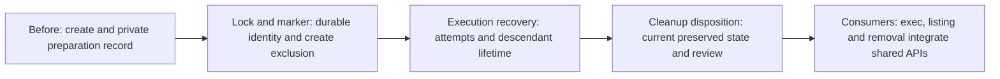

# Per-sandbox active-state exclusion

## Purpose

Give creation and its later lifecycle consumers one safe shared identity,
exclusion, execution-recovery and cleanup-authority protocol.

## Goals

- Extend existing creation without requiring execution provenance.
- Protect each sandbox generation through durable state and descendant stoppage.
- Keep cleanup authority current, private and explicitly reviewed.

## Mechanisms

- `script/sandbox.py` provides existing creation and private ownership machinery
  extended by the children below.
- The [shared root resolver](../../README.md#shared-root-and-ownership) provides
  canonical repository and managed-root ownership without a global registry,
  manual active bit or controller service.

## Visuals

At verified revision `44f40de`, `script/sandbox.py` has `ownership`,
`reserve_destination`, `update_state` and `create`; creation records canonical
Git common directory, project, base, preparation state and failure diagnostics.
`update_state` truncates its existing file; there is no lifecycle lock,
execution-attempt protocol or disposition recorder. Existing creation/root
machinery remains the owner; children fill these gaps rather than add another
record or resolver. The proposed protocol requires private control to remain
inaccessible to child commands.

## Acceptance criteria

### **AC-1 TODO** Compose the shared lifecycle safety protocol

Reviewed child outcomes provide automatic same-name exclusion, stable lock/fresh
generation, durable ready/failed preparation, retained execution through
descendant stoppage and results, and current explicit orchestrator disposition
after preservation and maintainer review. Unsupported/unsafe/stale identity and
unknown execution fail closed; listing observations grant no cleanup authority.
Creation works without execution binding and retains its own owner/resolver.

[Named ownership and generation safety](lock-and-marker/README.md#acceptance-criteria),
[attempt binding and protected recovery](execution-recovery/README.md#acceptance-criteria),
and
[current cleanup authority](cleanup-disposition/README.md#acceptance-criteria)
remain with their child outcomes. Consumer command integration remains with
native execution, listing and removal.

## Children

- **TODO** [Stable lock and durable marker](lock-and-marker/README.md):
  reserve an absent name, persist its generation/destination identity and
  serialize creation; expose safe acquisition, validated updates and read-only
  probes. Depends only on delivered creation.
- **TODO** [Execution attempts and recovery](execution-recovery/README.md):
  bind Evaluation ownership, retain attempts/results and protect descendant
  lifetime with fail-closed unknown recovery. After lock and marker delivery.
- **TODO** [Reviewed cleanup disposition](cleanup-disposition/README.md):
  record host authority bound to exact current preserved state and review;
  invalidate it on execution or state changes. After execution recovery.

## Additional context

The three children require serial delivery and independent review in their
listed order because they extend shared marker/helper surfaces. Creation never
waits for later execution, disposition or removal implementation; subsequent
children extend the validated record rather than replace its ownership.

[Native execution](../../execution/README.md), [listing](../listing/README.md)
and [removal](../removal/README.md) consume this completed protocol and own
their command integration. Shared children deliver no native exec, listing or
removal command. Removal owns deletion, marker-last cleanup and guarded retry.

No model run or sandbox probe is authorized here. Each child retains a bounded
review responsibility under
[Work sizing](../../../../workflow.md#scope-and-sizing). Expanded implementation
requires maintainer steering and the concrete planning PR merge under
[pause rules](../../../../workflow.md#decisions-and-new-splits).
