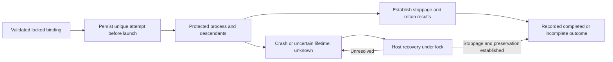

# Execution attempts and recovery

## Purpose

Keep execution ownership, attempt provenance and process lifetime safe across
initial launches, resumes and crashes.

## Goals

- Bind attempts to a source Evaluation Work, host owner and exact known session.
- Retain prior artifacts and protect access through descendant stoppage.
- Require safe host recovery when execution state is unknown.

## Mechanisms

- The existing private lifecycle marker retains source Work/owner binding and
  successive execution attempts without a second record.
- Shared lock/update APIs protect process invocation, durable attempt updates
  and host-side recovery.

## Visuals

At verified revision `44f40de`, creation retains preparation state but has no
execution-attempt or recovery protocol. Proposed shared lifetime:

Unknown execution refuses later launch and removal; OS lock availability alone
does not advance recovery.

## Acceptance criteria

### **AC-1 TODO** Retain bound attempt identity and invalidate old disposition

Each attempt retains its validated owner, provenance and results while
invalidating old cleanup authority.

#### Binding and attempts

- Initial binding requires a contained Evaluation Work with a README in the
  owning source repository/Work branch and a host-controlled orchestrator,
  validated under the lock even when absent from the frozen clone.
- Missing, escaped or invalid bindings refuse launch, and exact UUID resume must
  match recorded Work/owner/session without reassignment.
- Creation needs no Evaluation binding, while failed preparation may receive
  validated host binding under the lock before cleanup.
- Before launch, each attempt persists a unique run identity, available Codex
  UUID, preparation/execution outcome including incomplete/unknown state, and
  private output/artifact paths without overwriting earlier attempts.
- UUIDs are never invented or confused with delegated agent IDs, which are
  retained only when needed for provenance.
- The attempt API accepts locked sandbox, validated source Work/owner, initial
  or exact-session resume identity and invocation, returning retained
  completed/incomplete/unknown state.
- Identified initial/resumed attempts invalidate disposition before launch,
  including failed/rejected requests, while unsafe identity refuses without
  record updates.

Execution writes binding and attempt fields, never disposal approval; the
[disposition owner](../cleanup-disposition/README.md) binds review/preservation
to this invalidation and current attempt identity.

### **AC-2 TODO** Protect execution through safe recovery

Exclusion protects execution through descendant stoppage and retained results,
including after crashes.

- Automatic acquisition precedes launch and lasts until execution and all
  descendants with workspace/private-output access stop and results are
  retained, without escape after wrapper failure.
- Completion, interruption, interrupted updates and crashes preserve earlier
  outcomes/artifacts and permit only safe reacquisition.
- Unestablished descendant stoppage/observation retains unknown execution and
  refuses later launch/removal, regardless of OS lock release after process
  death.
- Host recovery uses the same locked identity and stoppage/preservation
  evidence, refusing unresolved safety and preserving earlier results before
  permitting action.
- Successful recovery establishes stoppage and retention under the lock, with
  explicit supported OS mechanisms/limits and no fixed Python signatures or new
  controller.

The orchestrator owns review/disposal rather than manual liveness unlocking;
no stale active bit needs clearing.

## Dependencies

- **TODO** [Stable lock and durable marker](../lock-and-marker/README.md):
  supplies exclusive validated scope and durable record updates before this
  protocol extends the marker.

## Links

- [Native execution](../../../execution/README.md): owns CLI inputs, native
  routing, readiness/model authorization and actual model runs; this Work owns
  the shared attempt/recovery APIs and authorizes no model run or sandbox probe.
