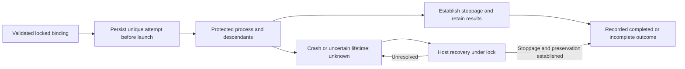

# Execution attempts and recovery

## Purpose

Keep execution ownership, attempt provenance and process lifetime safe across
initial launches, resumes and crashes.

## Goals

- Bind attempts to a source Evaluation Work, host owner and exact known session.
- Retain prior artifacts and protect access through descendant stoppage.
- Require safe host recovery when execution state is unknown.

## Mechanisms

- The existing private lifecycle marker retains source Work/owner binding and
  successive execution attempts without a second record.
- Shared lock/update APIs protect process invocation, durable attempt updates
  and host-side recovery.

## Visuals

At verified revision `44f40de`, creation retains preparation state but has no
execution-attempt or recovery protocol. Proposed shared lifetime:

Unknown execution refuses later launch and removal; OS lock availability alone
does not advance recovery.

## Acceptance criteria

### **AC-1 TODO** Retain bound attempt identity and invalidate old disposition

#### Binding and attempts

Before initial execution, the shared protocol binds a contained Evaluation Work
path and host-controlled owning orchestrator under the exclusive lock. The path
has a Work README in the owning source repository/Work branch; it need not exist
in the sandbox's frozen clone. Missing, escaped or invalid bindings refuse
launch. Exact-session resume must match recorded Work, owner and UUID without
reassigning ownership. Creation requires no Evaluation binding; failed
preparation can receive a validated host binding under the lock before cleanup.

Each attempted invocation persists a unique run identity before launch, the
Codex session UUID when available, preparation/execution outcome including
incomplete or unknown state, and private output/artifact paths. A session UUID
is distinct from a delegated agent identifier; an agent identifier is included
only when needed for provenance. Missing UUIDs are never invented. Earlier
attempts and artifacts survive failure and resume without overwritten
provenance.

The attempt API accepts a locked sandbox, validated source Work/owner, initial
or exact-session resume identity and process invocation; it returns retained
completed, incomplete or unknown state. It invalidates disposition before an
identified initial/resumed launch attempt, including failed or rejected
requests. Unsafe identity refuses without updating the record. Execution writes
binding and attempt fields, never disposal approval: the
[disposition owner](../cleanup-disposition/README.md) supplies review and
preservation authority using this invalidation and current attempt identity.

### **AC-2 TODO** Protect execution through safe recovery

Automatic exclusion starts before launch and lasts until execution and every
descendant capable of accessing workspace/private output have stopped and
results are retained. A wrapper crash cannot leave operating descendants after
exclusion ends; descendants cannot escape the protected lifetime. Normal
completion, interruption, interrupted updates and crashes preserve prior
outcomes/artifacts and permit only safe reacquisition.

If stoppage or observation of all descendants cannot be established, the marker
retains unknown execution and refuses later launch/removal. OS release after
process death alone establishes neither completion nor disposability; no stale
active bit requires manual clearing. The orchestrator owns review/disposal,
not manual liveness unlocking.

Host recovery accepts the same locked identity plus stoppage/preservation
evidence. It refuses while safety is unresolved and retains earlier results
before permitting later action. Successful recovery establishes stoppage and
preservation under the lock. These are semantic interfaces with explicit
supported OS mechanisms and limits, not fixed Python signatures or a new
controller.

## Dependencies

- **TODO** [Stable lock and durable marker](../lock-and-marker/README.md):
  supplies exclusive validated scope and durable record updates before this
  protocol extends the marker.

## Links

- [Native execution](../../../execution/README.md): owns CLI inputs, native
  routing, readiness/model authorization and actual model runs; this Work owns
  the shared attempt/recovery APIs and authorizes no model run or sandbox probe.
