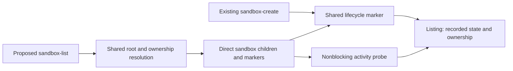

# Read-only sandbox discovery

## Purpose

Let the orchestrator discover local sandboxes and understand their recorded
state and observed activity without modifying them or mistaking inactivity for
permission to delete.

## Goals

- List sandboxes through `make sandbox-list [SANDBOX_ROOT=/absolute/path]`.
- Report sandbox identity, ownership, retained work, and recorded lifecycle
  state.
- Distinguish observed activity from recorded outcomes and cleanup authority.
- Identify unsafe or untrusted entries while keeping discovery read-only.

## Glossary

- **Managed root:** the project-scoped directory containing named sandboxes,
  selected by the shared root resolver.
- **Lifecycle marker:** the private per-sandbox ownership and lifecycle record
  maintained by the active-state Work.
- **Generation:** the unique identity of one sandbox creation, distinguishing it
  from a later sandbox with the same name.
- **Disposition:** the explicit orchestrator cleanup decision bound to the
  current preserved sandbox state and review.

## Non-Goals

- Create, execute, repair, migrate, or remove sandboxes.
- Grant cleanup permission from an activity observation.
- Introduce a registry, duplicate root resolver, or new lifecycle protocol.
- Read private artifact contents or unrelated host data.

## Mechanisms

- `script/sandbox.py` provides the existing root and ownership machinery used by
  sandbox creation.
- The shared lifecycle marker supplies recorded identity, outcomes, artifact
  paths, and disposition information.
- The shared nonblocking lock probe reports momentary activity without retaining
  exclusive access.

## Visuals

At verified revision `7709588`, `sandbox-create` prepares sandboxes and records
ownership/preparation state; there is no `sandbox-list` command. The proposed
listing command consumes the lifecycle marker and probe supplied by its
active-state dependency:

## Acceptance criteria

### **AC-1 TODO** Discover sandboxes and report their recorded state

`make sandbox-list [SANDBOX_ROOT=/absolute/path]` lists direct sandbox children
using the same root selection as creation. A missing managed root produces an
empty result; an unsafe resolved root is reported as unsafe.

The listing reports ready, partial, failed, and active sandboxes. Each entry
reports identity, location, Evaluation Work owner, known session/run identity,
artifact paths, recorded preparation/execution/failure outcome, and disposition
validity where available. Recorded outcomes remain distinct from observed
activity. Shared per-name lock files are coordination state, not sandbox
entries.

#### What exists

[Managed sandbox creation](../../../../evaluation-sandboxes.md) already resolves
the default root from the native system temporary directory and project name,
accepts `SANDBOX_ROOT`, and retains failed preparation records. Its
`safe_root` helper creates directories, so listing needs a read-only path
through the shared resolution and validation machinery.

### **AC-2 TODO** Distinguish trustworthy ownership from invalid or unknown metadata

Each entry reports ownership as valid, invalid, or unknown using the shared
ownership contract, including generation and native destination identity.
Malformed, missing, or conflicting-owner metadata is reported as invalid/unknown
without being trusted. Unsupported records are reported without migration.

Linked worktrees agree through their canonical Git common directory. A sandbox
owned by a different canonical Git common directory is recognizable as foreign
and cannot be treated as manageable by the current repository.

### **AC-3 TODO** Observe activity without granting cleanup authority

Listing reports active operation when the shared lock probe finds the lock
busy, observed inactivity when it can acquire the lock, and unknown activity
when observation is unsafe or unavailable, including a missing lock. Acquired
locks are released immediately, with no work performed while holding them.

Listing captures the generation, or its absence, before probing and rereads it
afterward. A generation change makes the activity observation unknown. These
are momentary observations: neither a free lock nor recorded success establishes
review, disposition validity, or permission to delete.

### **AC-4 TODO** Inspect entries without mutation or traversal into private data

Listing inspects only direct sandbox children and their narrow lifecycle
markers. It does not follow child or metadata symlinks; those entries are
reported as invalid without reading their targets or accepting them as ownership
evidence. Private artifact paths may be reported, but their contents and
unrelated host data are not read.

Listing leaves persistent filesystem state unchanged, including when metadata
is malformed or unsupported or a lock is missing or unsafe. It never creates,
rewrites, replaces, or repairs a lock or marker.

## Dependencies

- **TODO**
  [Per-sandbox active-state exclusion](../active-state-exclusion/README.md):
  delivers the shared lifecycle marker, identity validation, read-only lock
  probe, execution provenance, and disposition protocol, including creation
  integration. Listing consumes this completed protocol and owns its command
  integration.

## Links

- [Shared root and ownership](../../README.md#shared-root-and-ownership):
  authoritative root selection and repository/sandbox identity contract.
- [Stable lock and durable marker](../active-state-exclusion/lock-and-marker/README.md):
  shared marker and observational probe behavior, including generation changes
  and unsafe observations.
- [Sandbox lifecycle](../README.md): coordinates discovery with shared lifecycle
  safety and preservation-aware removal.
