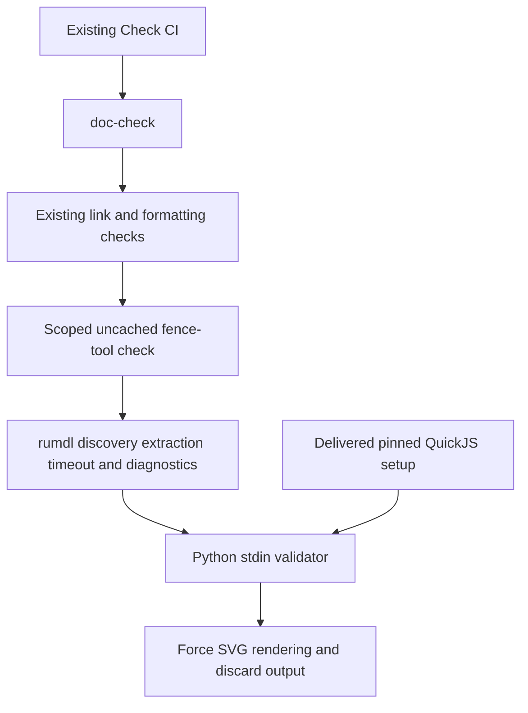

# Adopt bounded Markdown Mermaid checking

Catch Mermaid fence failures through `make doc-check` using the accepted
reproducible backend setup and delivered rumdl integration. Final adoption
acceptance remains open; no new diagram requirement is introduced. Current
[Work guidance](../../workflow.md) already asks for diagrams when useful.

The
[immutable investigation report](https://github.com/msitarz/ataraxia/blob/15535a9c66c5b1ccdabb745461d0a2f43dd901c2/doc/feat/mermaid-validation/investigation/report.md)
exercised mermaidx 0.9.5 with Mermaid 11.16.0 and a complete-source QuickJS-ng
build on CPython 3.14.6/macOS x86_64. The PyPI sdist lacked a header; the
locally built universal2 wheel emitted arm64 linker warnings. Linux, usable
arm64, Windows and clean offline setup were not verified. Markdown extraction
was a disposable harness. The original invalid sequence produced opaque
`Unknown quickjs tag: -6`; successful construction alone did not validate it,
because SVG rendering is lazy.

## Delivery map

- **DONE** Reproducible setup: pinned backend installation and offline SVG
  rendering accepted on local Intel macOS and Linux CI, including a manual
  fresh offline Intel macOS worktree check and disposable cleanup.
- **DONE** Checker integration: the
  [stdin validator](../../../script/validate_mermaid.py) forces QuickJS SVG
  rendering through scoped [Make](../../../Makefile) and
  [rumdl configuration](../../../pyproject.toml) after existing documentation
  checks, with offline execution, native diagnostics and no SVG output.
- **DONE** Upstream report: filed
  [rumdl issue #949](https://github.com/rvben/rumdl/issues/949) documenting
  blockquote markers retained in custom stdin source by rumdl 0.2.78.

Integrated setup acceptance is complete. Use ordinary
[setup and worktree commands](../../../CONTRIBUTING.md#getting-started), the
locked backend selection in [pyproject.toml](../../../pyproject.toml) and
[uv.lock](../../../uv.lock), and the retained
[forced-render smoke test](../../../test/script/integration/test_mermaid_backend.py).
Accepted backend Linux CI evidence suffices; no fresh worktree CI route is
needed. Integrated checker acceptance is also complete. rumdl owns fence
discovery/extraction, timeout and diagnostics; the stdin validator only forces
actual SVG rendering and discards output. The boundary reuses native rumdl
behavior and the prepared backend. The upstream report is tracked in
[rumdl issue #949](https://github.com/rvben/rumdl/issues/949); its fix remains
independent and does not block adoption acceptance.

The delivered route uses uncached native fence tools after fence-disabled
link-graph and formatting stages. The known blockquote extraction and renderer
parity limits remain in [documentation guidance](../../README.md#review);
the upstream issue tracks the separate fix follow-up.

Required adoption verification targets are local macOS x86_64 and the Linux
architecture used by existing CI, under the project's Python 3.14+ policy and
normal tool compatibility. This evidence scope is not a platform allowlist or
exact Python-minor cap. Accepted setup evidence records actual tested OS,
architecture, Python and backend versions without automatically switching
architecture. Other platforms
have no claimed verification here. Escalate failed required setup or expanded
verification responsibility before changing the backend or scope.

Browser/GitHub rendering parity, visual quality, performance guarantees, PNG
output and repairing upstream implementation are outside scope. Binary artifact
provenance and transitive licensing were reviewed during setup; maintainer-fork
wheel hosting remains a limitation. Diagnostic behavior is owned by native
rumdl and the delivered validator. A new toolchain, patched upstream source,
artifact distribution service or expanded verification responsibility requires
maintainer steering and a reviewed Work rather than an incidental workaround.

- **AC-1 TODO** Given accepted setup and checker deliveries, the existing
  `doc-check` route rejects failing selected Mermaid fences offline without SVG
  outputs, while preserving Markdown and local-link checking and native rumdl
  selection, timeout and error behavior subject to the blockquote limitation.

  Validation: independently review child evidence and integrated contracts;
  run doc/ac checks and focused integration tests on the combined revision.
  Upstream-report completion is not required for this criterion.
