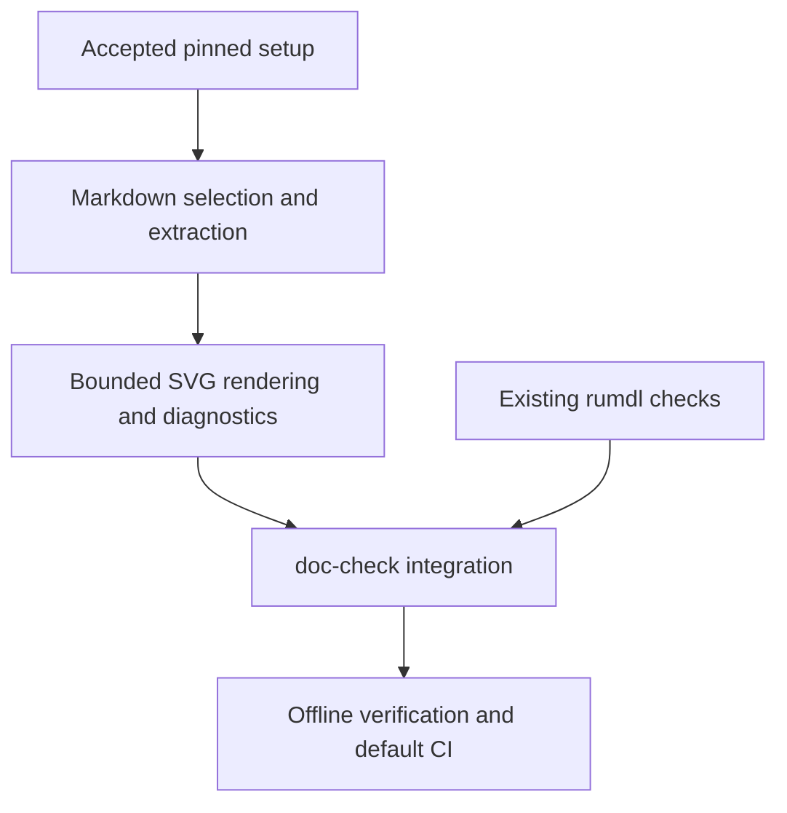

# Adopt bounded Markdown Mermaid checking

Catch Mermaid fence failures through `make doc-check` after reproducible setup
has been accepted. This is a proposed adoption plan; this PR changes only Work
contracts. It adopts no dependency, checker, CI change or new diagram
requirement. Current [Work guidance](../../workflow.md) already asks for
diagrams when useful.

The
[immutable investigation report](https://github.com/msitarz/ataraxia/blob/15535a9c66c5b1ccdabb745461d0a2f43dd901c2/doc/feat/mermaid-validation/investigation/report.md)
exercised mermaidx 0.9.5 with Mermaid 11.16.0 and a complete-source QuickJS-ng
build on CPython 3.14.6/macOS x86_64. The PyPI sdist lacked a header; the
locally built universal2 wheel emitted arm64 linker warnings. Linux, usable
arm64, Windows and clean offline setup were not verified. Markdown extraction
was a disposable harness. The original invalid sequence produced opaque
`Unknown quickjs tag: -6`; successful construction alone did not validate it,
because SVG rendering is lazy.

## Delivery map

- **TODO** [Reproducible setup](setup/README.md): prepare a pinned backend on
  the supported local macOS and Linux CI platforms, then run it offline.
- **TODO** [Checker integration](checker/README.md): after accepted setup,
  deliver the fenced-Markdown boundary and then wire it into `doc-check`.

Merge this reviewed parent plan before child delivery. Setup precedes all
checker implementation. The checker has ordered extraction, rendering and Make
integration leaves because each needs a separate review question; each
leaf targets about five-minute review including its tests and supporting docs.
If source/bootstrap ownership or delivery grows beyond that target, stop and
define smaller reviewed children before expanding implementation.

Supported adoption targets are Python 3.14 on local macOS x86_64 and the Linux
architecture used by the existing CI workflow. These are requirements to prove,
not claims of current support. Setup must record actual tested OS, architecture,
Python and backend versions; do not switch process architecture automatically.
Other platforms, including native macOS arm64 and Windows, remain outside this
plan. If the maintainer needs a different local architecture, or either required
target cannot be prepared, escalate before changing that boundary or backend.

Browser/GitHub rendering parity, visual quality, performance guarantees, PNG
output and repairing upstream implementation are outside scope. Source build
maintenance, transitive licensing and opaque diagnostics are adoption risks
owned by the setup and checker contracts. A new toolchain, patched upstream
source, artifact distribution service or expanded platform support requires
maintainer steering and a reviewed Work rather than an incidental workaround.

- **AC-1 TODO** Given accepted setup and checker deliveries, the existing
  `doc-check` route rejects failing selected Mermaid fences offline without
  checkout outputs, while preserving Markdown and local-link checking.

  Validation: independently review child evidence and integrated contracts;
  run doc/ac checks and the focused integration tests on the combined revision.
