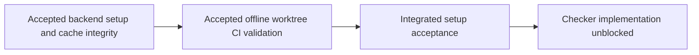

# Prepare reproducible Mermaid backend setup

Prepare the backend proposed by the [adoption plan](../README.md) on both
required platforms and leave it usable offline, including fresh worktrees.
This revised plan splits setup delivery; it changes contracts only. Checker
implementation remains blocked until both children are accepted.

## Delivery map

- **TODO** [Backend setup and cache integrity](backend/README.md): pinned
  bootstrap/dependencies, ordinary setup/offline rendering and refusal behavior.
- **TODO** [Offline worktree CI validation](worktree/README.md): after backend
  acceptance, prove fresh offline worktree setup/rendering through existing CI.

Merge this reviewed split before child delivery. Each leaf targets about
five-minute review of its full implementation, tests and supporting changes.
Reuse the executor's existing uncommitted implementation and valid evidence
when partitioning; the plan does not certify that implementation or its trials.
Sequence the shared Makefile, CONTRIBUTING setup sections and parent map.
Backend owns bootstrap, dependencies/lock, cache validation and ordinary
`verify-setup`/rendering; worktree consumes the prepared cache/environment and
owns worktree/CI verification. Do not duplicate the bootstrap or smoke test.

## Required evidence sequence

For each leaf, first perform its real macOS local proof before publication.
On Linux, try the normal pinned uv/PyPI install with compatible published wheels
first; failure needs evidence and maintainer steering before expanding the
source route. Publish the independently reviewed implementation with its
retained contract and Linux criteria `TODO`. Then inspect actual setup,
offline and rendering evidence from Actions on that exact reviewed head.
Only after independent acceptance may criteria become `DONE` and a separate
cleanup commit remove the completed leaf/update this map. This authorized
sequence obtains Linux evidence; it waives no platform outcome or latest-head
CI merge gate. Keep missing/failed/skipped evidence unresolved.

Support is bounded to Python 3.14/local macOS x86_64 and existing Linux CI
architecture. Do not infer arm64 support from a wheel tag or run under a changed
architecture without authorization. Stop with evidence if required setup fails,
needs upstream implementation changes, or adds independent source-distribution
responsibility; seek maintainer steering and split the Work when required by
[scope rules](../../../workflow.md#scope-and-sizing).

- **AC-1 TODO** Given clean disposable checkouts and declared native
  prerequisites on both required platforms, ordinary `make setup` locally and
  `make ci-setup` on Linux install the pinned backend without manual build or
  temporary-wheel steps, and force actual SVG rendering successfully.

  Validation: independently review accepted backend child evidence for real
  macOS setup and exact-reviewed-head Linux Actions setup/rendering, including
  versions, provenance, licensing and reproducibility. Assess the integrated
  artifact; run doc/ac checks. Shims cannot establish platform proof.
- **AC-2 TODO** Given each prepared environment, offline `verify-setup` and
  forced SVG rendering succeed with no dependency resolution or download;
  supported worktree preparation remains usable from prepared caches.

  Validation: independently review ordinary offline setup/render evidence from
  backend and actual offline `worktree-create`/render evidence from worktree,
  for macOS and exact-reviewed-head Linux Actions. Assess their integrated
  interface; run focused integration tests where integration changes invalidate
  child evidence. Cache-routing tests alone do not prove offline operation.
- **AC-3 TODO** Given absent prerequisites, unavailable sources or an
  unsupported architecture, setup fails with actionable setup diagnostics
  without changing architecture, silently replacing the backend or claiming
  readiness.

  Validation: independently review backend refusal/cache-integrity test evidence
  and integrated prerequisite/platform documentation; run doc/ac checks under
  the current [evidence policy](../../../validation.md).
