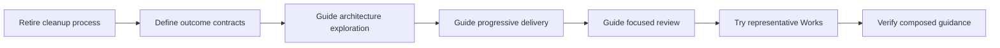

# Outcome-driven delivery guidance

## Purpose

Make delivery guidance support coherent outcomes, evolving architecture, and
substantive review with less process overhead.

## Goals

- Give a Work one useful outcome, verifiable acceptance conditions, and clear
  inherited constraints.
- Let architecture and implementation develop together without losing shared
  guarantees.
- Try the minimum guidance changes on representative Works before further
  tuning.

## Non-Goals

- Implement product features, review skills, automation, or a new contract
  schema.
- Design a replacement cleanup process.
- Require an agent or a Work for each engineering phase.

## Inherited constraints

These constraints apply to every child and to parent integration.

Each child review verifies its changed owner guidance against these constraints
and its local acceptance conditions. Parent integration verifies that the
combined guidance preserves them together. It checks that:

- Each rule remains at its authoritative owner.
- Role handoffs and reading routes preserve the shared constraints.
- Examples reflect the combined guidance.

Local child acceptance cannot establish this cross-guidance result.

- Keep README contracts in plain English.
- Preserve compatible required headings and checker syntax.
- Do not introduce YAML or mandatory Gherkin.
- Change rules at their authoritative owners, remove obsolete instructions, and
  link from reading routes instead of layering exceptions.
- Preserve maintainer review and merge authority, independent review, and
  final-head CI requirements.
- Retain completed Works, exploration findings, and typed architecture
  artifacts through this parent's completion.
- Parent completion does not authorize deletion of retained artifacts.
- The maintainer separately authorized deleting exactly the post-merge closure
  parent, command, and adoption contracts through the
  [cleanup retirement Work](retire-cleanup/README.md); this exception does not
  authorize deleting other Works or artifacts.
- Keep the current architectural view accurate as children change shared
  architecture.
- Distinguish superseded exploration and design from the current view.
- Retention does not require duplicate interfaces in active module resolution.
- Record consequential workflow rationale through the existing WDR process when
  implementing the relevant guidance change; this plan does not declare
  migration implemented.
- Keep inherited constraints separate from acceptance criteria, which state
  observable conditions for the Work's single outcome.

## Mechanisms

- Existing Work, engineering, testing, acceptance, and role guidance remain the
  authoritative rule owners.
- [Source decisions](source-decisions.md) retain the accepted direction locally.
- Child Works deliver usable guidance capabilities in dependency order.

## Visuals

At baseline `c08b883`, Work sizing targets the complete implementation review
and cleanup has prescribed closure and cleaner routes; the proposal changes
guidance in these steps:

## Acceptance criteria

### **AC-1 TODO** A coherent delivery route supports one outcome per Work

Starting from the repository's task routes, a maintainer and agent can use the
delivered child guidance to define, decompose when justified, implement, review,
and assess a Work without conflicting current rules. The guidance ensures:

- The five-minute target concerns understanding the outcome, acceptance
  conditions, constraints, and relationship to architecture.
- Substantive implementation review has no five-minute cap.
- Shared concepts, invariants, responsibilities, dependency direction, and
  effect limits are clear without requiring every signature up front.
- The Work tree does not have to match a module tree.

### **AC-2 TODO** Composition preserves shared guarantees

Parent integration checks the combined guidance against shared constraints and
end-to-end examples. The examples include a child that passes locally while a
system guarantee still fails. The guidance also ensures:

- The guidance gives each inherited non-functional requirement a local,
  architectural, or system verification scope.
- The guidance states the conditions for each quantitative threshold.
- The parent cannot be completed from child `DONE` statuses alone.

### **AC-3 TODO** A bounded trial supports the next decision

Observations from two or three representative Works show where the combined
guidance helps, conflicts, or remains uncertain and support a maintainer
decision about further adjustment. The trial includes at least one real Work
delivery under the
[trial acceptance conditions](representative-trial/README.md#ac-1-todo-concrete-cases-reveal-guidance-fit-and-remaining-friction).
Unobserved benefits remain claims, and unresolved required outcomes remain
`TODO`. No broader tuning or cleanup replacement is implied by completing the
trial.

## Children

- DONE [Retire the cleanup process](retire-cleanup/README.md): remove prescribed
  Work closure and post-merge Git cleanup procedures while preserving artifacts.
- DONE [Define outcome contracts](outcome-contracts/README.md): let a Work
  express one outcome with verifiable acceptance conditions and inherited
  constraints.
- DONE [Guide architecture exploration](architecture-exploration/README.md):
  make uncertain decomposition resolvable through minimal typed architecture
  exploration.
- DONE [Guide progressive delivery](progressive-delivery/README.md): make a
  coherent outcome executable in small steps with honest evidence.
- TODO [Guide focused engineering review](focused-review/README.md): make
  focused review produce supported findings and bounded repair.
- TODO [Try representative Works](representative-trial/README.md): use two or
  three Works to assess the guidance and decide the next adjustment.

## Links

- [Source decisions](source-decisions.md): accepted conversation direction and
  current-rule conflicts.
- [Documentation ownership](../../README.md): authoritative owners and route
  maintenance.

## Additional context

Cleanup retirement, outcome-contract guidance, architecture exploration, and
progressive delivery are delivered by their children. The parent's own
acceptance criteria and the remaining child Works remain `TODO`. Sequential
dependencies keep overlapping owner edits reviewable; they do not turn the
children into mandatory phases of ordinary product Works.

Retiring both prescribed cleanup procedures lets the maintainer handle cleanup
manually and observe how it evolves before defining another process. The
maintainer removes retained architecture artifacts manually later; this plan
introduces no deletion trigger or replacement cleanup process.
