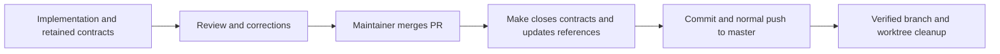

# Close Work contracts after merge

## Purpose

Keep Work contracts available throughout PR review and replace repeated
agent-driven cleanup with a deterministic post-merge command.

## Goals

- Retain requested Work and child contracts through implementation, review, and
  merge.
- Close merged contracts and update parent/dependent references through Make.
- Commit and push mechanical closure changes to master through the same command.
- Replace cleaner-agent operations with deterministic tooling where applicable.

## Glossary

- **Closure:** removal of accepted, merged contracts and mechanical updates to
  their parent maps and dependent links.
- **Git cleanup:** removal of verified merged branches and clean linked
  worktrees.

## Non-Goals

- Accept outcomes, merge implementation PRs, or infer completion from tests
  alone.
- Rewrite arbitrary dependency prose or broaden a Work's approved scope.
- Change ordinary implementation publication, CI, or maintainer review gates.
- Bypass repository protection rules, force a push, or discard undelivered work.

## Mechanisms

- A Make target exposes the closure operation through the existing tool
  interface.
- Git and PR metadata establish the merged revision and current master state.
- Canonical parent/dependency entries identify references the tool can update.
- Existing worktree tools provide guarded removal of clean linked worktrees.

## Visuals

Current guidance requires verified contract and cleanup commit pairs before
publication; corrections after cleanup restore the contract and remove it again.
The proposed sequence retains contracts until maintainer review and merge:

## Acceptance criteria

### **AC-1 TODO** Contracts remain available through PR review

Current lifecycle and publication guidance retain requested Work and descendant
contracts through merge. Corrections update the retained contracts and affected
evidence directly. Completion no longer requires alternating verification and
contract-removal commits before publication. Maintainer acceptance, agent
review, and latest-reviewed-head CI retain their existing responsibilities.

### **AC-2 TODO** One command publishes deterministic closure

After a merged PR is identified, a Make command verifies the accepted contracts,
removes the selected completed contract tree, updates parent and dependent
references, commits only the mechanical closure changes, and pushes normally to
master. It cannot publish unreviewed implementation changes. Missing acceptance,
ambiguous references, dirty state, unexpected remote changes, or publication
failure stop closure without declaring success or discarding recoverable work.

### **AC-3 TODO** Mechanical cleanup no longer requires a cleaner agent

The command owns the verified branch/worktree cleanup operations defined by its
contract, and current guidance no longer requires a cleaner agent for those
operations. Cleanup cannot delete unpublished changes or run ahead of successful
closure publication. The maintainer remains responsible for acceptance and
merge.

## Dependencies

- [Work contract template](../../work-contract-template.md) and
  [Work acceptance](../../acceptance-tracing.md): supply the delivered README
  format, outcome headings, and evidence duties consumed by the closure command.
  The remaining contract migration is independent of this lifecycle change and
  retains existing gates until adoption.

## Children

- **TODO** [Post-merge lifecycle guidance](lifecycle/README.md): define retained
  contracts, mechanical reference updates, publication authority, and the
  decision.
- **TODO** [Mechanical closure command](command/README.md): deliver the Make
  interface and its guarded Git/reference operations.
- **TODO** [Cleanup adoption](adoption/README.md): retire replaced cleaner
  duties and verify the end-to-end lifecycle and reading routes.

## Links

- [Current acceptance and delivery](../../acceptance-tracing.md): owns the
  sequence being replaced.
- [Current branch cleanup](../../branch-cleanup.md): owns merged-tip and clean
  worktree checks to preserve in the mechanical route.

## Additional context

This Work defines a future lifecycle/tool delivery; it does not change the
currently required cleanup sequence or execute closure. The migration's policy
thinning and this Work's lifecycle change have separate owners. Shared guidance
edits use the delivered authoring/evidence rules and are coordinated with the
migration owner to avoid conflicting rules.
