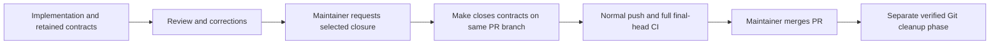

# Close Work contracts on explicit maintainer request

> **Historical plan, superseded by
> [WDR 30](../../wdr/0030-retire-prescribed-work-and-git-cleanup.md).**
> Lifecycle guidance was delivered; unfinished command and adoption outcomes are
> abandoned and are no longer scheduled or delivery prerequisites. Their
> criteria remain `TODO` so the record does not claim undelivered behavior.

## Purpose

Keep Work contracts available for review until the maintainer requests closure
and replace repeated agent-driven mechanics with deterministic tooling.

## Goals

- Retain requested and descendant contracts until explicitly authorized closure.
- Close selected contracts and update references through Make, with explicit
  confirmation before aborting incomplete outcomes.
- Commit and push mechanical closure changes on the reviewed open PR's branch.
- Keep Git branch/worktree cleanup strictly after maintainer merge.
- Replace cleaner-agent operations with deterministic tooling where applicable.

## Glossary

- **Closure:** explicitly authorized removal of selected contracts and
  mechanical updates to their parent maps and dependent links, preserving
  completed outcomes as `DONE` and explicitly aborted outcomes as `ABORT`.
- **Git cleanup:** removal of verified merged branches and clean linked
  worktrees.

## Non-Goals

- Accept outcomes, merge implementation PRs, or infer completion from tests
  alone.
- Rewrite arbitrary dependency prose or broaden a Work's approved scope.
- Change ordinary implementation publication, CI, or maintainer review gates.
- Bypass repository protection rules, force a push, or discard undelivered work.

## Mechanisms

- A Make target exposes the closure operation through the existing tool
  interface.
- Git and PR metadata establish the reviewed PR head and exact branch tips.
- Canonical parent/dependency entries identify references the tool can update.
- Existing worktree tools provide guarded removal of clean linked worktrees.

## Visuals

The verified baseline at `b14cc86` retains contracts through merge while closure
tooling is pending; the proposed lifecycle permits explicit closure on the
reviewed open PR:

## Acceptance criteria

### **AC-1 DONE** Contracts remain available through PR review

Work acceptance retains requested and descendant contracts until explicitly
authorized closure, as defined in
[Work delivery](../../acceptance-tracing.md#work-delivery). Corrections preserve
or restore affected contracts and evidence, and maintainer acceptance,
independent review, and full final-head CI remain merge gates.

### **AC-2 TODO** One command publishes deterministic closure

On an explicitly authorized reviewed open PR, a Make command removes the
selected contracts under the
[authorized closure guidance](../../acceptance-tracing.md#authorized-closure),
updates references, commits only mechanical
closure changes, and pushes normally to the same PR branch. The final closure
head must pass full CI before maintainer merge. Closure cannot publish
unreviewed implementation changes, target master directly, or open a separate
closure PR; failures preserve recoverable work without declaring success.

### **AC-3 TODO** Mechanical cleanup no longer requires a cleaner agent

The command owns the verified branch/worktree cleanup operations defined by its
contract in a separate post-merge phase or reinvocation after its delivery.
Until adoption, current cleanup continues through the cleaner role. Cleanup
requires verified merged closure provenance and cannot follow merely from
pushing closure to an open PR. It preserves unpublished work; the maintainer
owns acceptance and merge.

## Dependencies

- [Work contract template](../../work-contract-template.md) and
  [Work acceptance](../../acceptance-tracing.md): supply the delivered README
  format, outcome headings, and evidence duties consumed by the closure command.
  The remaining contract migration is independent of this lifecycle change and
  retains existing gates until adoption.

## Children

- **DONE** Authorized closure lifecycle guidance: define
  retained contracts, mechanical reference updates, publication authority, and
  the decision.
- **ABORT** [Mechanical closure command](command/README.md): deliver the Make
  interface and its guarded Git/reference operations. Superseded by WDR 30;
  unfinished outcomes were not delivered.
- **ABORT** [Cleanup adoption](adoption/README.md): retire replaced cleaner
  duties and verify the end-to-end lifecycle and reading routes. Superseded by
  WDR 30; unfinished outcomes were not delivered.

## Links

- [Current acceptance and delivery](../../acceptance-tracing.md): owns the
  sequence being replaced.
- [Current branch cleanup](../../branch-cleanup.md): owns merged-tip and clean
  worktree checks to preserve in the mechanical route.

## Additional context

Revising this contract does not authorize closing any Work. The authorization
and publication rules are delivered in
[Work acceptance](../../acceptance-tracing.md#authorized-closure), and lifecycle
integration is complete. The planned Make interfaces and command implementation
remain pending in the command Work. Existing directory paths are retained. The
migration's policy thinning and this Work's lifecycle change have separate
owners. Shared guidance edits use the delivered authoring/evidence rules and are
coordinated with the migration owner to avoid conflicting rules.
