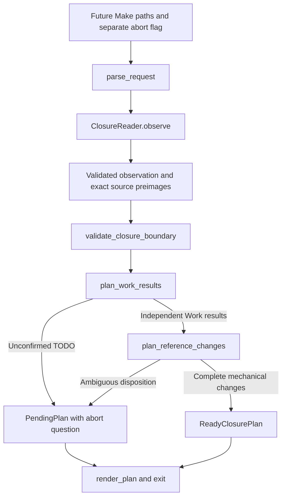

# Typed architecture skeleton for AC-1

This is a proposed architecture artifact for
[AC-1](README.md#ac-1-todo-closure-preparation-produces-a-read-only-plan),
before implementation. The declarations in
[script/work_close](../../../../script/work_close/__init__.py) are `.pyi`
signatures with no runtime implementation. They do not expose a runnable Make
command, extend the current checker, or establish acceptance of AC-1.

| Boundary | Declaration owner | Responsibility |
| --- | --- | --- |
| Values | [model.pyi](../../../../script/work_close/model.pyi) | Immutable requests, observed Git/PR facts, criterion alternatives, per-Work results, exact file proposals, and ready/pending alternatives. |
| Contract decisions | [contracts.pyi](../../../../script/work_close/contracts.pyi) | Adapt parsed contract declarations and decide each selected Work's result independently. |
| Planning | [planning.pyi](../../../../script/work_close/planning.pyi) | Own the read port, validate repository/selection binding, decide reference updates, and compose a complete read-only plan. |
| Effects | [adapters.pyi](../../../../script/work_close/adapters.pyi) | Observe local Git, GitHub metadata, contained files, Markdown and live references; normalize untyped inputs once. |
| Command | [command.pyi](../../../../script/work_close/command.pyi) | Adapt future Make inputs, inject the concrete reader/parser, render proposals/questions, and exit without waiting. |

The dependency direction is `command -> adapters -> planning -> model`, with
`planning -> contracts -> model`. The planner depends on its own `ClosureReader`
port, never on `GitHubClosureReader`. Contract adaptation uses the existing
repository Markdown model and Work rules. All sequences crossing the planning
boundary are immutable tuples, and records are frozen dataclasses.

`prepare_closure` performs observation and calls the pure `build_closure_plan`.
Everything below the observation boundary operates on explicit typed values;
it does not read files, processes, environment, clocks, or host services. The
reader owns subprocess/file lifetimes and translates expected failures into
`ClosurePlanningError` with causes. Invalid or unsafe observations raise that
error; choices needing maintainer steering return `PendingPlan`.

Selection consists only of explicit Work README paths, including any parent
and descendants separately selected by the caller. No ancestry, DONE status,
or host approval signal expands selection or proves session authorization.
The reader rejects unsafe paths and captures contract contents at the reviewed
head, all relevant live links/maps, and supporting-artifact uses. It checks
snapshot consistency after collection. The pure boundary check requires clean
state and a matching open PR, repository identities, reviewed head, HEAD and
local/remote branch tips. The future host adapter must make the source of the
reviewed-head binding explicit; it cannot infer review from passing checks or
infer renewed session instruction after corrections.

Without the confirmed flag, any selected TODO yields the complete list and an
abort question. The command exits immediately. With explicit confirmation
relayed by the agent as `ABORT_REMAINING=true`, the same selection is observed
again, and every remaining TODO gains a proposed ABORT identity and reason.
The pure decision computes DONE only for a Work whose own criteria are all
DONE. Existing/proposed aborts produce ABORT independently of other selected
Works. The flag is an operation input, not an approval credential.

Reference planning follows the existing
[lifecycle rules](../../../workflow.md#lifecycle). It retains unselected
contracts and needed supporting artifacts, preserves map titles/purposes, and
refuses semantic guesswork. A ready plan includes exact replacements/removals
with preimages, selected contract snapshots, per-criterion proposed aborts,
per-Work results, and PR/tip bindings. This is data for later application, not
permission to mutate. The later AC-2 consumer must recheck those bindings and
preserve abort dispositions in committed history before deleting contracts.

The existing
[criterion status owner](../../../../script/work_check/rules.py) supports only
TODO/DONE. Implementation must extend that owner and its guidance to ABORT
before `parse_contract` can consume aborted criteria; these declarations do
not supply a parallel parser. Existing discovery accepts empty/default-all and
directory selectors, so the closure ingress must narrow selection before
reusing its containment/read behavior. Concrete reference extraction must
handle the repository's supported link forms, including reference-style links;
unresolved forms refuse readiness rather than disappearing from the inventory.

Application, commits, pushes, post-merge cleanup, Make wiring, runtime invariant
checks and behavior tests remain implementation work. No Work criterion is
marked DONE by this artifact.
