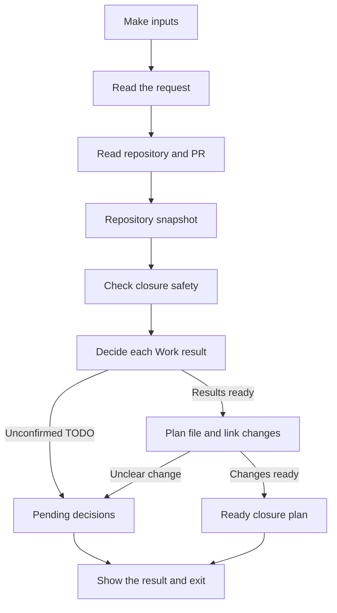

# Typed architecture skeleton for AC-1

## TL;DR

- This design prepares a closure plan for the Work README files you select.
- It reads the repository and PR, checks that closure is safe, and lists the
  proposed changes.
- It asks for a decision when criteria are unfinished or a link update is
  unclear.
- Planning does not change files, stage changes, commit, or push.
- The current artifact contains typed declarations only; the command is not
  implemented and AC-1 remains TODO.

The scope comes from
[AC-1](README.md#ac-1-todo-closure-preparation-produces-a-read-only-plan).

## Underlying services

The planned command uses these tools and services:

- **Make** accepts the selected README paths and the separate abort flag.
- **Git** supplies file contents, working tree status, and local and remote
  branch commit IDs.
- **GitHub, through `gh`,** supplies PR details and the commit associated with
  review.
- **The local filesystem** supplies Work contracts, documents, and supporting
  files.
- **The existing Markdown parser** reads document structure and source line
  locations.
- **The existing Work checker** validates contract structure and criterion
  declarations, once it supports ABORT.

## Data flow

## Make inputs

- Pass only the Work README paths to close in `ARGS`.
- List a parent and its descendants separately when selecting both.
- Pass `ABORT_REMAINING=true` separately, only after the maintainer explicitly
  confirms abandonment of unfinished outcomes.
- The command does not require a chat token or approval file.

## Read the request

`parse_request` in [command.pyi](../../../../script/work_close/command.pyi)
turns the inputs into a `ClosureRequest`.

- Reject an empty selection, directory selections, and positional options.
- Reject paths that are not Work README files.
- Accept only an absent, false, or true abort flag.
- Keep the selected paths exact; selecting a parent does not select its
  descendants automatically.

## Read repository and PR

`ClosureReader.observe` in
[planning.pyi](../../../../script/work_close/planning.pyi) defines what the
planner needs to read.

`GitHubClosureReader` in
[adapters.pyi](../../../../script/work_close/adapters.pyi) supplies those facts
using Git, GitHub, files, and the Markdown parser.

- Read the selected contracts, parent and dependency entries, links, and uses
  of supporting files.
- Check that paths stay inside the repository and refer to tracked regular
  files.
- Validate Git and GitHub responses before handing them to the planner.
- Handle supported Markdown links, including reference-style links.
- Refuse a ready plan if a relevant link cannot be resolved.
- Check the commit IDs again after reading to detect changes during collection.
- Close files and processes on success or failure.
- Report expected read failures as `ClosurePlanningError`, keeping the original
  cause.

## Repository snapshot

`ClosureObservation` holds the facts collected by the reader.

- Keep the PR details, reviewed commit ID, and local and remote branch commit
  IDs.
- Keep the exact original contents of every file used in the plan.
- Keep each selected Work's criteria and their source locations.
- Keep the document structure and resolved links needed to plan updates.
- Include uses by unselected Works so their supporting files are preserved.
- Use immutable records and tuples so planning cannot change the snapshot.

## Check closure safety

`validate_closure_boundary` checks whether the request and snapshot agree.

- Require a clean working tree, including no staged or untracked changes.
- Require an open PR for the expected repository and branch.
- Require the checked-out commit, local branch, remote branch, PR head, and
  reviewed commit to match.
- Require selected contracts to match the reviewed commit and belong to the
  PR's scope.
- Reject a detached checkout or a protected target such as `master`.
- Report invalid or unsafe state as `ClosurePlanningError`.

The GitHub reader must identify where the reviewed commit ID comes from.
Passing checks do not prove review, and GitHub metadata cannot prove session
authorization or renewed instruction after implementation corrections.

## Decide each Work result

`plan_work_results` in
[contracts.pyi](../../../../script/work_close/contracts.pyi) decides the result
of each selected Work separately.

- Propose DONE only when every criterion in that Work is DONE.
- Report every remaining TODO if the abort flag is absent or false.
- With the confirmed flag, propose ABORT for each TODO and include its ID and
  a reason stating that the outcome was explicitly abandoned.
- Preserve the reasons for criteria already marked ABORT.
- Propose ABORT for a Work with any existing or proposed aborted criterion once
  no TODO remains unresolved.
- Do not use a parent's or sibling's result to decide another Work's result.

## Plan file and link changes

`plan_reference_changes` follows the existing
[lifecycle rules](../../../workflow.md#lifecycle).

- Propose removal of selected contracts only.
- Update parent and dependency entries with each Work's own result.
- Remove contract links while preserving entry titles and purpose text.
- Remove other obsolete links when the change is mechanical.
- Ask for a decision when a link needs a new destination that requires judgment.
- Keep supporting files still needed by live documents or Works.
- Ask for a decision when it is unclear whether a supporting file is needed.
- Include the original contents alongside every proposed replacement or removal.

## Pending decisions

`PendingPlan` means the command needs an answer before it can finish planning.

- List unfinished criteria and ask whether to abort their remaining outcomes.
- List unclear link or supporting-file decisions that need maintainer guidance.
- Show the questions and exit immediately without waiting for input.
- Leave the repository unchanged when the maintainer cancels or gives no answer.
- After explicit abort confirmation, rerun the same selection with the flag and
  read the repository again.

## Ready closure plan

`ReadyClosurePlan` in [model.pyi](../../../../script/work_close/model.pyi)
describes the complete proposed closure.

- Include the selected contracts and each Work's proposed result.
- Include every proposed criterion abort with its ID and reason.
- Include the exact file replacements and removals with their original contents.
- Include the PR and branch commit IDs that were checked.
- Return this result only when safety checks pass and no decision is pending.

The later application phase must recheck these facts before making changes.
It must also preserve abort results and reasons in committed history before
deleting contracts.

## Show the result and exit

`render_plan` creates the text, and `main` displays it at the command boundary.

- Return exit code 0 when a plan is ready.
- Return exit code 1 when decisions are pending.
- Return exit code 2 when input is invalid, state is unsafe, or reading fails.
- Do not apply changes, stage files, commit, push, or remove branches or
  worktrees.

## How the modules fit together

- `command` connects the parser, reader, and planner.
- `adapters` implements the reader interface defined by `planning`.
- `planning` uses `contracts` to decide Work results and `model` to describe
  inputs and outputs.
- `contracts` reuses the repository's Markdown types and Work checking rules.
- `model` holds shared records and result types.

`prepare_closure` reads the facts and passes them to `build_closure_plan`.
The plan builder and its decision functions use only their inputs; they do not
read files, run processes, consult the environment, or call services.

## What still needs implementation

- Add runtime code for the declarations in
  [script/work_close](../../../../script/work_close/__init__.py).
- Extend the existing
  [criterion checker](../../../../script/work_check/rules.py) and its guidance
  from TODO/DONE to include ABORT.
- Reuse the current contract discovery checks after narrowing its broader
  directory and default-all selection behavior.
- Connect the command to Make and add behavior tests.
- Implement application, publication, and post-merge cleanup under their own
  acceptance criteria.
