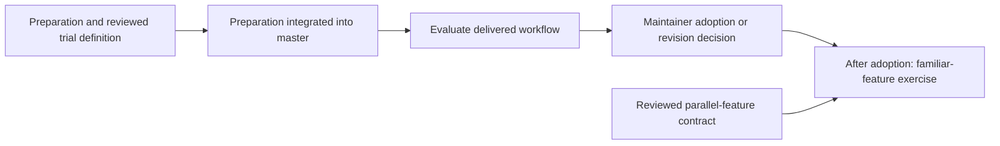

# Reviewable workflow

## Purpose

Make delivery understandable through bounded Works that the maintainer can
inspect, discuss, and steer.

## Goals

- Establish focused guidance for reviewable delivery and delegated handoffs.
- Evaluate the delivered workflow's usefulness and total maintainer effort.

## Non-Goals

- Treat completed guidance as proof of workflow efficiency.
- Approve an experimental parallel implementation or supply missing trial
  thresholds through this planning overview.

## Visuals

At baseline `4160afc`, preparation already gates the trial, but the trial still
describes replacing guidance and leaves its measurement contract undefined.
The clarified remaining flow is:

## Acceptance criteria

### **AC-1 TODO** Reviewable delivery guidance is ready for evaluation

The delivered child outcomes and remaining trial preparation compose a workflow
with focused guidance, bounded review, delegated handoffs, and recovery. Lasting
rules live in their authoritative owners; the child map records delivered and
abandoned outcomes without requiring their historical mechanisms to remain
current.

### **AC-2 TODO** Workflow usefulness has an explicit decision

The live trial supplies observations and a maintainer adoption or revision
decision against a reviewed protocol, including total maintainer effort and a
subsequent familiar-feature exercise after adoption. The missing protocol,
thresholds, and parallel-feature prerequisites remain owned by
[Trial contract](trial-preparation/trial-contract/README.md). Trial execution
waits for that reviewed definition and integrated preparation.

## Children

- **DONE** Guidance and routing — moved rules to their owners and routed
  agents by task.
- **DONE** Work structure and review — established Work contracts, lifecycle,
  and PR review rules, including the historical Prototype kind now replaced by
  [Investigation prototyping](../../work-definition.md#investigations).
- **DONE** Focused guidance — established focused owners and direct routes for
  change and check rules.
- **DONE** Checks and evidence — focused preparation and full-CI merge gates
  live in the [check and evidence policy](../../validation.md); Work acceptance
  coverage is owned by [acceptance tracing](../../acceptance-tracing.md).
- **TODO** [Trial preparation](trial-preparation/README.md): resolve completion,
  recovery, guidance, and tooling gaps before the live trial.
- **TODO** [Live trial](live-trial/README.md): after trial preparation, evaluate
  the workflow during delivery and on a familiar feature.
- **DONE** Retire the feat-slice workflow — removed unused legacy routes and
  session roles after confirming no legacy slices remained outside this Work;
  retained ADR/WDR history and the distinct trading Feature term.
- **DONE** Workflow Decision Records — established eligibility and shared
  record policy, with an initial retrospective set in the
  [WDR index](../../wdr/README.md).
- **DONE** Orchestrator handoffs — established role-triggered change delegation
  (then assigned to Luna), review corrections, and maintainer gates in
  [orchestrator guidance](../../orchestrator.md).
- **DONE** Handoff scope growth — added a stop-and-split rule for delegated
  scope in [orchestrator guidance](../../orchestrator.md).
- **DONE** Maintainer review effort — sized Works around the complete change and
  added expected-scope and actual-diff review checkpoints for orchestrators.
- **DONE** Function-size guardrails — added advisory and blocking Ruff
  statement-count checks to the existing Make lint workflows.

## Links

- [Work workflow](../../workflow.md): current scope, lifecycle, and planning
  gates.
- [Orchestrator guidance](../../orchestrator.md): current executor routing and
  maintainer approval boundaries.
