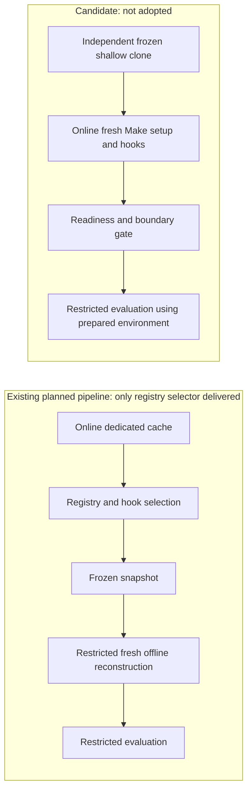

# Orchestrator-prepared evaluation environments

Can a trusted orchestrator prepare an independent frozen shallow evaluation
clone, fresh environment and installed hooks online using existing Make, uv and
prek operations, then hand it to an executor whose commands cannot use network,
the original repository or excluded history? Recommend whether this simpler
path can replace the planned offline snapshot reconstruction while preserving
evaluation isolation, readiness, failure recovery and existing review gates.

At `044e0617cc60dbca3cb365c9c2adcaac7b0ab153`, the
[Makefile](../../../../../../../Makefile) already provides locked `ci-setup`,
`setup` (hook preparation/installation and wheel build), and offline
`verify-setup`/`verify-check` with no automatic uv synchronization. The optional
registry selector is delivered; the rest of the snapshot pipeline is planned.
The [historical setup report](../sandbox-isolation/setup-preparation.md)
records successful online Make preparation and later separate offline
reconstruction, including failed cache/layout and scratch conditions. It is
evidence to reuse, not proof of this proposed current condition. Reuse the
[sandbox recipe and retained runners](../sandbox-isolation/successful-recipe.md)
for deterministic boundary controls; shallow cloning alone is not isolation.

## Bounded comparison and controls

Compare the native online-prepared candidate with the existing snapshot plan,
using its retained evidence rather than rebuilding that pipeline. Before probes,
freeze one selected committed input, its canonical lock/hook declarations,
resolved tools/platform, fresh disposable paths, permitted dependencies and
access profile. No old environment or host cache is input. Verify the clone's
base, depth-one refs, absent alternates and removed source remote; check the
current tree for excluded answers and prior evidence. Uncommitted source edits
are not inputs. Keep reviewer controls and evidence outside executor access.

Prepare in the final clone location online through `make setup` and its native
operations with clone-local environment/cache/hook paths, canonical pins and
sanitized configuration. Online dependency/hook preparation is permitted during
future approved execution under declared permissions; it does not authorize
model calls. Inspect environment/editable links, hook launch paths and readable
dependency/cache contents for original source, answers, history, host
credentials or unintended external roots. Fresh caches are not inherently safe.
Do not require offline dependency provisioning inside the evaluated session or
reconstruction from a snapshot.

Then use the actual deterministic sandbox, if supported, to run readiness,
focused project tools and installed pre-commit/commit-msg hooks without new
installs or automatic synchronization. Use matching unrestricted non-secret
controls and denied command-network, original-source, explicit old-object/local
fetch and symlink access probes from existing runner evidence. Declare required
runtime/dependency reads and clone-local scratch; preserve source/history
denies. Offline flags supplement actual access denial. Unsupported sandbox
execution, invalid controls, exposure, missing tools, installation attempts or
failed hooks block launch; never rescue with network or wider grants. If the
installed client cannot support the condition, record the limit rather than
inventing a sandbox.

One fresh preparation and restricted check batch is sufficient for this
feasibility question: startup/denial probes have 30 seconds each, Make commands
five minutes each, with 20 minutes total excluding independent review. Stop on
the first failed gate or timeout, retain partial destinations and observations,
and return for steering; no automatic retries. Record commands, statuses,
versions, effective access settings and deviations in this README, with only
necessary small inspectable evidence links. Do not turn the report into a cache
whitelist or a new protocol tree. Historical evidence must retain its original
condition and cannot satisfy current probes.

Recommend simplification only if native preparation and useful restricted work
both pass without forbidden exposure or installation/fallback. Failed controls
or unavailable enforcement are inconclusive; observed incompatibility may
support keeping the existing plan. A no-change recommendation is valid. Map each
existing preparation requirement to the native operation or remaining constraint
and identify exact Works to retain, replace or simplify, without adopting
policy.

## Acceptance

- **AC-1 TODO** Given the selected committed input and initially absent
  environment/cache, actual fresh online native preparation records whether
  canonical pinned dependencies and hooks become ready, with failures retained.

  Validation: independently inspect the commands, selected input/tool
  provenance, preparation outputs and environment/hook paths against canonical
  declarations.
- **AC-2 TODO** Under the frozen current restricted condition, deterministic
  controls record usable installed tools/hooks and denied command network,
  original repository and excluded history; unsupported or failed gates block
  launch without installation, synchronization or silent network fallback.

  Validation: review actual sandbox outputs and matching unrestricted controls,
  environment/editable/dependency exposure inspection and retained failures;
  distinguish historical results from observed current enforcement.
- **AC-3 TODO** A bounded recommendation compares the native path with the
  existing snapshot plan, maps preserved requirements and remaining constraints,
  and names precise Work replacement or simplification, including no-change or
  inconclusive outcomes when supported by evidence.

  Validation: independently review the comparison against observations and the
  parent/implementation contracts; verify uncertainty, adoption and next
  approval gates are explicit and the complete result fits one five-minute
  review.

This contract PR runs no experiments and changes no runtime. Investigation
execution excludes models, actual executor turns, controllers/import utilities,
benchmarks, custom permanent helpers, cache-entry filters, registry schemas and
new regression-fixture hierarchies. Readiness does not establish a complete
model-session/tool boundary. Any model trial needs separate authorization under
the [parent execution gate](../README.md#execution-gate-and-limits). The
existing preparation policy remains authoritative; adoption and implementation
require maintainer decision, applicable WDR and revised planning/review/merge
gates.
