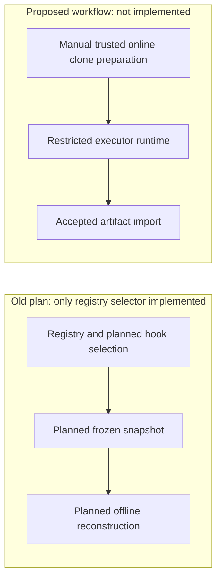

# Optional shallow executor workflow

Deliver trusted orchestrator preparation, restrictive executor control and
accepted-artifact import. The
[verified native-preparation Investigation](https://github.com/msitarz/ataraxia/blob/c9a24b3f8cccfb9392ec12db2029dfe03887786d/doc/feat/reviewable-workflow-v2/trial-preparation/workflow-efficiency/shallow-executor-clones/environment-preparation/README.md)
supports the simpler candidate only for its Darwin Intel deterministic
condition; it tested no model session. The
[older recipe](../sandbox-isolation/successful-recipe.md) remains historical
support, including its offline reconstruction, not the new preparation contract.

This revised plan adds no executable behavior, experiments or policy adoption.
Keep the regular worktree target, linked-worktree policy, model selection and
trial approval gates. Any consequential adoption still needs the existing
[WDR route](../../../../../../wdr-workflow.md) and owner updates.

## Child Works and dependencies

- **ABORT** Dependency snapshot and its unrun pinned-hook-sources,
  snapshot-delivery and current-dependency-compatibility contracts: native
  online preparation removes the need for selection, filter-on-copy delivery
  and offline environment reconstruction. Their required outcomes were not
  verified; abandonment does not mark them DONE. Git preserves those contracts
  and the retained Investigation/audit evidence is unchanged.
- **TODO** [Clone preparation](clone-preparation/README.md): manual native Git
  and existing online Make setup, fresh readiness and handoff record.
- **TODO** [Executor runtime](executor-runtime/README.md): restrictive start and
  exact-session correction; depends on accepted prepared-clone readiness.
- **TODO** [Artifact import](artifact-import/README.md): accepted output into a
  full-history Work branch; depends on accepted runtime output.

The shallow-clone parent separately owns
[registry selector cleanup](../registry-selector-cleanup/README.md), an
independently scoped maintenance leaf. It removes obsolete tooling after
consumer disposition is verified and is independent of runtime/import when no
active consumer requires it.

The delivered registry selector, tests and
[usage owner](dependency-snapshot/registry-selection.md) remain implemented
until that separate cleanup. Its
[verified historical delivery](https://github.com/msitarz/ataraxia/blob/e15059213964809026ca09505a190ad09701b64b/doc/feat/reviewable-workflow-v2/trial-preparation/workflow-efficiency/shallow-executor-clones/implementation/dependency-snapshot/registry-cache-selection/evidence.md)
is preserved; snapshot abandonment does not undo that delivered outcome.

Merge this revised planning map before implementation. Route clone preparation,
then executor runtime, then artifact import; cleanup may be scheduled separately
under its consumer gate. Each leaf aims at one five-minute complete review,
including tests and supporting changes; split before oversized execution.
Follow existing contribution, acceptance, review and publication contracts.
Host commits retain signing settings; never disable production signing.

## Acceptance

- **AC-1 TODO** The three workflow outcomes compose from a frozen manually
  prepared clone through restrictive execution to accepted Work-branch import,
  while existing worktree behavior remains available.

  Validation: reuse independently reviewed leaf evidence; manually trace the
  exact base, readiness record, runtime start/exact UUID resume and acceptance
  bindings through import. Test new runtime/import integration at its owning
  leaf; do not add native Git/Make fixtures or repeat the Investigation.
- **AC-2 TODO** Usage and supported-condition limits are promoted to their
  authoritative owners without changing default policy or claiming untested
  configurations are supported.

  Validation: independently review contribution/orchestrator guidance and any
  implemented Make help against the retained report and leaf evidence. Review
  required WDR/owner changes before consequential adoption; normal latest-head
  PR/CI gates apply. No live PR/CI experiment is required.
