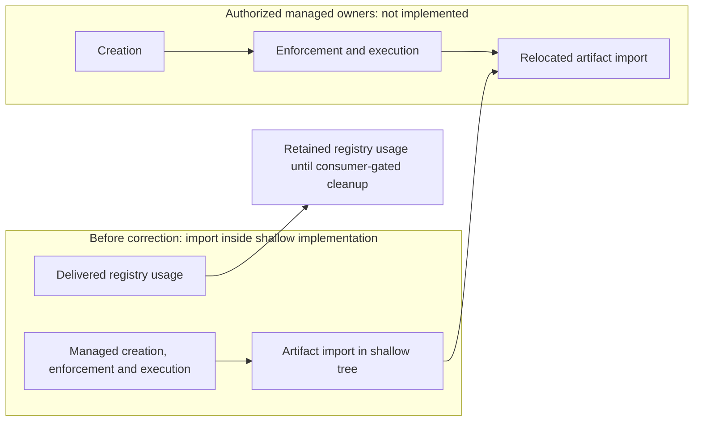

# Superseded shallow executor implementation contract

This retained contract awaits reviewed supersession cleanup. Its former
composition outcome now belongs to
[managed evaluation sandboxes](../../../../../evaluation-sandboxes/README.md),
including the relocated import Work; no active child remains here. The
[verified native-preparation Investigation](https://github.com/msitarz/ataraxia/blob/c9a24b3f8cccfb9392ec12db2029dfe03887786d/doc/feat/reviewable-workflow-v2/trial-preparation/workflow-efficiency/shallow-executor-clones/environment-preparation/README.md)
supports the simpler candidate only for its Darwin Intel deterministic
condition; it tested no model session. The
[older recipe](../sandbox-isolation/successful-recipe.md) remains historical
support, including its offline reconstruction, not the new preparation contract.

This revised plan adds no executable behavior, experiments or policy adoption.
Keep the regular worktree target, linked-worktree policy, model selection and
trial approval gates. Any consequential adoption still needs the existing
[WDR route](../../../../../../wdr-workflow.md) and owner updates.

## Child Works and dependencies

- **ABORT** Dependency snapshot and its unrun pinned-hook-sources,
  snapshot-delivery and current-dependency-compatibility contracts: native
  online preparation removes the need for selection, filter-on-copy delivery
  and offline environment reconstruction. Their required outcomes were not
  verified; abandonment does not mark them DONE. Git preserves those contracts
  and the retained Investigation/audit evidence is unchanged.
- **ABORT** Unimplemented manual clone-preparation contract: superseded by
  [managed creation](../../../../../evaluation-sandboxes/creation/README.md).
  Useful manual inputs survive in the
  [Work-owned inputs](../../../../../evaluation-sandboxes/preparation-input.md);
  its requirements were not delivered by #315.
- **ABORT** Unimplemented executor-runtime contract: superseded by managed
  [enforcement](../../../../../evaluation-sandboxes/enforcement/README.md) and
  [execution](../../../../../evaluation-sandboxes/execution/README.md).
  Runtime ownership is not duplicated and its criteria are not DONE.

Artifact import is now a direct TODO child of
[managed evaluation sandboxes](../../../../../evaluation-sandboxes/README.md#children-and-gates),
with all required import outcomes and gates retained. It is no longer a child
of this superseded Work.

The shallow-clone parent separately owns
[registry selector cleanup](../registry-selector-cleanup/README.md), an
independently scoped maintenance leaf. It removes obsolete tooling after
consumer disposition is verified and is independent of runtime/import when no
active consumer requires it.

The delivered registry selector, tests and
[usage owner](dependency-snapshot/registry-selection.md) remain implemented
until that separate cleanup. Its
[verified historical delivery](https://github.com/msitarz/ataraxia/blob/e15059213964809026ca09505a190ad09701b64b/doc/feat/reviewable-workflow-v2/trial-preparation/workflow-efficiency/shallow-executor-clones/implementation/dependency-snapshot/registry-cache-selection/evidence.md)
is preserved; snapshot abandonment does not undo that delivered outcome.

The maintainer-authorized #315 ownership correction supersedes this Work:
managed creation, enforcement, execution and import own its workflow composition
and usage promotion. The two unsatisfied criteria below remain TODO as the
retained pre-cleanup contract; they are not delivered by abandonment. The old
parent records ABORT rather than an empty active implementation wrapper.
After independent review, remove only this obsolete README; the registry usage
owner and its implementation remain until the separately owned cleanup passes
its consumer gate. Host production signing and ordinary review/publication gates
remain unchanged.

## Acceptance

- **AC-1 TODO** The three workflow outcomes compose from a frozen
  prepared clone through restrictive execution to accepted Work-branch import,
  while existing worktree behavior remains available.

  Validation: reuse independently reviewed leaf evidence; manually trace the
  exact base, readiness record, runtime start/exact UUID resume and acceptance
  bindings through import. Test new runtime/import integration at its owning
  leaf; do not add native Git/Make fixtures or repeat the Investigation.
- **AC-2 TODO** Usage and supported-condition limits are promoted to their
  authoritative owners without changing default policy or claiming untested
  configurations are supported.

  Validation: independently review promoted usage/orchestrator guidance upon
  command delivery and any implemented Make help against the retained report and
  leaf evidence. Review required WDR/owner changes before consequential
  adoption; normal latest-head PR/CI gates apply. No live PR/CI experiment is
  required.
