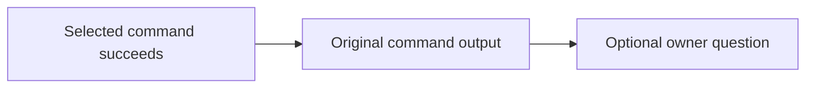

# Make guidance reminders

Add short, optional quality questions after selected Make commands succeed, with
particular attention to orchestrators drifting past independent artifact and
evidence review. Reminders point to existing owners; they do not perform review,
establish acceptance, or require repeated reading. The
[Work-context parent](../README.md#works) maps this outcome. This contract
replaces the proposed `make work-context` assembler completely and does not
adopt a new policy.

## Scope and current behavior

At `1407cfa6635f41bd3b4dfdd94fdecf73eedd21ae`, the
[Makefile](../../../../../../../Makefile) runs pinned rumdl for `doc-format`;
`doc-check` checks links, checks formatting, then invokes recursive
`doc-check-mermaid`. A failed step stops the recipe with its normal tool and
Make diagnostics. `ac-check` routes to the declaration checker and `commit` to
the existing commit helper. None emits a success quality question. No
`work-context` target exists.

Select `doc-format`, `doc-check`, `doc-check-mermaid`, `ac-check`, `commit`,
`test`, `ac-test`, `verify-test`, `verify-examples`, `ci-test`, and
`ci-examples`: these target Work contract reuse, documentation review, visual
clarity, independent orchestrator review, recovery from a discarded approach,
and test quality. `ac-collect`, package smoke targets, aggregate `ci`/`verify`,
setup targets, and `worktree-create` are outside this scope. Existing recipes
emit the optional question after successful command output. On failure they
retain their existing diagnostics and status without a reminder; `doc-check`
stops at its first failed stage, including recursive Mermaid
validation. A direct top-level
`doc-check-mermaid` invocation emits its question; when it runs under
`doc-check`, the nested invocation suppresses its own question so `doc-check`
emits only its review question. Other nested invocations also suppress
questions. The six test-execution targets share one concise, three-line
question about test layer and ownership, fixture data, and independent defect
assertions. Their recursive calls stay silent, so each successful outer wrapper
emits one reminder only after all its work and prerequisites succeed.

## Success questions

Emit one advisory quality question after the selected command's own output on
success. The wording may be concise, but the question meaning and owner anchor
are required. Paths are repository-relative and point to exact existing
headings.

| Target | Success question |
| --- | --- |
| `doc-format` | `If defining a Work: does its contract solve the underlying problem using inspected existing commands/APIs/helpers? doc/work-definition.md#work-definition` |
| `doc-check` | `Was the whole affected section reviewed at its owner for duplication and accuracy? doc/README.md#review` |
| `doc-check-mermaid` | `For meaningful changes: would a Mermaid diagram or before/after visual clarify what changes? doc/work-definition.md#describing-changes` |
| `ac-check` | `Independent orchestrator review: underlying problem solved? Existing concepts reused? Outcome supported by observed evidence? doc/orchestrator.md#review-and-return` |
| `commit` | `If a fundamentally wrong approach was discarded: were it and compensating changes reverted before reimplementation? doc/change-rules.md#fix-the-underlying-problem` |
| `test`, `ac-test`, `verify-test`, `verify-examples`, `ci-test`, `ci-examples` | Three questions below |

The test-execution targets ask:

- `Are tests in the right layer/layout? At Work closure, are retained tests
  project regressions rather than temporary adoption probes?` See
  [test-layer selection](../../../../../../testing.md#layout-ownership-and-adoption)
  and [test ownership](../../../../../../test-ownership.md#test-ownership).
- `Are reviewed static fixtures treated as data without redundant validation?`
  See [test data](../../../../../../testing.md#treat-test-data-as-data).
- `Do assertions catch the named defect with independent expectations at the real boundary?`
  See [what a test proves](../../../../../../testing.md#what-a-test-proves) and
  [independent expectations](../../../../../../testing.md#make-expectations-independent).

The questions are grounded in
[Work definition](../../../../../../work-definition.md#work-definition),
[repair and reuse rules](../../../../../../change-rules.md#fix-the-underlying-problem),
[whole-section documentation review](../../../../../../README.md#review), and
[independent review](../../../../../../orchestrator.md#review-and-return) with
[observed evidence](../../../../../../acceptance-tracing.md#planned-validation-and-evidence).
The `commit` question applies when the maintainer or orchestrator discards a
fundamentally wrong approach; it does not require reverting every minor fix or
make Git changes automatically.

The Mermaid question is conditional: small or self-explanatory changes need no
visual. It suggests a readability check; it does not require adding a diagram,
imply that Make creates one, or treat successful rendering as acceptance.

The `ac-check` question addresses the orchestrator; it does not add
orchestrator reading to executor tasks. Passing `ac-check` does not imply
acceptance, coverage, evidence, CI success, or permission to publish. Make asks
the quality questions without answering them. Consultation remains optional:
there is no reading gate, automatic document loading, or copied policy
checklist.

The interaction is advisory; Make performs no artifact or evidence review and
does not assess acceptance:

Reminders apply only to selected targets invoked at top-level Make
(`MAKELEVEL=0`). Recursive invocations suppress only the success question.
When top-level `doc-check` invokes `doc-check-mermaid`, the nested helper stays
silent and its output and failure reach the outer target before its single
success question. The existing `ci`/`verify` route calls `doc-check`
recursively, so it gains no question.

Use the existing recipes and commands, preserving arguments, environment,
quoting, hooks, offline behavior, diagnostics, effects, and failure behavior.
Emit a question only after the underlying command or all `doc-check` stages
succeed. Keep the normal failing status and stop later `doc-check` stages after
the first failure; add no failure-mode guidance output. For test wrappers with
prerequisites or multiple nested commands, emit only after all of them succeed;
recursive selected targets suppress their own question. Preserve existing
prerequisite and failure handling.

No global shell traps, classifiers, role flags, wrappers, registry, index,
reminder-only review target, context assembler, or CI metrics tool is in scope.
Coordinate any shared guidance-owner edits with
[guidance application](../../guidance-application/README.md), without rewriting
its contract. Preserve completed
[handoff guidance](../../../../../../orchestrator.md),
[PR guidance](../../../../../../pull-requests.md), and
[acceptance tracing](../../../../../../acceptance-tracing.md).

## Acceptance

- **AC-1 DONE** Each selected top-level target emits its mapped success question
  once, after the command's output. Recursive selected-target invocations
  suppress the question, with wrapper questions following all successful
  commands and prerequisites. Command failures retain their existing diagnostics
  and status without a success question; `doc-check` stops at its first failed
  stage. No failure-mode guidance reminder is added.
  Validation: focused criterion-marked Make integration tests check every
  selected success outcome,
  including the shared test question's owner anchors, single emission, and
  ordering after the final command output. Existing tests retain error and
  stop-at-first-failure coverage; add no failure-reminder tests.
- **AC-2 DONE** Reminders remain optional questions to existing owners and do
  not establish acceptance or add mandatory reading, automated review, or Git
  actions. Only selected targets emit questions; nested invocations suppress
  them, including beneath `ci-test` and `ci-examples`.
  Validation: exercise `doc-check` directly and through recursive Make, and
  exercise test wrappers through their nested Make calls, confirming one
  top-level question after successful output. Invoke `doc-check-mermaid`
  directly to confirm its top-level question appears once. Review the full diff
  for owner and scope preservation; run scoped doc-format, doc-check, ac-check,
  and focused reminder tests.

This leaf uses focused integration assertions for its bounded review. During
normal subsequent work, discuss observed guidance drift or corrections in the
existing conversation and review records. Make no benefit claim from reminder
presence alone. No new benchmark, empirical protocol, report, or ledger is
required; the separate guidance-application Investigation retains its question
and evidence obligations.
