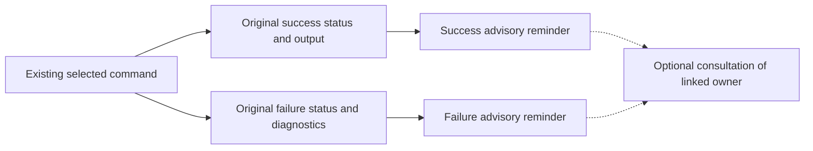

# Make guidance reminders

Add short, optional repository-owned guidance reminders after selected Make
commands finish, with particular attention to orchestrators drifting past
independent artifact and evidence review. Reminders point to existing owners;
they do not perform review, establish acceptance, or require repeated reading.
The [Work-context parent](../README.md#works) maps this planned outcome.
This contract replaces the proposed `make work-context` assembler completely.
No runtime change or trial has been delivered by this planning revision.

## Scope and current behavior

At `41e3cc0627b155b05a3f7906c938b93004b1ba02`, the
[Makefile](../../../../../../../Makefile) routes `ac-check` to the declaration
checker and `commit` to the existing commit helper. Failed commands stop their
recipes. `worktree-create` validates inputs, creates the tree, copies available
caches, runs offline `ci-setup`, and runs `verify-setup` before reporting
readiness. Its failure paths retain their diagnostics and recovery instructions;
setup failure may leave a recoverable worktree. None emits the proposed owner
reminders. No `work-context` target exists.

The initial selection is only `worktree-create`, `ac-check`, and `commit`:
preparation, the central declaration-versus-review boundary, and the
commit-versus-publication boundary. Existing recipes and helpers can carry
scoped outcome handling; no broader framework is needed. This is one review
question across three existing targets and their focused integration assertions,
expected to fit a five-minute leaf review. Reassess the actual implementation
diff before publication if that expectation fails.

## Proposed output

Emit one advisory reminder after the selected command's own output, with a
distinct success or failure message. The following text is provisional wording;
the owner anchors and distinctions are required. Paths are repository-relative
and point to exact existing headings.

| Target | Outcome | Proposed reminder |
| --- | --- | --- |
| `worktree-create` | Success | `Worktree prepared; optional branch/base guidance: CONTRIBUTING.md#work-branches-review-and-merge` |
| `worktree-create` | Failure | `Worktree preparation failed; inspect diagnostics. Recovery guidance: CONTRIBUTING.md#getting-started` |
| `ac-check` | Success | `Orchestrator review: declarations checked; independent artifact/evidence review still required. doc/orchestrator.md#review-and-return` |
| `ac-check` | Failure | `Orchestrator review: declarations failed; affected criteria remain unresolved. Inspect diagnostics before review. doc/orchestrator.md#review-and-return` |
| `commit` | Success | `Commit created; publication still requires review. Optional guidance: doc/pull-requests.md#publishing` |
| `commit` | Failure | `Commit failed; inspect diagnostics before retrying. Optional guidance: CONTRIBUTING.md#commits-and-pull-requests` |

The `ac-check` prompt addresses the orchestrator; it does not add orchestrator
reading to executor tasks. A declaration failure does not invalidate unrelated
verified criteria, and passing does not imply acceptance, coverage, evidence,
CI success, or permission to publish. The reminder links to the review owner
on either outcome so long-running sessions encounter that boundary again.
Consultation remains optional: there is no reading gate, automatic document
loading, or copied policy.

Proposed interaction only; Make emits advice and performs no artifact/evidence
review or acceptance assessment:

Reminders apply only to selected targets invoked at top-level Make
(`MAKELEVEL=0`). Recursive invocations emit no selected-target reminder; the
suppression changes only this advisory output. The current `ci` and `verify`
paths do not invoke these selected targets. Do not alter their behavior or add
reminders to setup, checks, or nested tools as part of this leaf.

Use scoped recipe mechanics with the existing commands, preserving their
arguments, environment, quoting, hooks, offline setup, diagnostics, effects, and
failure behavior. Keep the original failing command status inside outcome
handling and return failure to Make (whose process may normalize it). A
reminder must not turn failure into success, suppress diagnostics, skip a
required step, or announce readiness after any input, Git, cache-copy, setup,
or verification failure. Handle all existing multi-step failure paths, including
early exits; do not merely append a success echo. No selected target currently
has a Make prerequisite; do not introduce prerequisite failure paths that bypass
the required failure reminder.

No global shell traps, classifiers, role flags, wrappers, registry, index,
reminder-only review target, context assembler, or CI metrics tool is in scope.
Existing artifacts, AC markers, and owner links remain intact. Coordinate any
shared guidance-owner edits with
[guidance application](../../guidance-application/README.md), without rewriting
its contract. Preserve completed
[handoff guidance](../../../../../../orchestrator.md),
[PR guidance](../../../../../../pull-requests.md), and
[acceptance tracing](../../../../../../acceptance-tracing.md).

## Acceptance

- **AC-1 TODO** The three selected top-level targets emit one short advisory
  reminder after their own output for success and failure, using the mapped
  owner anchors and outcome distinctions. Both `ac-check` outcomes explicitly
  address orchestrator artifact/evidence review without implying tool review
  or acceptance; unrelated verified criteria remain valid after a failure.
  Validation: run focused criterion-marked Make integration tests for all six
  outcomes, asserting relevant message meaning, owner anchor, output ordering,
  and absence of the opposite-outcome message. Independently review wording
  against the linked owners; avoid tests that mirror echo formatting exactly.
- **AC-2 TODO** Original diagnostics, command effects, hooks, arguments,
  environment, offline behavior, and failure status are preserved. Every
  existing `worktree-create` stage failure emits a failure reminder without
  reaching later steps or announcing readiness; commit validation, formatting,
  or Git/hook failure and declaration failure remain failures.
  Validation: extend the existing Make integration tests at their current
  boundaries, covering input/Git/cache/setup/verification refusal paths and
  commit/checker failures with original diagnostics and nonzero Make status;
  verify captured underlying statuses remain unchanged and expected later
  effects are absent. Reuse existing preparation, commit, and declaration
  evidence for preserved behavior rather than replacing their real commands.
- **AC-3 TODO** Recursive selected-target invocations suppress only reminders,
  while top-level invocation retains them; no broader guidance machinery or
  new reading requirement is introduced.
  Validation: exercise a selected target through recursive Make and directly,
  comparing effects, diagnostics, and status while asserting reminder absence
  only for the recursive call. Review the complete diff for scope and owner
  preservation; run scoped doc-format, doc-check, and ac-check.

This leaf uses focused integration assertions as its bounded trial. During
normal subsequent work, discuss observed guidance drift or corrections in the
existing conversation and review records. Make no benefit claim from reminder
presence alone. No new benchmark, empirical protocol, report, or ledger is
required; the separate guidance-application Investigation retains its question
and evidence obligations.
