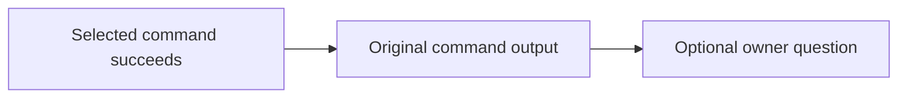

# Make guidance reminders

Add short, optional quality questions after selected Make commands succeed, with
particular attention to orchestrators drifting past independent artifact and
evidence review. Reminders point to existing owners; they do not perform review,
establish acceptance, or require repeated reading. The
[Work-context parent](../README.md#works) maps this outcome. This contract
replaces the proposed `make work-context` assembler completely and does not
adopt a new policy.

## Scope and current behavior

At `1407cfa6635f41bd3b4dfdd94fdecf73eedd21ae`, the
[Makefile](../../../../../../../Makefile) runs pinned rumdl for `doc-format`;
`doc-check` checks links, checks formatting, then invokes recursive
`doc-check-mermaid`. A failed step stops the recipe with its normal tool and
Make diagnostics. `ac-check` routes to the declaration checker and `commit` to
the existing commit helper. None emits a success quality question. No
`work-context` target exists.

Select only `doc-format`, `doc-check`, `ac-check`, and `commit`: Work contract
reuse, documentation review, independent orchestrator review, and recovery
from a discarded approach. `worktree-create` is outside this scope. Existing
recipes can emit the optional question after successful command output. On
failure they retain their existing diagnostics and status without a reminder;
`doc-check` stops at its first failed stage, including recursive Mermaid
validation. Nested invocations of selected targets suppress only the success
question. The four targets and focused success assertions share one review
question, expected to fit a five-minute leaf review. Reassess the actual diff
before publication if that expectation fails.

## Success questions

Emit one advisory quality question after the selected command's own output on
success. The wording may be concise, but the question meaning and owner anchor
are required. Paths are repository-relative and point to exact existing
headings.

| Target | Success question |
| --- | --- |
| `doc-format` | `If defining a Work: does its contract solve the underlying problem using inspected existing commands/APIs/helpers? doc/work-definition.md#work-definition` |
| `doc-check` | `Was the whole affected section reviewed at its owner for duplication and accuracy? doc/README.md#review` |
| `ac-check` | `Independent orchestrator review: underlying problem solved? Existing concepts reused? Outcome supported by observed evidence? doc/orchestrator.md#review-and-return` |
| `commit` | `If a fundamentally wrong approach was discarded: were it and compensating changes reverted before reimplementation? doc/change-rules.md#fix-the-underlying-problem` |

The questions are grounded in
[Work definition](../../../../../../work-definition.md#work-definition),
[repair and reuse rules](../../../../../../change-rules.md#fix-the-underlying-problem),
[whole-section documentation review](../../../../../../README.md#review), and
[independent review](../../../../../../orchestrator.md#review-and-return) with
[observed evidence](../../../../../../acceptance-tracing.md#planned-validation-and-evidence).
The `commit` question applies when the maintainer or orchestrator discards a
fundamentally wrong approach; it does not require reverting every minor fix or
make Git changes automatically.

The `ac-check` question addresses the orchestrator; it does not add
orchestrator reading to executor tasks. Passing `ac-check` does not imply
acceptance, coverage, evidence, CI success, or permission to publish. Make asks
the quality questions without answering them. Consultation remains optional:
there is no reading gate, automatic document loading, or copied policy
checklist.

The interaction is advisory; Make performs no artifact or evidence review and
does not assess acceptance:

Reminders apply only to selected targets invoked at top-level Make
(`MAKELEVEL=0`). Recursive invocations suppress only the success question.
`doc-check-mermaid` is unselected and emits no question; its output and failure
reach the outer `doc-check` before any success question. The existing
`ci`/`verify` route calls `doc-check` recursively, so it gains no question.

Use the existing recipes and commands, preserving arguments, environment,
quoting, hooks, offline behavior, diagnostics, effects, and failure behavior.
Emit a question only after the underlying command or all `doc-check` stages
succeed. Keep the normal failing status and stop later `doc-check` stages after
the first failure; add no failure-mode guidance output. No selected target
currently has a Make prerequisite; do not introduce prerequisite failures that
bypass the command's normal error handling.

No global shell traps, classifiers, role flags, wrappers, registry, index,
reminder-only review target, context assembler, or CI metrics tool is in scope.
Coordinate any shared guidance-owner edits with
[guidance application](../../guidance-application/README.md), without rewriting
its contract. Preserve completed
[handoff guidance](../../../../../../orchestrator.md),
[PR guidance](../../../../../../pull-requests.md), and
[acceptance tracing](../../../../../../acceptance-tracing.md).

## Acceptance

- **AC-1 DONE** Each of the four selected top-level targets emits its mapped
  success question once, after the command's output. Recursive selected-target
  invocations suppress the question. Command failures retain their existing
  diagnostics and status without a success question; `doc-check` stops at the
  first failed stage. No failure-mode guidance reminder is added.
  Validation: extend criterion-marked Make integration tests for the four
  success outcomes, checking question meaning, owner anchor, single emission,
  and ordering after output. Keep the command failure and stage-stop contracts
  covered by their existing Make integration tests; do not add dedicated
  failure-reminder tests.
- **AC-2 DONE** Reminders remain optional questions to existing owners and do
  not establish acceptance or add mandatory reading, automated review, or Git
  actions. Only the four selected targets emit questions; `doc-check-mermaid`
  remains unselected.
  Validation: exercise `doc-check` directly and through recursive Make,
  confirming its top-level success question appears once and nested invocations
  suppress it while preserving command output/status. Confirm the unselected
  Mermaid helper emits no question. Review the full diff for owner and scope
  preservation; run scoped doc-format, doc-check, and ac-check.

This leaf uses focused integration assertions for its bounded review. During
normal subsequent work, discuss observed guidance drift or corrections in the
existing conversation and review records. Make no benefit claim from reminder
presence alone. No new benchmark, empirical protocol, report, or ledger is
required; the separate guidance-application Investigation retains its question
and evidence obligations.
