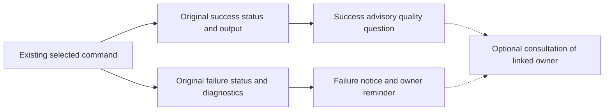

# Make guidance reminders

Add short, optional repository-owned guidance reminders after selected Make
commands finish, with particular attention to orchestrators drifting past
independent artifact and evidence review. Reminders point to existing owners;
they do not perform review, establish acceptance, or require repeated reading.
The [Work-context parent](../README.md#works) maps this planned outcome.
This contract replaces the proposed `make work-context` assembler completely.
No runtime change or trial has been delivered by this planning revision.

## Scope and current behavior

At `1407cfa6635f41bd3b4dfdd94fdecf73eedd21ae`, the
[Makefile](../../../../../../../Makefile) runs pinned rumdl for `doc-format`;
`doc-check` checks links, checks formatting, then invokes recursive
`doc-check-mermaid`. Each failed step stops the recipe. `ac-check` routes to
the declaration checker and `commit` to the existing commit helper. None
emits the proposed reminders. No `work-context` target exists.

Select only `doc-format`, `doc-check`, `ac-check`, and `commit`: contract
problem/reuse, documentation review, independent artifact/evidence review, and
recovery from a discarded approach. `worktree-create` is outside this revised
scope. Existing recipes and helpers can carry scoped outcome handling; no
broader framework is needed. The four targets and focused integration
assertions share one review question, expected to fit a five-minute leaf
review. Reassess the actual diff before publication if that expectation fails.

## Proposed output

Emit one advisory reminder after the selected command's own output, with a
distinct success or failure message. The following text is provisional wording;
the owner anchors and distinctions are required. Paths are repository-relative
and point to exact existing headings.

| Target | Outcome | Proposed reminder |
| --- | --- | --- |
| `doc-format` | Success | `If defining a Work: does its contract solve the underlying problem using inspected existing commands/APIs/helpers? doc/work-definition.md#work-definition` |
| `doc-format` | Failure | `Documentation formatting failed; inspect diagnostics before retrying. Optional guidance: doc/README.md#review` |
| `doc-check` | Success | `Was the whole affected section reviewed at its owner for duplication and accuracy? doc/README.md#review` |
| `doc-check` | Failure | `Documentation checks failed; inspect diagnostics before review. Optional guidance: doc/README.md#review` |
| `ac-check` | Success | `Independent orchestrator review: underlying problem solved? Existing concepts reused? Outcome supported by observed evidence? doc/orchestrator.md#review-and-return` |
| `ac-check` | Failure | `Orchestrator review: declarations failed; affected criteria remain unresolved. Inspect diagnostics before review. doc/orchestrator.md#review-and-return` |
| `commit` | Success | `If a fundamentally wrong approach was discarded: were it and compensating changes reverted before reimplementation? doc/change-rules.md#fix-the-underlying-problem` |
| `commit` | Failure | `Commit failed; inspect diagnostics before retrying. Optional guidance: CONTRIBUTING.md#commits-and-pull-requests` |

The questions are grounded in
[Work definition](../../../../../../work-definition.md#work-definition),
[repair and reuse rules](../../../../../../change-rules.md#fix-the-underlying-problem),
[whole-section documentation review](../../../../../../README.md#review), and
[independent review](../../../../../../orchestrator.md#review-and-return) with
[observed evidence](../../../../../../acceptance-tracing.md#planned-validation-and-evidence).
The last question applies when the maintainer or orchestrator discards a
fundamentally wrong approach; it does not require reverting every minor fix or
make Git changes automatically.

Historical rationale in
[WDR 10](../../../../../../wdr/0010-recover-delegated-handoffs.md),
[WDR 17](../../../../../../wdr/0017-review-local-artifacts-before-pr-publication.md),
and [WDR 21](../../../../../../wdr/0021-publish-after-local-work-acceptance.md)
supports unresolved-scope recovery, completed-artifact review, and actual
Validation evidence. Runtime reminders route to current owners, not WDRs.

The `ac-check` prompt addresses the orchestrator; it does not add orchestrator
reading to executor tasks. A declaration failure does not invalidate unrelated
verified criteria, and passing does not imply acceptance, coverage, evidence,
CI success, or permission to publish. Make asks the quality questions without
answering them. Consultation remains optional: there is no reading gate,
automatic document loading, or copied policy checklist.

Proposed interaction only; Make emits advice and performs no artifact/evidence
review or acceptance assessment:

Reminders apply only to selected targets invoked at top-level Make
(`MAKELEVEL=0`). Recursive invocations suppress only reminder output.
`doc-check-mermaid` is unselected and emits no reminder; its output and failure
must reach the outer `doc-check` before the outer reminder. The existing
`ci`/`verify` route calls `doc-check` recursively, so it gains no reminder.

Use scoped recipe mechanics with the existing commands, preserving their
arguments, environment, quoting, hooks, offline behavior, diagnostics, effects,
and failure behavior. Keep the original failing command status inside outcome
handling and return failure to Make (whose process may normalize it). Handle
failure at any `doc-check` step, including recursive Mermaid validation: emit
one failure reminder after diagnostics, skip later steps, and never emit a
success question after failure. No selected target currently has a Make
prerequisite; do not introduce prerequisite failures that bypass the notice.

No global shell traps, classifiers, role flags, wrappers, registry, index,
reminder-only review target, context assembler, or CI metrics tool is in scope.
Existing artifacts, AC markers, and owner links remain intact. Coordinate any
shared guidance-owner edits with
[guidance application](../../guidance-application/README.md), without rewriting
its contract. Preserve completed
[handoff guidance](../../../../../../orchestrator.md),
[PR guidance](../../../../../../pull-requests.md), and
[acceptance tracing](../../../../../../acceptance-tracing.md).

## Acceptance

- **AC-1 DONE** The four selected top-level targets emit one short advisory
  reminder after their own output on success or failure, using the mapped
  quality questions, owner anchors, and outcome distinctions. Both `ac-check`
  outcomes explicitly address independent review without implying tool review
  or acceptance. Original diagnostics and failure status are preserved; no
  failed step produces a success question or proceeds to later steps.
  Validation: extend existing criterion-marked Make integration tests for the
  eight outcomes, asserting message meaning, anchor, diagnostic/reminder
  ordering, nonzero failure status, and absence of the opposite-outcome notice.
  Cover each `doc-check` step's failure, including recursive Mermaid validation,
  and meaningful commit/checker failure boundaries using existing fixtures.
  Preserve captured underlying statuses; do not rebuild hook, setup, or cache
  regression suites or mirror echo formatting. Independently review questions
  against their owners and their conditional applicability.
- **AC-2 DONE** Recursive selected-target invocations suppress only reminders;
  top-level invocation retains them. No broader machinery, mandatory reading,
  automatic review, or automated Git action is introduced.
  Validation: exercise `doc-check` directly and through recursive Make,
  comparing effects, diagnostics, and status while asserting reminder absence
  only for the recursive selected target. Confirm `doc-check-mermaid` produces
  no inner reminder and its failure reaches the outer failure notice. Review
  the full diff for owner and scope preservation; run scoped doc-format,
  doc-check, and ac-check.

This leaf uses focused integration assertions as its bounded trial. During
normal subsequent work, discuss observed guidance drift or corrections in the
existing conversation and review records. Make no benefit claim from reminder
presence alone. No new benchmark, empirical protocol, report, or ledger is
required; the separate guidance-application Investigation retains its question
and evidence obligations.
