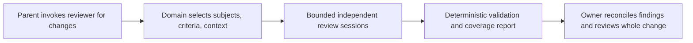

# Reviewer

## Purpose

Reduce instruction drift, especially overlooked rules deep in generated code,
through reusable focused LLM reviews with traceable coverage and owner judgment.

## Goals

- Deliver a Codex skill named `reviewer` with engineering review as its first
  usable vertical outcome.
- Reuse deterministic review execution and aggregation across domains whose
  subjects, criteria, and context differ.
- Give the parent agent a concise, inspectable account of findings, uncertainty,
  and incomplete coverage.
- Choose review granularity from detection evidence relative to resource use,
  accepting higher token consumption when it improves review quality.

## Glossary

These concepts describe this Work's review model, not prescribed interfaces:

- Subject: the identified source being judged, such as a function, component,
  test, or guidance section.
- Criterion: one rule or invariant against which a subject is judged.
- Context: the information necessary to judge that subject against that
  criterion.
- Review job: one subject, exactly one criterion, and its relevant context.
- Coverage: the accounting of selected changes, considered criteria, exclusions,
  planned review jobs, and their observed outcomes within the declared scope.

Judgments retain the meanings of `PASS`, `VIOLATION`, `NOT_APPLICABLE`, and
`UNCERTAIN` in
[focused rule review](../../engineering-review.md#focused-rule-review).
Execution failure is not a semantic judgment.

## Non-Goals

- Deliver test, architecture, or guidance review in the initial engineering
  slice.
- Replace deterministic checks or claim that focused review proves the whole
  change correct.
- Create a generic plugin framework, prescribe classes or modules, or freeze
  internal algorithms and interfaces before architecture review.
- Change delegation, correction limits, maintainer authority, review gates, or
  existing guidance ownership.
- Deliver automated reviewer-alignment workflows, accept/reject UX, automated
  second-pass precision review, or flip-rate testing in the initial scope.

## Mechanisms

- The `reviewer` Codex skill gives the parent agent a reusable invocation and
  report workflow.
- Python owns deterministic orchestration and validation of independent,
  non-interactive `codex exec` sessions that perform semantic judgments.
- Existing guidance and deterministic-tool configuration remain the authorities
  for review rules and their machine-enforced portions.

## Inherited constraints

These parent-owned requirements apply to every child and future domain.
Each child verifies its local behavior; the owning Orchestrator verifies their
integration under this parent's acceptance criteria.

### Responsibilities and judgment

- Domain behavior owns subject discovery, criterion applicability, and context
  assembly; generic execution and aggregation do not assume function subjects.
- Deterministic Python behavior owns execution, resource limits, result
  validation, and accounting; LLM judgments remain nondeterministic.
- Production jobs judge exactly one subject against exactly one criterion,
  with independent sessions and no interactive parent intervention required for
  completion; the engineering experiment's multi-rule baseline is a comparator,
  not a production job or an exception for production reviews.
- Production subject granularity follows a recorded decision supported by
  evidence, potentially varying by criterion; whole-diff and function scope
  remain open.
- Each criterion exposes applicability and deterministic-enforcement
  information; applicability favors avoiding missed relevant rules, and
  exclusions have inspectable reasons in coverage reports.
- Exclude only the portions of rules reliably enforced by existing deterministic
  tools after considering effective enables and exclusions; passing a metric
  does not settle related semantic questions.
- Prompts include sufficient rule-specific context, including old and new source
  when relevant, without unrelated material; insufficient context produces
  `UNCERTAIN`, and broader rules are not forced into function scope.
- Verdict and supporting evidence are primary; findings include concrete source
  evidence and consequences, and `NOT_APPLICABLE` explains non-applicability.
- Correction suggestions are optional, separate from judgments, and never a
  condition of review validity.
- The responsible owner retains deduplication, rule-conflict and applicability
  reconciliation, whole-change judgment, and correction responsibilities under
  [engineering review](../../engineering-review.md) and
  [orchestration](../../orchestrator.md#review-and-return).
- Existing focused, whole-change, and architectural reviews remain available;
  focused judgments complement these reviews, and existing behavior remains
  available until any replacement has been validated and independently reviewed.

### Safety, resources, and traceability

- Review sessions are read-only with respect to repository files and refs;
  evidence output is separate from the reviewed source and cannot change it.
- Reviews use consistent immutable source and guidance revisions; changes during
  preparation or execution cannot silently mix revisions or count as coverage.
- Identical complete effective inputs and configuration yield the same review
  plan and stable job identities; this does not promise identical LLM judgments.
- Every result is traceable to its complete effective prompt, source,
  comparison, context, criterion, guidance, and execution configuration;
  different effective inputs are never treated as interchangeable.
- Before execution, planning reports estimated job and token budgets and visibly
  refuses to proceed if configured limits would be exceeded; estimates remain
  distinct from observed usage and unavailable measurements.
- If caching is adopted, identity includes effective prompt, review inputs,
  relevant guidance, and execution configuration; cached results cannot count as
  independent experimental trials.
- A finite positive concurrency limit and finite per-session execution bound
  constrain resource use; invalid settings fail before sessions start.
- Process output, retained artifacts, and any retries have finite declared
  limits; exhaustion is visible as incomplete coverage rather than hidden
  truncation or unbounded work.
- Success, failure, timeout, and cancellation release acquired resources and
  leave no review processes running after the runner returns.
- The initial engineering child verifies these limits with controlled workloads;
  future children verify their additions, and parent integration review checks
  that no domain bypasses them.

### Completeness and evidence

- Every planned job has one accounted terminal outcome; failed, timed-out,
  missing, malformed, duplicate, or foreign results cannot become successful
  coverage or overwrite a valid result silently.
- `UNCERTAIN` is a valid judgment that remains visible as unresolved review;
  `NOT_APPLICABLE` is a reasoned judgment, not an execution failure or a pass.
- Reports distinguish complete execution from semantic confidence and avoid
  claiming complete review when discovery, context assembly, or execution is
  incomplete.
- Aggregation of the same validated inputs is deterministic regardless of
  completion order; evidence retains the individual judgments and failure
  reasons behind the concise parent report.
- Verification follows [testing](../../testing.md), separating deterministic
  orchestration evidence from live LLM observations; fake judgments cannot prove
  the model's semantic accuracy.
- Maintainable Python, clear responsibility and validation boundaries, minimal
  defensive programming, and existing Make/tooling conventions apply under
  [engineering guidance](../../engineering.md).

## Visuals

At base `c8990b2`,
[focused rule review](../../engineering-review.md#focused-rule-review) describes
optional judgments reconciled by the owner; it has no reusable runner in the
inspected Make targets. The proposed behavior adds this flow, without selecting
internal components:

## Acceptance criteria

### **AC-1 TODO** Integrated engineering review preserves shared guarantees

The parent agent can use `reviewer` for the
[initial engineering outcome](engineering/README.md), with the shared
responsibilities, effect limits, completeness guarantees, and revision identity
preserved from invocation through owner handoff.

Independent parent integration review traces representative success,
uncertainty, and incomplete runs through the actual skill and runner, verifies
the shared constraints across their boundaries, including deterministic
planning, pre-execution budget refusal, and complete input identity, and
confirms that existing review routes and correction authority remain available.
The integrated delivery follows the engineering child's granularity decision and
supporting evidence. Child completion alone does not establish this guarantee.

### **AC-2 TODO** Future domains fit without function-specific execution

Generic execution supports non-function subjects without moving domain selection
or context assembly into execution; this is a mandatory delivered guarantee.

Architecture review checks concrete examples from test review (fixtures,
helpers, and isolation context), architecture review (boundaries and dependency
flows), and guidance review (surrounding sections and cross-owner
contradictions). Controlled execution evidence verifies non-function job
handling and aggregation, while design review verifies responsibility separation
for those examples. This does not require delivering those domains or a plugin
framework.

## Children

- TODO [Engineering review](engineering/README.md): Integrate engineering-review
  evidence and a recorded granularity decision into a usable reviewer with
  explicit coverage and traceable judgments.

## Additional context

Engineering owns the integrated vertical outcome, with separate
[Evaluation evidence](engineering/evaluation/README.md) and
[usable Delivery](engineering/delivery/README.md) children. Delivery follows
completed Evaluation evidence and the engineering owner's recorded decision.
Separate runner, discovery, and aggregation Works are not justified solely by
implementation layers. Any further decomposition remains unknown until bounded
typed architecture under
[Work definition](../../work-definition.md#decomposition-and-architectural-exploration).

The engineering parent owns the
[granularity decision](engineering/README.md#ac-7-todo-granularity-follows-representative-detection-evidence);
its Evaluation owns the experiment's evidence without adopting policy. This
parent owns cross-domain invariants and integration. No strategy winner or
function-level or whole-diff child is chosen before evidence exists.

Test review is a distinct future domain with its own
[testing rules](../../testing.md), not engineering review applied to test files.
Architecture and guidance review likewise need their own scope and context.
Delivering these domains and other extensions requires later concrete outcomes
and contracts and remains deferred. The parent's
[mandatory non-function execution and responsibility separation guarantee](#ac-2-todo-future-domains-fit-without-function-specific-execution)
still applies. No speculative child contracts are defined now.

Typed architecture must resolve revision handling for committed and dirty
inputs, changed/deleted or unparseable subjects, rule selection and context
sufficiency, read-only execution and artifact placement, structured-result
validation, cancellation, bounded output and retries, and the smallest usable
invocation. It must assess whether any resulting capability is independently
deliverable before proposing a split. No architecture, skeleton, implementation,
or guidance migration is authorized by this definition artifact.

Hashes, snapshots, caches, rule-index schemas, parsers, and orchestration APIs
remain architectural candidates. The experiment also remains unexecuted at this
definition stage; its protocol and measurements must not be invented here.

There is no intended conflict with current owner review or delegation duties.
Consequential architecture or workflow choices follow the existing
[ADR](../../adr-workflow.md) and [WDR](../../wdr-workflow.md) processes; this
contract does not decide them or adopt a replacement review policy.
