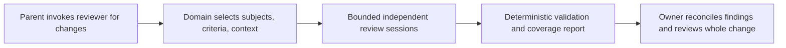

# Reviewer

## Purpose

Make independent focused LLM reviews reusable without losing coverage,
revision traceability, or the responsible owner's judgment of the whole change.

## Goals

- Deliver a Codex skill named `reviewer` with engineering review as its first
  usable vertical outcome.
- Reuse deterministic review execution and aggregation across domains whose
  subjects, criteria, and context differ.
- Give the parent agent a concise, inspectable account of findings, uncertainty,
  and incomplete coverage.

## Glossary

These concepts describe this Work's review model, not prescribed interfaces:

- Subject: the identified source being judged, such as a function, component,
  test, or guidance section.
- Criterion: one rule or invariant against which a subject is judged.
- Context: the information necessary to judge that subject against that
  criterion.
- Review job: one subject, exactly one criterion, and its relevant context.
- Coverage: the accounting of selected changes, considered criteria, exclusions,
  planned review jobs, and their observed outcomes within the declared scope.

Judgments retain the meanings of `PASS`, `VIOLATION`, `NOT_APPLICABLE`, and
`UNCERTAIN` in
[focused rule review](../../engineering-review.md#focused-rule-review).
Execution failure is not a semantic judgment.

## Non-Goals

- Deliver test, architecture, or guidance review in the initial engineering
  slice.
- Replace deterministic checks or claim that focused review proves the whole
  change correct.
- Create a generic plugin framework, prescribe classes or modules, or freeze
  internal algorithms and interfaces before architecture review.
- Change delegation, correction limits, maintainer authority, review gates, or
  existing guidance ownership.

## Mechanisms

- The `reviewer` Codex skill gives the parent agent a reusable invocation and
  report workflow.
- Python owns deterministic orchestration and validation of independent,
  non-interactive `codex exec` sessions that perform semantic judgments.
- Existing guidance and deterministic-tool configuration remain the authorities
  for review rules and their machine-enforced portions.

## Inherited constraints

These parent-owned requirements apply to every child and future domain.
Each child verifies its local behavior; the owning Orchestrator verifies their
integration under this parent's acceptance criteria.

### Responsibilities and judgment

- Domain behavior owns subject discovery, criterion applicability, and context
  assembly; generic execution and aggregation do not assume function subjects.
- Deterministic Python behavior owns execution, resource limits, result
  validation, and accounting; LLM judgments remain nondeterministic.
- Jobs judge exactly one subject against exactly one criterion, with independent
  sessions and no interactive parent intervention required for completion.
- Exclude only the portions of rules reliably enforced by existing deterministic
  tools; passing a metric does not settle related semantic questions.
- Prompts include sufficient rule-specific context, including old and new source
  when relevant, without unrelated material; missing context permits
  `UNCERTAIN`.
- Findings include concrete source evidence and consequences, separated from
  suggestions; `NOT_APPLICABLE` explains why the criterion does not apply.
- The responsible owner retains deduplication, rule-conflict and applicability
  reconciliation, whole-change judgment, and correction responsibilities under
  [engineering review](../../engineering-review.md) and
  [orchestration](../../orchestrator.md#review-and-return).
- Existing focused, whole-change, and architectural reviews remain available;
  focused judgments complement these reviews, and existing behavior remains
  available until any replacement has been validated and independently reviewed.

### Safety, resources, and traceability

- Review sessions are read-only with respect to repository files and refs;
  evidence output is separate from the reviewed source and cannot change it.
- Every run identifies its intended immutable source revision, comparison scope,
  guidance and criterion provenance, job inputs, and effective execution
  settings.
- Results are attributable to that run, job, subject, criterion, and source;
  mismatched or stale results cannot count toward its coverage.
- Source changes during preparation or execution cannot silently produce mixed
  revision judgments; preserve an immutable input or report incomplete coverage.
- A finite positive concurrency limit and finite per-session execution bound
  constrain resource use; invalid settings fail before sessions start.
- Process output, retained artifacts, and any retries have finite declared
  limits; exhaustion is visible as incomplete coverage rather than hidden
  truncation or unbounded work.
- Success, failure, timeout, and cancellation release acquired resources and
  leave no review processes running after the runner returns.
- The initial engineering child verifies these limits with controlled workloads;
  future children verify their additions, and parent integration review checks
  that no domain bypasses them.

### Completeness and evidence

- Every planned job has one accounted terminal outcome; failed, timed-out,
  missing, malformed, duplicate, or foreign results cannot become successful
  coverage or overwrite a valid result silently.
- `UNCERTAIN` is a valid judgment that remains visible as unresolved review;
  `NOT_APPLICABLE` is a reasoned judgment, not an execution failure or a pass.
- Reports distinguish complete execution from semantic confidence and avoid
  claiming complete review when discovery, context assembly, or execution is
  incomplete.
- Aggregation of the same validated inputs is deterministic regardless of
  completion order; evidence retains the individual judgments and failure
  reasons behind the concise parent report.
- Verification follows [testing](../../testing.md), separating deterministic
  orchestration evidence from live LLM observations; fake judgments cannot prove
  the model's semantic accuracy.
- Maintainable Python, clear responsibility and validation boundaries, minimal
  defensive programming, and existing Make/tooling conventions apply under
  [engineering guidance](../../engineering.md).

## Visuals

At base `c8990b2`,
[focused rule review](../../engineering-review.md#focused-rule-review) describes
optional judgments reconciled by the owner; it has no reusable runner in the
inspected Make targets. The proposed behavior adds this flow, without selecting
internal components:

## Acceptance criteria

### **AC-1 TODO** Integrated engineering review preserves shared guarantees

The parent agent can use `reviewer` for the
[initial engineering outcome](engineering/README.md), with the shared
responsibilities, effect limits, completeness guarantees, and revision identity
preserved from invocation through owner handoff.

Independent parent integration review traces representative success,
uncertainty, and incomplete runs through the actual skill and runner, verifies
the shared constraints across their boundaries, and confirms that existing
review routes and correction authority remain available. Child completion alone
does not establish this guarantee.

### **AC-2 TODO** Future domains fit without function-specific execution

The reviewed execution boundary can accept jobs whose subjects are not
functions, without moving domain selection or context assembly into generic
execution.

Architecture review checks concrete examples from test review (fixtures,
helpers, and isolation context), architecture review (boundaries and dependency
flows), and guidance review (surrounding sections and cross-owner
contradictions). These examples establish design fit and responsibility
separation, not delivered domain behavior or a requirement for a plugin
framework.

## Children

- TODO [Engineering review](engineering/README.md): Let a parent agent obtain
  focused engineering judgments for a change with explicit coverage and
  evidence.

## Additional context

Engineering is one independently useful vertical outcome: invocation, domain
selection, execution, and report together make review usable. Separate runner,
discovery, and aggregation Works are not justified solely by implementation
layers. Whether this child needs further coherent outcomes remains unknown
until bounded typed architecture under
[Work definition](../../work-definition.md#decomposition-and-architectural-exploration).

Test review is a distinct future domain with its own
[testing rules](../../testing.md), not engineering review applied to test files.
Architecture and guidance review likewise need their own scope and context.
These domains and other extensions require later concrete outcomes and
contracts; they are not completion conditions for this initial parent beyond
AC-2's design fit. No speculative child contracts are defined now.

Typed architecture must resolve revision handling for committed and dirty
inputs, changed/deleted or unparseable subjects, rule selection and context
sufficiency, read-only execution and artifact placement, structured-result
validation, cancellation, bounded output and retries, and the smallest usable
invocation. It must assess whether any resulting capability is independently
deliverable before proposing a split. No architecture, skeleton, implementation,
or guidance migration is authorized by this definition artifact.

There is no intended conflict with current owner review or delegation duties.
Consequential architecture or workflow choices follow the existing
[ADR](../../adr-workflow.md) and [WDR](../../wdr-workflow.md) processes; this
contract does not decide them or adopt a replacement review policy.
