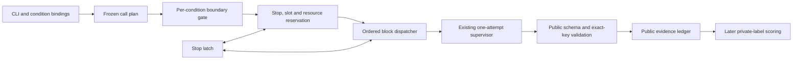

# Evaluation harness architecture

## TL;DR

- This is a typed architecture proposal for a small fixed-call-list Evaluation
  harness.
- It is not implemented and completes no acceptance criterion.
- It adds only an architecture view and a design interface at
  [`design/evaluation_harness.pyi`](design/evaluation_harness.pyi).
- The existing [protocol](protocol.md) owns the call matrix, budgets, retry
  eligibility, and reporting rules.
- This proposal authorizes no calls, corpus preparation, baseline measurement,
  scoring, or production wiring.

## Services

- The **CLI binding** resolves the executable and records its version without
  deciding whether a particular effort is supported.
- The **frozen plan** names every strategy, effort, repetition, session, and
  prepared input, and persists exact public prompt, source, instruction, and
  configuration bytes with their digests and expected assessment keys.
- The **condition gate** checks independently retained preparation evidence
  against each frozen CLI, input, configuration, and tool binding; an effort
  gap skips only its condition, while unresolved shared protection refuses
  launch and a detected protection breach globally stops dispatch.
- The **preflight and resource ledger** validate the frozen positive integer
  concurrency cap, check the whole base plan, and atomically reserve a slot,
  stop check, time, raw usage allowance, and evidence capacity for each
  dispatch against active and remaining reservations.
- The **dispatcher** runs conditions and strategies in protocol order, keeps
  each attempt's slot and reservations through cleanup, and retries only when
  the predecessor cleanup is confirmed safe and the protocol permits it.
- The **supervisor boundary** imports the existing `AttemptRunner` and
  `call_supervisor` contracts; it owns one process attempt and cleanup, while
  the harness owns retry, cancellation policy, and planned-call accounting.
- The **public evidence ledger** persists frozen inputs and provenance, every
  attempt and cleanup observation, valid public results, terminal call states,
  stop information, and run summary without storing private labels or prior
  answers.
- The **later scoring consumer** reads validated public results and separately
  uses the private reference material for owner scoring and adjudication.

### Composition and guarantees

The evaluation entry point supplies the supervisor call, stop hook, configured
resource ledger, evidence sink, and clock to one small coordinator.

#### Ownership

The coordinator owns the following:

- Its active-task registry.
- Protocol order and per-condition verification.
- Retries and exactly-once terminal accounting.
- Cancellation and awaiting of active tasks on global stop.
- Settlement of resource leases only after cleanup on global stop.

The resource ledger owns:

- Bounds and base reservations.
- Atomic slot and resource accounting.
- Task cancellation and process cleanup remain outside its ownership.

The supervisor owns process acquisition, deadlines, output limits, and cleanup.
Its existing process lifecycle limitations remain documented in the
[supervisor contract](process-supervisor/README.md).

#### Identities and validation

The plan freezes the following identities and digests:

- Expected rule, file, and qualified-function triples.
- The exact prompt, input, and session identity.
- Source, instruction, and configuration digests.

Responses bind the session, strategy, and prepared input to the frozen
identity. Effort comes only from trusted issued-session metadata. Model
self-report does not establish effort.

The validator applies these checks:

- It accepts only retained raw output bytes.
- It decodes and checks the schema and identities.
- It checks for duplicate keys before mapping results.
- Malformed, stale, incomplete, duplicate, foreign, or missing results produce
  a typed refusal.
- A typed refusal cannot count as a pass or be retried.
- Each assessment retains one of `PASS`, `VIOLATION`, `NOT_APPLICABLE`, or
  `UNCERTAIN`.
- Each assessment retains an explanation and any violation locations,
  quotations, and consequences.

This validates schema and identity only. Private-label comparison and
independent evidence adjudication remain later operations.

#### Concurrency and dispatch

The concurrency cap has these rules:

- It is a frozen run setting supplied through the library argument.
- It defaults to one.
- It must be a positive integer, and booleans are not accepted.
- It applies across matched strategies and efforts.
- It is validated before calls can be issued.
- It applies only to distinct calls in the current strategy, effort, and
  repetition block.

Strategy A naturally offers one call. Strategy B offers three calls, and
strategy C offers 24. The protocol fixes the strategy, effort, and repetition
barriers.

Dispatch follows these rules:

- Initial attempts follow the frozen call order.
- Before dispatch, one atomic reservation couples stop inspection, slot
  acquisition, and resource reservations.
- Reservations are released only after cleanup.
- A retry reserves fresh capacity after its predecessor's cleanup.
- A retry never overlaps its predecessor.
- Concurrent terminal events are evaluated in frozen call order for the
  consecutive-failure rule.
- A global stop cancels and awaits active calls.
- A global stop preserves terminal accounting for every planned call.
- A global stop prevents further dispatch.

#### Resource estimates and accounting

Per-call estimates record their value, method, and version. Resource accounting
follows these rules:

- Unknown usage is never treated as zero.
- Under the protocol, dispatch requires a conservative raw-ceiling reservation
  that includes active attempts and calls still planned.
- If that reservation cannot be made, the call and remaining calls retain
  incomplete accounting.
- The ledger records observed utilization, wall time from run launch through
  final cleanup, and summed attempt duration separately.
- No estimate claims a hard provider token cap.
- Budgets continue to use raw observed consumption.
- Only protocol-matched measured baselines support adjusted reports.

#### Condition verification

The condition gate consumes authorized, retained preparation evidence. That
evidence is bound to the following:

- The exact CLI version and model.
- The calibration input and configuration.
- The surfaced tools and condition.

The gate does not launch a calibration call. Its verification outcomes follow
these rules:

- An unverified effort produces a skip scoped to its condition.
- Other independently verified conditions may proceed unless a global stop
  applies.
- A detected breach of shared source, label, or prior-answer protection
  globally stops dispatch.
- Without required proof, the gate refuses the recorded condition or run
  scope.
- Unavailable opaque runtime-context observations remain disclosed as
  unavailable and do not count as verified isolation.

The gate retains exact source and configuration bindings, model and
effective-effort observations, and references to concrete boundary checks.
Source protection requires all of the following:

- An enforceable allow-listed input boundary.
- Read-only source access.
- Attempted-read and attempted-write checks.

Private labels and prior answers remain in a separate scoring store that the
invocation boundary cannot access. A prompt instruction or static render cannot
establish that separation. Until these controls and actual invocation
observations are verified, the gate refuses affected trial launches. The
accepted CLI tool/context limitation is recorded. It does not itself prove
source or label protection.

#### Preflight

Preflight refusal produces no launch. The accepted preflight receipt binds the
following:

- The plan digest and exact bounds.
- Frozen concurrency and base reservations.

Dispatch requires that receipt to match the supplied run exactly. The resource
ledger is configured from that run, bounds, and receipt before any dispatch.

#### Evidence and design limits

Cancellation and escaping exceptions are captured as typed evidence snapshots
with available supervisor cleanup observations. Evidence handling follows these
rules:

- The stop latch is set before evidence is persisted.
- The original cancellation or exception is then re-raised.
- A persistence failure is retained as an evidence-incomplete stop.
- A persistence failure does not replace control flow.
- Evidence includes an append-only plan record.
- Evidence includes all attempt snapshots and raw usage.
- Evidence includes validated public results.
- Evidence includes one final state per planned call.
- Evidence includes a stop record and a resource and time summary.
- Private labels, rationales, and prior answers never enter these artifacts.

Static types describe ownership and required fields. They do not establish
effective effort, read-only access, label separation, process cleanup, or
accounting behavior. Those guarantees require the protocol's controlled
boundary checks and invocation evidence before launch. The design does not
claim that the accepted CLI limitation is resolved or that the Evaluation's
TODO criteria are complete.
