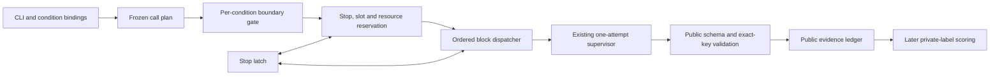

# Evaluation harness architecture

**TL;DR:** This is a typed architecture proposal for a small fixed-call-list
Evaluation harness; it is not implemented and completes no acceptance
criterion. It adds only an architecture view and a design interface at
[`design/evaluation_harness.pyi`](design/evaluation_harness.pyi). The existing
[protocol](protocol.md) owns the call matrix, budgets, retry eligibility, and
reporting rules; this proposal authorizes no calls, corpus preparation,
baseline measurement, scoring, or production wiring.

## Services

- The **CLI binding** resolves the executable and records its version without
  deciding whether a particular effort is supported.
- The **frozen plan** names every strategy, effort, repetition, session, and
  prepared input, and persists exact public prompt, source, instruction, and
  configuration bytes with their digests and expected assessment keys.
- The **condition gate** checks independently retained preparation evidence
  against each frozen CLI, input, configuration, and tool binding; an effort
  gap skips only its condition, while unresolved shared protection refuses
  launch and a detected protection breach globally stops dispatch.
- The **preflight and resource ledger** validate the frozen positive integer
  concurrency cap, check the whole base plan, and atomically reserve a slot,
  stop check, time, raw usage allowance, and evidence capacity for each
  dispatch against active and remaining reservations.
- The **dispatcher** runs conditions and strategies in protocol order, keeps
  each attempt's slot and reservations through cleanup, and retries only when
  the predecessor cleanup is confirmed safe and the protocol permits it.
- The **supervisor boundary** imports the existing `AttemptRunner` and
  `call_supervisor` contracts; it owns one process attempt and cleanup, while
  the harness owns retry, cancellation policy, and planned-call accounting.
- The **public evidence ledger** persists frozen inputs and provenance, every
  attempt and cleanup observation, valid public results, terminal call states,
  stop information, and run summary without storing private labels or prior
  answers.
- The **later scoring consumer** reads validated public results and separately
  uses the private reference material for owner scoring and adjudication.

### Composition and guarantees

The evaluation entry point supplies the supervisor call, stop hook, configured
resource ledger, evidence sink, and clock to one small coordinator; the
coordinator owns its active-task registry, protocol order, per-condition
verification, retries, and exactly-once terminal accounting. On global stop,
the coordinator cancels and awaits active tasks, then settles their resource
leases only after cleanup. The resource ledger owns bounds, base reservations,
and atomic slot/resource accounting, not task cancellation or process cleanup.
The supervisor owns process acquisition, deadlines, output limits, and cleanup,
and its existing process lifecycle limitations remain documented in the
[supervisor contract](process-supervisor/README.md).

The plan freezes expected triples of rule, file, and qualified function, plus
the exact prompt/input/session identity and source, instruction, and
configuration digests. Responses bind session, strategy, and prepared input to
that identity; effort comes only from trusted issued-session metadata, never
model self-report. The validator accepts only retained raw output bytes,
decodes and checks the schema and identities, then checks duplicate keys before
mapping. Malformed, stale, incomplete, duplicate, foreign, or missing results
return a typed refusal that cannot be treated as a pass or retried. Each
assessment retains one of `PASS`, `VIOLATION`, `NOT_APPLICABLE`, or `UNCERTAIN`,
an explanation, and any violation locations, quotations, and consequences.
This is schema and identity validation only; private-label comparison and
independent evidence adjudication remain later operations.

The configured concurrency cap is a frozen run setting supplied through the
library argument, defaults to one, and must be a positive integer that excludes
booleans. The same cap applies across matched strategies and efforts and is
validated before calls can be issued. It applies only to distinct calls within
the current strategy/effort/repetition block; A naturally offers one call,
while B and C offer three and 24. Strategy, effort, and repetition barriers
remain fixed by the protocol. Initial attempts follow the frozen call order. An
atomic reservation couples stop inspection, slot acquisition, and resource
reservations before dispatch; settlement releases them only after cleanup.
Retries reserve fresh capacity after predecessor cleanup and never overlap
their predecessor. Concurrent terminal events are evaluated in frozen call
order for the consecutive-failure rule. Global stop cancels and awaits active
calls, preserves every planned call's terminal accounting, and prevents further
dispatch.

Per-call estimates record value, method, and version. Unknown usage is never
treated as zero: a dispatch needs a conservative raw-ceiling reservation under
the protocol, including active attempts and calls still planned; if that
reservation cannot be made, the call and remaining calls retain incomplete
accounting. The ledger records observed utilization, wall time from run launch
through final cleanup, and summed attempt duration separately. No estimate
claims a hard provider token cap; budgets continue to use raw observed
consumption and only protocol-matched measured baselines support adjusted
reports.

The condition gate consumes authorized, retained preparation evidence bound to
the exact CLI version, model, calibration input, configuration, surfaced tools,
and condition; it does not launch a calibration call. An unverified effort
produces a condition-scoped skip while other independently verified conditions
may proceed unless a global stop applies. A detected shared source, label, or
prior-answer protection breach globally stops dispatch; absent required proof
refuses its recorded condition or run scope. An unavailable opaque
runtime-context observation remains disclosed as unavailable and does not count
as verified isolation. The gate retains exact source/config bindings, model and
effective-effort observations, and references to concrete boundary checks.
Source protection requires an enforceable allow-listed input boundary with
read-only source access and attempted-read/write checks. Private labels and
prior answers remain in a separate scoring store unavailable to the invocation
boundary; a prompt instruction or static render cannot establish that
separation. Until these controls and actual invocation observations are
verified, the gate refuses affected trial launches. The accepted CLI
tool/context limitation is recorded, and does not itself prove source or label
protection.

Preflight refusal produces no launch. Its accepted receipt binds the plan
digest, exact bounds, frozen concurrency, and base reservations; dispatch
requires that receipt to match the supplied run exactly. The resource ledger is
configured from that run, bounds, and receipt before any dispatch.

Cancellation and escaping exceptions are captured as typed evidence snapshots
with available supervisor cleanup observations. The stop latch is set before
evidence persistence; the original cancellation or exception is then
re-raised, and persistence failure is retained as an evidence-incomplete stop
without replacing control flow. Evidence includes an append-only plan record,
all attempt snapshots and raw usage, validated public results, one final state
per planned call, stop record, and resource/time summary; private labels,
rationales, and prior answers never enter these artifacts.

Static types describe ownership and required fields but do not establish
effective effort, read-only access, label separation, process cleanup, or
accounting behavior. Those guarantees require the protocol's controlled
boundary checks and invocation evidence before launch. The design does not
claim the accepted CLI limitation is resolved or that the Evaluation's TODO
criteria are complete.
