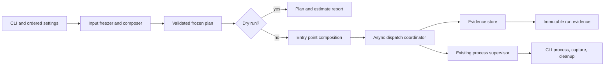

# Generic evaluation harness architecture

**Status: exploratory proposal for the generic harness Work.** The Work
contract in [README.md](README.md) owns behavior and acceptance. This proposal
does not authorize implementation or model calls. The sibling
[process supervisor](../process-supervisor/README.md) is implemented and owns
one attempt's process lifecycle; this harness owns plans, dispatch policy, and
run evidence around that boundary.

## TL;DR

- The CLI turns ordered options into one validated, frozen plan before any
  Codex process can start.
- The harness composes exact tracked source bytes and keeps token estimation as
  a replaceable library port until implementation selects a package.
- An async coordinator owns run order, concurrency, stop latching, retries, and
  not-started accounting while calling the existing supervisor once per
  attempt.
- An exclusive evidence store writes immutable run, call, and attempt records;
  persistence failure stops dispatch and leaves the run incomplete.
- Configuration and persisted records use strict, immutable Pydantic models at
  their boundaries; domain decisions and effects stay outside validators.
- Call identity describes effective inputs. Run identity and scheduled
  positions preserve repeated entries and manually selected reruns.
- This boundary stores observations and generic usage telemetry only. The
  caller owns experiment protocol, budgets across runs, ordering claims, and
  interpretation.

## Proposed components

### CLI and ordered settings

**TL;DR:** Parse the public options and preserve their order and positions.

- The CLI owns repeated directory, model, effort, and separator arguments,
  positive concurrency, output destination, and dry-run mode.
- It turns separators into directory-boundary values only after validating
  exactly one separator per boundary; omitted values mean two LF bytes.
- It rejects missing required values and invalid combinations before handing
  control to preparation.
- Dry run follows preparation and planning but does not create output or invoke
  Codex. It may report token estimates when the estimator can identify their
  method and compatibility.
- Effects: argument parsing and diagnostic output only; it does not perform
  Git, source, process, or evidence effects itself.

### Input freezer and prompt composer

**TL;DR:** Resolve and freeze the exact tracked inputs used by every planned
call.

- This component resolves one repository root and HEAD for all inputs, checks
  the checkout and tracked-file membership in batches, and rejects paths that
  escape the repository or traverse symbolic links.
- It selects immediate regular files in lexical order, strictly decodes UTF-8,
  and compares each selected snapshot with the corresponding commit blob before
  dispatch.
- It composes unchanged source bytes in directory-argument order with the
  selected boundary bytes, then records ordered paths, source digests, prompt
  digests, commit provenance, and separator bytes.
- The plan retains the snapshots and sends those frozen bytes to each
  invocation; execution never re-reads mutable source files.
- Effects: read-only Git subprocesses and filesystem reads. No CLI process or
  output writes are permitted during preparation.

### Plan and boundary records

**TL;DR:** Represent validated settings and frozen work as immutable values.

- The plan records the ordered Cartesian product of selected files, model, and
  effort, including duplicate scheduled positions as distinct entries.
- Frozen dataclass values represent internal source, prompt, call, run, and
  attempt concepts. Pydantic models validate and serialize configuration and
  persisted records, rejecting extra fields at those raw-data boundaries.
- Validators check value constraints only. Git checks, file reads, estimates,
  directory creation, and process execution belong to explicit operations.
- Effective-call identity includes ordered content and all settings that can
  change the invocation. A separate run identity and position distinguish
  repetitions and scheduled duplicates. A manual subset is a new run; there is
  no prior-output scan or implicit resume.
- Effects: none. These values describe decisions and observations but do not
  perform them.

### Token estimate port

**TL;DR:** Keep estimation separate from planning and execution.

- A small consumer-owned port accepts exact composed bytes and the requested
  model and returns an estimate with method, library and tokenizer versions,
  and compatibility status.
- The concrete token library is deferred to implementation. Unsupported model
  compatibility is reported as unknown or approximate, never as billing
  precision.
- Estimates cover supplied composed context only; unavailable automatic CLI or
  system context is excluded and labeled.
- Effects: local computation only. The port cannot call the model CLI or change
  the frozen prompt.

### Async dispatch coordinator

**TL;DR:** Own all planned-call and retry policy around one supervisor attempt
at a time.

- The coordinator walks the frozen plan in order, holds a semaphore slot until
  an attempt and its cleanup settle, and calls the supervisor's public
  `call_supervisor` boundary with a caller-owned stop hook.
- It owns process signal handlers, a stop latch, retry eligibility and count,
  and explicit accounting for calls that never started. Finite execution,
  cleanup, grace, output, retry, and concurrency settings are supplied from
  validated configuration, not hidden protocol constants.
- The default retry count is zero. Only declared infrastructure outcomes can
  be eligible; a completed zero-exit result is never retried based on output
  content. Nonzero exits require explicit caller opt-in and are still not
  evidence that no semantic result exists. Cancellation, overflow, uncertain
  acquisition, unsafe cleanup, or recording failure never retries.
- The stop hook latches stop before any fallible recording. Dispatch checks the
  latch before each call. No later attempt starts until prior cleanup permits
  dispatch; cancellation stops new work and waits for bounded supervisor
  cleanup.
- Stop reasons and partial observations remain evidence on the original control
  flow. The coordinator classifies process outcomes but does not parse reviewer
  answers or assign semantic meaning to output.
- Effects: async tasks, semaphore, process signal registration, and calls to
  the existing supervisor. It does not own subprocess creation or cleanup.

### Evidence store

**TL;DR:** Preserve each run, planned call, and attempt without replacing prior
evidence.

- The store exclusively creates a new output directory, after confirming its
  location is outside the input repository or ignored there.
- It writes finalized metadata and exact stdout and stderr bytes as separate,
  immutable artifacts. Empty output, unavailable output, partial output, and
  unavailable usage remain distinct; observed exit, termination, cleanup,
  timestamps, and available telemetry retain their source and units.
- Each write is atomic at its artifact boundary. If recording fails, the run is
  incomplete, the stop latch is set, and remaining planned calls stay marked
  not started. A recording failure after an attempt does not replace that
  attempt's original exception or cancellation; if no earlier failure is
  active, the recording error is returned as the run failure. The store does
  not fabricate a successful record.
- A small optional telemetry extractor may preserve generic usage fields while
  retaining raw stdout. It does not validate answer schemas, parse reviewer
  verdicts, inspect labels, or score results.
- Effects: exclusive directory creation and evidence writes. It never scans
  prior runs or overwrites them.

### Entry point composition

**TL;DR:** Wire adapters once and keep policy in the coordinator.

- The entry point connects CLI settings, input preparation, the selected token
  estimator, coordinator, supervisor adapter, and evidence store.
- It resolves and records the absolute Codex executable and observable
  invocation settings during execution. It does not perform live CLI version
  probes in dry-run mode.
- The existing `script/process_supervisor.py` remains a separate dependency:
  its `AttemptRunner` owns one attempt, while `call_supervisor` forwards the
  outcome and invokes the harness-owned `DispatchStop` hook when cancellation
  or unsafe cleanup requires stopping.
- The composition root owns concrete adapters; domain modules depend on their
  consumer-facing ports. No generic plugin registry or scheduler framework is
  proposed.
- Effects: connects the effects listed above and exposes the CLI entry point.

## Proposed flow

The diagram shows proposed harness boundaries. The existing supervisor and its
OS adapter are the only implemented service shown; the remaining boxes are
exploratory. The token estimator is an optional local port used during
preparation and is omitted from the execution path for clarity.

## Type boundary

The adjacent [typed interface](design/evaluation_harness.pyi) sketches only
shared values and the consumer-facing ports needed to review ownership and
effects. It is exploratory, is not importable runtime API, and intentionally
leaves private helpers and concrete persistence formats flexible. It does not
replace or redeclare the supervisor's types.
