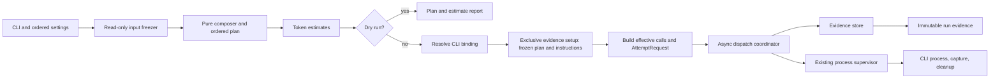
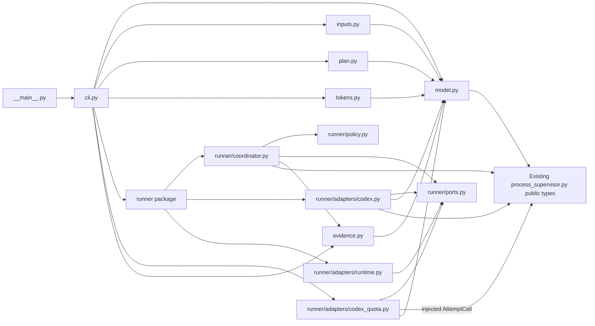

# Generic evaluation harness architecture

**Status: current view for the generic harness Work.** The Work contract in
[README.md](README.md) owns behavior and acceptance. The shared model records
are implemented in
[`script/eval/model.py`](../../../../../../script/eval/model.py), and the input
freezer is implemented in
[`script/eval/inputs.py`](../../../../../../script/eval/inputs.py). Pure
orchestration wiring is implemented in
[`script/eval/plan.py`](../../../../../../script/eval/plan.py), including
grouping, separator decoding, exact-byte composition, and deterministic matrix
expansion. The token estimator and dry-run report builder are implemented; CLI
integration, dispatch, and persistence remain planned. No implementation
authorizes model calls. The sibling
[process supervisor](../process-supervisor/README.md) is
implemented and owns one attempt's process lifecycle; this harness owns plans,
dispatch policy, and run evidence around that boundary.

The planned quota wait, model-capacity retry, and standalone-invocation
amendments are owned by
[AC-6](README.md#ac-6-todo-optional-quota-waiting-preserves-the-active-run),
[AC-7](README.md#ac-7-todo-optional-model-capacity-retries-use-bounded-backoff),
and
[AC-8](README.md#ac-8-todo-standalone-invocation-supports-external-execution).
The typed sketches below describe the proposed policy boundary for those
amendments; they do not establish recognition rules, a Codex reset API, or
implemented behavior. The captured exec quota observation does not identify a
machine-readable source for reset times, and the capacity report does not
establish a CLI recognition signal. Until investigation verifies those sources,
adapters return explicit unknown or unavailable results and the coordinator
fails closed. All ACs remain TODO.

## TL;DR

- The CLI turns ordered options into one validated, frozen plan before any
  Codex process can start.
- The harness composes exact tracked source bytes and estimates them through an
  implemented provider-neutral port and `tiktoken` adapter.
- An async coordinator owns run order, concurrency, stop latching, separate
  infrastructure, quota, and capacity policies, and not-started accounting
  while calling the existing supervisor once per attempt.
- An exclusive evidence store writes immutable run, call, and attempt records;
  persistence failure stops dispatch and leaves the run incomplete.
- Configuration and persisted records use strict, immutable Pydantic models at
  their boundaries; domain decisions and effects stay outside validators.
- Call identity describes effective inputs. Run identity and scheduled
  positions preserve repeated entries and manually selected reruns.
- This boundary stores observations and generic usage telemetry only. The
  caller owns experiment protocol, budgets across runs, ordering claims, and
  interpretation.

## Proposed components

### CLI and ordered settings

**TL;DR:** Parse the public options and preserve their order and positions.

- The CLI owns repeated directory, model, effort, and separator arguments,
  positive concurrency, output destination, dry-run mode, and optional
  `-i FILE` / `--instructions-file FILE`.
- CLI help states that the flag freezes the selected file and passes its staged
  path to Codex using `-c model_instructions_file=PATH`. It replaces Codex's
  native system instructions for that call; it does not add the file to generic
  context directories.
- It turns separators into directory-boundary values only after validating
  exactly one separator per boundary; omitted values mean two LF bytes.
- It rejects missing required values and invalid combinations before handing
  control to preparation.
- Dry run follows preparation and planning but does not create output or invoke
  Codex. It may report token estimates when the estimator can identify their
  method and compatibility.
- Effects: argument parsing and diagnostic output only; it does not perform
  Git, source, process, or evidence effects itself.

### Input freezer

**Implemented:**
[`script/eval/inputs.py`](../../../../../../script/eval/inputs.py) provides the
`RepositoryReader` port and `GitRepositoryReader` adapter. It requires all
inputs to resolve to one non-bare worktree, checks the whole checkout for
staged, unstaged, and untracked changes, and batches tracked-file and
commit-blob queries. It selects immediate regular files in lexical order
without recursion, requires each context directory to contain an immediate
regular file, and strictly decodes selected bytes as UTF-8. Symlink aliases and
parent components in context-directory paths are resolved normally; selected
file entries and the final instructions-file entry must be regular
nonsymlinks, while symlinked directory entries are skipped. A root-directory
context skips the linked-worktree `.git` administrative file. Read bytes must
exactly match pinned commit blobs; filter or line-ending transformations are
reported as mismatches. Empty files are preserved. Instructions remain a
distinct snapshot. Git commands have a finite timeout, use a deterministic
locale, clear all inherited `GIT_*` variables before setting owned Git
environment, and disable replacement objects, ambient global/system config,
fsmonitor, optional index locks, and promisor lazy-fetches. The explicit global
`--no-lazy-fetch` option makes unsupported Git versions fail rather than
silently allowing missing-object fetches. The freezer performs no writes or
model calls. The reviewed
[`inputs.pyi`](design/eval/inputs.pyi) remains the historical port definition.

**TL;DR:** Resolve and freeze exact tracked source bytes; leave composition to
the pure planner.

- This component resolves one repository root and HEAD for all inputs, checks
  the checkout and tracked-file membership in batches, and rejects paths that
  escape the repository.
- It selects immediate regular files in lexical order, strictly decodes UTF-8,
  skips symlinked directory entries, and compares exact selected bytes with
  their corresponding commit blobs before dispatch.
- A configured instructions file passes the same repository containment,
  clean-checkout, tracked-file, strict UTF-8, and commit-blob checks. Its bytes,
  repository path, blob SHA, and content digest form a separate
  `InstructionsSnapshot`; no context file receives an instruction role.
- When the flag is omitted, the plan records that no instruction file was
  configured. Codex keeps its default system instructions, whose automatic
  bytes are unavailable to the harness; omission does not mean there is no
  system context.
- It returns the repository root, HEAD, ordered context snapshots, and the
  optional separately typed instructions snapshot.
- Effects: read-only Git subprocesses and filesystem reads. It does not compose
  prompts or make plans. No CLI process or output writes are permitted during
  preparation.

### Plan and boundary records

**Implemented pure planner:**
[`script/eval/plan.py`](../../../../../../script/eval/plan.py) invokes typed
grouping, context-composition, and call-scheduling functions in order. The
context composer receives grouped source indices and `FrozenInputs`, so it can
read exact frozen context bytes without hidden state or I/O. It does not
compose the optional instructions-file snapshot; the builder forwards that
snapshot separately into `FrozenPlan`. The builder assembles the plan while
forwarding the validated configuration and frozen input provenance. Its public
`PlanBuilder.plan(FrozenInputs,
HarnessConfig)` boundary is pure. A caller supplies `run_id` to the concrete
builder, so identity creation remains caller-owned and planning does not read a
clock, generate randomness, or perform I/O. Grouping preserves configured
directory positions and frozen source order, including repeated directory
options. Composition selects one source per directory in Cartesian order,
uses default two-LF or decoded explicit separator bytes, and hashes scheduled
prompt bytes. Scheduling expands each context over models and efforts in
argument order, preserving repeated entries as distinct zero-based positions.
No implicit headers or instruction bytes enter prompts. This planner behavior
does not establish the CLI matrix, estimate, dispatch, or evidence criteria.
The reviewed type sketch in
[`design/eval/plan.pyi`](design/eval/plan.pyi) is retained as historical
reference; the runtime module is authoritative.

**TL;DR:** Represent validated settings and frozen work as immutable values.

- A pure composer and planner join the frozen source bytes with the ordered
  boundary bytes, then build the Cartesian product of contexts, models, and
  efforts. Duplicate scheduled positions remain distinct.
- The plan records source paths and digests, prompt digests, commit provenance,
  exact separator bytes, and the strict immutable CLI configuration that
  produced them. Ordered option events preserve which separators were explicit;
  omission remains distinguishable from an explicit two-LF separator. The
  configuration also retains concurrency, retry, deadline, grace, and output
  limits. Execution uses these snapshots and never re-reads mutable source
  files.
- Frozen dataclasses represent in-memory preparation and invocation values.
  Pydantic boundary models cover configuration, ordered option events, source
  snapshots, planned calls, the frozen plan, and persisted records. They use
  `ConfigDict(extra="forbid", strict=True, frozen=True)`; nested settings are
  tuples and immutable scalar or byte values rather than mutable mappings.
- Configuration validation enforces unique increasing option positions,
  separator placement and supported escapes, required matrix and output
  settings, and numeric bounds. Typed immutable plan and record schemas retain
  their declared field shapes and serialize the producer's values losslessly;
  they do not recheck producer relationships or recompute producer digests.
  Attempt timestamps and outcome fields preserve raw observations, while
  monotonic elapsed time remains the duration source because wall-clock time
  can move backwards.
- The external input operation owns Git checks, selected-file checks, and
  snapshot digest calculation. Filesystem effects, estimates, directory
  creation, and process execution also belong to explicit operations rather
  than model validators.
- A scheduled position has no effective-call identity until execution resolves
  its CLI binding and invocation settings. The effective identity then includes
  ordered content, exact instruction bytes, model, effort, executable/version,
  and all other settings that can change the invocation. Run identity and
  position distinguish repetitions and duplicate positions. A manual subset
  is a new run; there is no prior-output scan or implicit resume.
- Effects: none. These values describe decisions and observations but do not
  perform them.

### Token estimate port

**TL;DR:** Keep estimation separate from planning and execution.

- **Implemented:** `script/eval/tokens.py` defines the consumer-owned
  `TokenEstimator` port, the `tiktoken` adapter, and a pure report builder. The
  report uses each scheduled call's exact frozen prompt bytes and model,
  retains repeated positions, and estimates configured instruction bytes
  separately. Omitted instructions produce no estimate for unavailable
  automatic system bytes. CLI binding and effective call identities remain
  explicitly unknown in the dry-run record.
- The adapter uses tiktoken's declared exact model table and prefix table. Exact
  table matches are labeled exact for encoding selection; prefix matches are
  approximate because the library notes they can match nonexistent model
  names. Unknown models and known mappings to unavailable encodings return
  `token_count=None` with diagnostics. The method records the encoding name and
  library version; tiktoken exposes no independent vocabulary version, so
  `tokenizer_version` remains unknown. Counts use ordinary-text encoding, so
  strings resembling special tokens remain literal text. Counts exclude model
  message framing and other request overhead and do not claim billing accuracy.
- GPT-6 family names (`gpt-6`, `gpt-6-*`, and numeric minor forms such as
  `gpt-6.1-sol`) explicitly use the canonical `gpt-5.6` tiktoken mapping as an
  approximate surrogate, even if tiktoken later adds a GPT-6 mapping. The
  estimate retains the requested model name and diagnoses the surrogate and
  the absence of framing or billing guarantees. This is a practical estimate,
  not an authoritative GPT-6 tokenizer mapping.
- A dry-run report contains one estimate for every scheduled call. Unsupported
  model compatibility is explicit unknown or approximate, never an omitted
  estimate or billing precision.
- Estimates cover supplied composed context only; unavailable automatic CLI or
  system context is excluded and labeled. If no instructions file is
  configured, the report says Codex defaults are preserved and their automatic
  bytes are unavailable; it does not report that no system instructions exist.
- A configured instructions file receives its own separately labeled estimate;
  it is never folded into the supplied-context count without its basis being
  disclosed.
- Effects: local computation plus tiktoken's native vocabulary bootstrap. A
  cache miss can download tokenizer data and write it to tiktoken's cache; this
  effect is documented and does not call the model API or CLI or write harness
  output or evidence. The adapter cannot change the frozen prompt. This wiring
  does not establish dry-run CLI behavior.

### CLI binding and request construction

**TL;DR:** Bind runtime settings to frozen call bytes and build the exact
supervisor request.

- Execution resolves the absolute Codex path and observable CLI version and
  settings after the dry-run branch through `runner.adapters.codex`, without
  probing the CLI during dry run.
- The Codex adapter implements the consumer-owned `AttemptRequestBuilder` port.
  Its builder consumes the frozen plan and scheduled call, the resolved
  binding, and the staged instruction path returned by evidence preparation.
  When configured, it passes that path to Codex as
  `-c model_instructions_file=PATH`; when omitted, it adds no override and
  leaves Codex's native system instructions in place. It then returns an
  effective-call identity and `AttemptRequest`.
- The builder is pure: the plan supplies run identity and ordered frozen
  inputs, the binding supplies runtime settings, and the evidence result
  supplies the staged path. It hashes those effective inputs without opening
  the staged file or original source path.
- When runtime binding is unavailable during dry run, the report marks its
  binding and effective-call identity unknown. It may show a plan identity,
  clearly labeled as such, but never as the effective invocation identity.
- Effects: the binding resolver performs execution-time CLI path/version
  probes. Request construction has no I/O. Dry run uses neither probe nor
  request construction.

### Async dispatch coordinator

**TL;DR:** `runner.coordinator` runs independent calls concurrently while
gating retries and stopping globally on unsafe outcomes.

- The coordinator schedules calls in plan order under one concurrency limit.
  Distinct planned calls may execute concurrently; completion order does not
  change their identity or evidence association.
- A retry belongs to its call and starts only after that call's previous
  attempt cleanup permits dispatch. Cancellation, overflow, uncertain
  acquisition, unsafe cleanup, or recording failure latches a global stop and
  prevents any later dispatch.
- Ordinary infrastructure and model-capacity retry allowances are separate
  finite policies and both default to zero. Quota waiting defaults off; its
  cumulative duration bound is optional and finite positive when supplied. A
  recognized retry category cannot bypass its own allowance through another
  retry category.
- A classifier consumes structured supervisor observations and only explicitly
  verified CLI evidence. It returns infrastructure, quota, capacity, other,
  or unknown with its evidence basis. It never interprets answer content,
  treats a nonzero exit as proof of no semantic result, or treats a capacity
  message alone as retry eligibility. Unknown recognition fails closed.
- The current harness resolves one Codex CLI binding shared by every planned
  call, so verified Codex quota exhaustion stops new dispatch globally, settles
  active attempts through bounded cleanup, persists their evidence, releases all
  slots, then consults the quota-status port. An observation carries an opaque
  provider/account-allowance scope and provider-neutral window IDs, states,
  reset times, and sources. The Codex adapter owns completeness for its required
  five-hour and weekly windows; a missing or malformed one is emitted as unknown
  or unavailable, never omitted or guessed. The core does not interpret window
  IDs: absent or mismatched scope, empty observations, and unknown or
  unavailable states cannot establish exhaustion or availability. A known
  exhausted window without a numeric reset still pauses dispatch and uses
  periodic checks; it simply has no earlier reset hint. The latest relevant
  exhausted-window reset is a scheduling hint, not a timer that authorizes
  resume. A finite cumulative wait bound includes earlier paused intervals
  across checks, including checks performed while paused, but not active-period
  monitoring. Without a configured bound, an explicitly enabled run may remain
  paused through successive periodic checks. Every retry is gated again on
  current quota state.
- The composition pairs the Codex request path and settled-output classifier
  with a quota reader configured for the same CLI binding scope. The external
  binding adapter creates a `QuotaScope` only from verified provider and
  allowance identity; otherwise the binding scope is absent. Once a source is
  verified, the Codex quota adapter validates its reported identity against
  that expected scope; missing or mismatched identity yields an unscoped,
  inconclusive observation. The coordinator trusts these internal typed values
  and compares scope equality; it does not parse account identifiers. Persisted
  scope identifiers are opaque and nonsecret, never raw account names,
  credentials, or tokens. The current source format and identity evidence are
  unresolved, so these validation boundaries remain planned and fail closed.
- A later mixed-provider runner could pause only calls sharing a blocked quota
  scope. That is not the current AC-6 behavior: the single Codex binding keeps
  the pause global, and this design adds no provider registry or CLI provider
  selection.
- With quota waiting enabled, the coordinator owns one lifecycle-managed async
  polling task. A finite positive interval controls periodic checks; an earlier
  numeric hint from the latest relevant exhausted-window reset may schedule a
  check sooner, but never authorizes dispatch. Missing, stale, or past hints
  fall back to the interval. Enabling quota waiting explicitly authorizes
  checks; an absent count cap adds no harness probe-count limit, a positive cap
  is enforced, and zero refuses probe dispatch. Default-off execution and dry
  run perform neither probes nor session reads. One monitor task owns one
  sleep/check cycle at a time: hints shorten the next cycle instead of creating
  a parallel reset timer. The monitor runs during active and paused periods,
  allows one probe in flight, and uses no evaluation semaphore slot. Quota
  exhaustion first pauses dispatch whether first observed in an evaluation or
  poll, then settles active attempts; no new probe starts until their evidence
  is durable, while an already-running supervised probe must settle. Each pause
  has a stable wait ID captured by probes started to confirm it. A probe started
  before that pause, including an active-period probe, may settle and persist
  but cannot reopen the newer pause; completion time or a later source read does
  not make its result eligible.
- The consumer-owned quota port separates passive settled-attempt ingestion
  from active polling. Passive ingestion returns an observation; `poll` performs
  one separate supervised invocation. The Codex adapter privately correlates
  captured `thread.started` evidence to its session and owns request
  construction, the existing public supervisor call, and normalization. Thread
  identifiers stay inside that adapter; the port and evidence events retain the
  generic observation with sanitized source coordinate, producer timestamps,
  and source sequence. Both paths produce generic scoped observations, and the
  coordinator stores passive observations with their call/attempt identity and
  checks scope against the bound run. The core never parses CLI output or
  session files. The source adapter orders
  evidence before returning it, so delayed older availability cannot replace
  newer exhaustion; unknown or mismatched scope, missing windows, stale source,
  or malformed data fails closed. This ordering and freshness boundary awaits
  verified source rules.
- Each active check has a separate `QuotaProbeId` and append-only start and
  settled evidence. The settled record combines shared `ProcessRecord` fields
  (request settings, process start/end, timing basis, exit/termination, cleanup,
  raw-stream artifact references, usage, and error type/diagnostic) with probe
  identity, quota state, and observation. `ProcessRecord.outcome_kind` keeps
  timeout, overflow, cancellation, errors, no observation, and no launch
  distinct; none implies availability. The probe's coordinator
  `poll_started_at_utc` remains distinct from supervisor process start time.
  Passive evaluation telemetry is also appended separately with its call and
  attempt identity. Neither is an evaluation attempt record; probes consume no
  evaluation attempt number, measurement, or semaphore slot. A configured
  probe-count cap counts every active check. A known exhausted observation is a
  normal paused result and schedules another cadence check. Unknown or
  unavailable data, infrastructure failure, output overflow, evidence failure,
  unsafe cleanup, or uncertain acquisition latches stop. Cancellation and normal
  completion both cancel/join the monitor after any in-flight probe safely
  settles and persists.
- Capacity backoff is local to its call. For retry index `k`, sample full jitter
  in `[0, min(cap, base * 2**k)]`, saturating the bound at `cap`; await and
  sample through the injected `Runtime` port. Release the attempt slot
  before quota or capacity waiting. Even zero jitter yields to the event loop. A
  capacity retry is a fresh invocation of the same model, frozen inputs, and
  invocation settings, with no probe or substitution. Its normal wait end is
  `delay_elapsed`, persisted before a fresh attempt can start; dispatch then
  checks both the stop latch and quota gate.
- Before a wait begins, persist a start event with a stable wait ID and its
  policy context. Capacity context includes the failed call and attempt, retry
  index, base, cap, computed bound, and sampled delay; quota context includes
  the triggering call and attempt, the scoped generic window observations,
  optional selected reset hint, optional cumulative limit, and elapsed wait from
  earlier reset cycles.
- Both retry types require confident no-semantic-result evidence, safe cleanup,
  and successful persistence before waiting or retrying. They retain every
  attempt and count toward caller-owned attempt limits. A quota pause gates
  every dispatch, including capacity retries whose backoff elapsed earlier.
- Cancellation and the latched stop take precedence over any wait or quota
  resumption. Cancellation, overflow, uncertain acquisition, unsafe cleanup,
  and recording failure forbid retries. Active attempts settle and record
  before quota waiting; evidence records observations throughout waits (start,
  reset source, rechecks, elapsed monotonic duration, cancellation or bound),
  not merely the eventual run summary.
- The stop hook latches stop before any fallible recording. The coordinator
  checks the latch before each call and attempt. Cancellation stops new work
  and waits for bounded supervisor cleanup.
- It owns process signal handlers and truthful not-started accounting.
  Concurrency, each retry allowance, backoff and wait bounds, deadlines, grace,
  and output allowance have one source: validated run configuration.
- Stop reasons and partial observations remain associated with the original
  control flow. The coordinator does not parse reviewer answers or assign
  semantic meaning to output.
- Effects: async tasks, semaphore, signal registration, and calls to the
  existing supervisor. It does not own subprocess creation or cleanup.

### Runner policy, ports, and adapters

**TL;DR:** Keep dispatch mechanics separate from retry decisions and concrete
Codex, quota, and runtime adapters.

- `runner.__init__` re-exports the package's consumer-facing runner API.
- `runner.coordinator` owns task scheduling, semaphore lifetime, dispatch
  stop-latching, cleanup sequencing, wait-event persistence, and not-started
  accounting. It depends on consumer ports and pure policy functions, not on
  concrete adapters.
- `runner.policy` contains pure functions for confident no-result eligibility,
  separate infrastructure and capacity allowance checks, saturated jitter
  bounds, cumulative quota-wait limits, probe authorization, and reset-hint
  scheduling. Inputs include typed observations and configuration; these
  functions read no clocks, randomness, files, or processes.
- `runner.ports` owns consumer interfaces and shared values: the frozen
  `CliBinding`, `BoundRun`, and `EffectiveCall`. It defines one-attempt
  supervisor, settled-outcome, combined passive/active quota-reader, and
  injected-runtime contracts without importing concrete adapters. The one quota
  port exposes separate settled-attempt ingestion and supervised-poll calls.
- `runner.adapters.codex` resolves the CLI binding, builds each fresh request
  from frozen inputs, and classifies only settled captured stdout JSONL and raw
  stderr. It makes no streaming promise and returns unknown for unsupported or
  unverified classification signals; it never parses answer content.
- `runner.adapters.codex_quota` implements the provider-neutral quota-reader
  port for a Codex binding scope. It owns passive session lookup and separate
  supervised probe request construction/invocation through the injected public
  supervisor adapter, then correlates each `thread.started` ID to a session. It
  maps the required five-hour and weekly windows into generic window records
  with producer time/sequence and read time. The supplied sample is only a
  candidate format: source lookup, session association, scope identity,
  freshness, request flags, and exec output schema remain unverified. No
  endpoint or app-server schema is assumed; until prerequisites are verified,
  the adapter returns unknown and cannot resume work. Persisted source
  coordinates are sanitized and contain no account PII.
- `runner.adapters.runtime` supplies UTC and monotonic clocks, cancellable
  `asyncio` waits, and uniform jitter sampling through the runtime port.
- The adapter package exports these planned adapters. The CLI composition root
  wires the Codex request and classifier adapters and one quota adapter
  configured for the same binding scope, along with the runtime and supervisor
  adapter, into one coordinator. These are design stubs only; no runner
  implementation is present.
- Effects: the coordinator owns async scheduling and effect ordering. The
  Codex and quota adapters own their stated external reads; the runtime adapter
  owns clock, wait, and random effects.

### Standalone invocation

**TL;DR:** The harness owns a live run; the caller owns how it is launched.

- `python -m script.eval` is the documented external entry point and delegates
  to the same CLI composition as the Make target. It does not require a live
  agent conversation.
- Usage documents the repository working directory, locked dependency setup,
  Python and CLI version expectations, authentication and unattended Codex
  configuration, environment prerequisites, output directory, and exit
  meanings. Missing prerequisites fail explicitly; execution never waits for a
  human approval response.
- While the process is alive, the harness owns children, dispatch, bounded
  cleanup, evidence, quota waits, capacity backoff, and cancellation through
  AC-1–AC-7. The invoking shell or external scheduler owns launch and liveness.
  Scheduler installation, restart recovery, and model-call authorization remain
  outside this boundary.
- The exit status distinguishes complete success, run failure, cancellation,
  and incomplete evidence. Exact numeric values belong to the CLI contract and
  must agree with the standalone acceptance scenario.
- Effects: an external process invocation and the same effects as CLI execution;
  there is no scheduler service or background daemon.

### Evidence store

**TL;DR:** Preserve each run, planned call, and attempt without replacing prior
evidence.

- The store exclusively creates a new output directory, after confirming its
  location is outside the input repository or ignored there.
- Before any supervisor process can launch, `create` writes the frozen plan to
  that new area and materializes configured instructions-file bytes as the
  artifact referenced by `model_instructions_file`. It returns that artifact
  path to the request builder. If no instructions file was configured, the
  plan records that Codex defaults are preserved and automatic bytes are
  unavailable. Dry run never calls `create` and writes no artifacts.
- It writes finalized metadata and exact stdout and stderr bytes as separate,
  immutable artifacts. Empty output, unavailable output, partial output, and
  unavailable usage remain distinct; observed exit, termination, cleanup,
  timestamps, and available telemetry retain their source and units.
- Each write is atomic at its artifact boundary. If recording fails, the run is
  incomplete, the stop latch is set, and remaining planned calls stay marked
  not started. A recording failure after an attempt does not replace that
  attempt's original exception or cancellation; if no earlier failure is
  active, the recording error is returned as the run failure. The store does
  not fabricate a successful record.
- Every attempt record carries its run ID, call ID, scheduled position, and
  attempt number explicitly. The in-memory observation reuses the supervisor's
  `AttemptResult`, `AttemptCancelled`, or `AttemptFailureEvidence` value rather
  than copying its output, status, and cleanup fields into a second outcome
  type. The strict Pydantic attempt record is only the persisted projection,
  with structured cleanup observations and separate stream artifact references.
  An unexpected original exception remains in control flow with its supervisor
  evidence snapshot when one is available. Each record also keeps the actual
  request's argv and cwd, plus elapsed time and whether that time came from a
  supervisor observation or is unavailable. Returned outcomes, cancellations,
  and attached failure evidence each provide the supervisor observation basis;
  an exception without attached evidence has no elapsed observation. Each
  record also stores the request's execution timeout, cleanup timeout, grace,
  and output-byte allowance, which are supervisor settings rather than CLI
  arguments.
- Wait events are appended durably when a quota or capacity wait starts (the
  quota start event includes the optional selected reset hint), when quota
  status is rechecked, and when the wait ends. The same event stream records
  quota-poll cadence waits with their scheduled check and optional reset hint;
  probe-start and settled events separately record actual check timing and
  source evidence. Every event carries the same stable wait ID and policy
  context as its `WaitRecord` summary, so concurrent waits remain
  distinguishable. The event ledger is persisted as it grows rather than
  duplicated in the final `RunRecord`; a final summary alone is not evidence for
  a live wait. A failed event write latches stop and forbids resumption or
  retry.
- A quota pause ends successfully only as `quota_available`, after a fresh
  positive observation for the same scope. This can happen before a reset hint
  or when no hint exists, but only from a probe started for the current pause
  after active evaluations settle. Reaching a reset hint ends only that cadence
  wait as `reset_reached` and schedules an immediate recheck; it never ends the
  pause or reopens dispatch. With no hint, cadence waits end periodically. The
  single monitor task owns all these sleeps, so the coordinator does not run a
  second reset timer alongside polling. Unknown or unavailable data fails
  closed; a bound, cancellation, or stop can end the pause without resumption.
  `delay_elapsed` is the normal end of capacity backoff and ordinary
  quota-monitor cadence.
- A small optional telemetry extractor may preserve generic usage fields while
  retaining raw stdout. It does not validate answer schemas, parse reviewer
  verdicts, inspect labels, or score results.
- Effects: exclusive directory creation and evidence writes. It never scans
  prior runs or overwrites them.

### Entry point composition

**TL;DR:** Wire adapters once and keep policy in the coordinator.

- The entry point connects CLI settings, input freezing, pure composition and
  planning, the selected token estimator, CLI binding, request construction,
  coordinator, supervisor adapter, and evidence store.
- For execution, it resolves the CLI binding, asks the evidence store to
  exclusively create the run area and persist the frozen plan, including its
  original strict CLI configuration, and instruction artifact; it builds
  requests from the returned artifact path, then passes one bound-run value
  and the same evidence-store adapter to the coordinator. That setup step must
  succeed before the first supervisor launch.
- The composition owns the evidence-store adapter once; the coordinator
  receives it for attempt and final-run records. Dry run returns after planning
  and estimation, before CLI binding, output creation, or request construction.
- The existing `script/process_supervisor.py` remains a separate dependency:
  its `AttemptRunner` owns one attempt, while `call_supervisor` forwards the
  outcome and invokes the harness-owned `DispatchStop` hook when cancellation
  or unsafe cleanup requires stopping.
- The composition root owns concrete adapters; domain modules depend on their
  consumer-facing ports. No generic plugin registry or scheduler framework is
  proposed.
- Effects: connects the effects listed above and exposes the CLI entry point.

## Proposed flow

The diagram shows proposed harness boundaries. The existing supervisor, input
freezer, pure planner, and token-estimation wiring are implemented; CLI
integration, dispatch, and persistence remain planned.
The input freezer performs read-only Git and filesystem effects; composition,
planning, and report assembly are pure. Estimation returns one explicit value
for each planned call, including an unknown value when compatibility is not
known. The dry-run branch never resolves or probes the CLI.

## Type boundary

The adjacent [package-shaped type sketch](design/eval/) records the reviewed
boundary from which implementation proceeds. The pre-existing declarations in
`model.pyi` are a historical snapshot of the current value boundary; its new
quota, classification, wait, and shared `ProcessRecord` declarations are
proposals awaiting review and migration into `script/eval/model.py`. The shared
base preserves current attempt-record fields while allowing probes to reuse the
supervisor projection; it does not change the runtime record yet. These
proposals are not implemented runtime types or a competing active contract.
`plan.pyi` remains a historical planner
reference. The active implementations are
[`script/eval/model.py`](../../../../../../script/eval/model.py) and
[`script/eval/plan.py`](../../../../../../script/eval/plan.py). Shared validated
values, persisted record shapes, pure context composition, scheduling, and
token-estimation adapter are implemented. CLI integration, dispatch,
persistence, and the remaining harness behavior are planned. Before runner
implementation, migrate accepted fields from sketches into the single
authoritative `script/eval/model.py`; do not add a parallel runtime model or
change supervisor types. Private helpers and concrete persistence formats
remain flexible; supervisor outcomes and requests continue to use the existing
public types. Recognition and quota-status adapters must wait until their
machine-readable sources are verified.

| Proposed module | Responsibility |
| --- | --- |
| `script/eval/cli.py` | Ordered arguments, help text, and one-time composition root. |
| `script/eval/model.py` | Shared validated configuration, plan values, observations, and persisted records. |
| `script/eval/inputs.py` | Consumer-owned Git and filesystem snapshot port. |
| `script/eval/plan.py` | Pure source grouping, exact-byte context composition, and call-matrix scheduling. |
| `script/eval/tokens.py` | Consumer-owned token-estimation port, `tiktoken` tokenizer adapter, and pure dry-run report assembly. |
| `script/eval/runner/__init__.py` | Public runner imports for the CLI composition root. |
| `script/eval/runner/coordinator.py` | Async call scheduling, quota monitor lifecycle, concurrency, stop gates, cleanup ordering, and attempt accounting. |
| `script/eval/runner/policy.py` | Pure retry eligibility, separate allowances, quota-wait/probe limits, reset-hint scheduling, and saturated jitter calculations. |
| `script/eval/runner/ports.py` | Consumer-owned supervisor, quota-reader, and runtime protocols plus frozen `CliBinding`, `BoundRun`, and `EffectiveCall` values. |
| `script/eval/runner/adapters/codex.py` | CLI binding, fresh evaluation request construction, and conservative settled-output classification. |
| `script/eval/runner/adapters/codex_quota.py` | Passive session ingestion and separately supervised Codex probes, mapped to generic scoped windows; source and identity remain unverified. |
| `script/eval/runner/adapters/runtime.py` | Standard-library UTC/monotonic clocks, async sleep, and random sampling. |
| `script/eval/runner/adapters/__init__.py` | Concrete planned adapters exported for composition. |
| `script/eval/evidence.py` | Exclusive output creation and immutable artifact persistence port. |
| `script/eval/__main__.py` | Thin entry point delegating to the CLI composition. |

The dependency direction stays toward the shared values and consumer-owned
ports. Within this package, `model.py` has no adapter imports and refers to the
supervisor's public attempt types only for observation fields; concrete
adapters are connected in `cli.py`.

These module names are a typed design map only. They do not specify private
file boundaries, create runtime modules, or change the existing supervisor.
