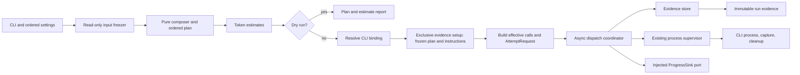
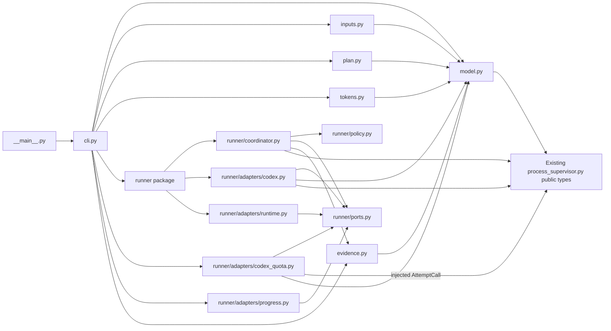

# Generic evaluation harness architecture

**Status: current view for the generic harness Work.** The Work contract in
[README.md](README.md) owns behavior and acceptance. The shared model records
are implemented in
[`script/eval/model.py`](../../../../../../script/eval/model.py), and the input
freezer is implemented in
[`script/eval/inputs.py`](../../../../../../script/eval/inputs.py). Pure
orchestration wiring is implemented in
[`script/eval/plan.py`](../../../../../../script/eval/plan.py), including
grouping, separator decoding, exact-byte composition, and deterministic matrix
expansion. The token estimator, dry-run report builder, evidence storage, and
Codex invocation leaves are implemented. The coordinator is bound to one run
and evidence store; it owns a typed dispatch-decision loop, attempt evidence
ordering, and a directly awaited quota-recovery seam. Dispatch selection,
supervisor-evidence conversion, probe cadence and recovery assessment, retry
policy, and scheduler accounting remain unimplemented; CLI integration and
full dispatch remain planned. Shared
consumer-owned runner ports and accepted runtime configuration are implemented
in
[`script/eval/runner/ports.py`](../../../../../../script/eval/runner/ports.py)
and `script/eval/model.py`. No implementation authorizes model calls. The
sibling [process supervisor](../process-supervisor/README.md) is implemented and
owns one attempt's process lifecycle; this harness owns plans, dispatch policy,
and run evidence around that boundary.

The planned quota wait, model-capacity retry, and standalone-invocation
amendments are owned by
[AC-6](README.md#ac-6-todo-optional-quota-waiting-preserves-the-active-run),
[AC-7](README.md#ac-7-todo-optional-model-capacity-retries-use-bounded-backoff),
and
[AC-8](README.md#ac-8-todo-standalone-invocation-supports-external-execution).
The typed sketches below describe the proposed policy boundary for those
amendments; they do not establish recognition rules, a Codex reset API, or
implemented behavior. The captured exec quota observation does not identify a
machine-readable source for reset times, and the capacity report does not
establish a CLI recognition signal. Until investigation verifies those sources,
adapters return explicit unknown or unavailable results and the coordinator
fails closed. All ACs remain TODO.

## TL;DR

- The CLI turns ordered options into one validated, frozen plan before any
  Codex process can start.
- The harness composes exact tracked source bytes and estimates them through an
  implemented provider-neutral port and `tiktoken` adapter.
- An async coordinator owns run order, concurrency, stop latching, separate
  infrastructure, quota, and capacity policies, and not-started accounting
  while calling the existing supervisor once per attempt.
- An exclusive evidence store writes immutable run, call, and attempt records;
  persistence failure stops dispatch and leaves the run incomplete.
- Configuration and persisted records use strict, immutable Pydantic models at
  their boundaries; domain decisions and effects stay outside validators.
- A consumer-owned progress sink presents immutable coordinator snapshots on
  stderr; durable evidence writes remain authoritative for reported facts.
- Call identity describes effective inputs. Run identity and scheduled
  positions preserve repeated entries and manually selected reruns.
- This boundary stores observations and generic usage telemetry only. The
  caller owns experiment protocol, budgets across runs, ordering claims, and
  interpretation.

## Proposed components

### CLI and ordered settings

**TL;DR:** Parse the public options and preserve their order and positions.

- The CLI owns repeated directory, model, effort, and separator arguments,
  positive concurrency, output destination, dry-run mode, and optional
  `-i FILE` / `--instructions-file FILE`, plus `--quiet` for presentation only.
- `HarnessConfig.progress_interval_seconds` defaults to 1.0 seconds and is
  validated as finite and positive. It configures only the terminal adapter's
  routine refresh throttle; callers do not need another clock or CLI option.
- CLI help states that the flag freezes the selected file and passes its staged
  path to Codex using `-c model_instructions_file=PATH`. It replaces Codex's
  native system instructions for that call; it does not add the file to generic
  context directories.
- It turns separators into directory-boundary values only after validating
  exactly one separator per boundary; omitted values mean two LF bytes.
- It rejects missing required values and invalid combinations before handing
  control to preparation.
- Dry run follows preparation and planning but does not create output or invoke
  Codex. It may report token estimates when the estimator can identify their
  method and compatibility.
- Effects: argument parsing and diagnostic output only; it does not perform
  Git, source, process, or evidence effects itself.

### Input freezer

**Implemented:**
[`script/eval/inputs.py`](../../../../../../script/eval/inputs.py) provides the
`RepositoryReader` port and `GitRepositoryReader` adapter. It requires all
inputs to resolve to one non-bare worktree, checks the whole checkout for
staged, unstaged, and untracked changes, and batches tracked-file and
commit-blob queries. It selects immediate regular files in lexical order
without recursion, requires each context directory to contain an immediate
regular file, and strictly decodes selected bytes as UTF-8. Symlink aliases and
parent components in context-directory paths are resolved normally; selected
file entries and the final instructions-file entry must be regular
nonsymlinks, while symlinked directory entries are skipped. A root-directory
context skips the linked-worktree `.git` administrative file. Read bytes must
exactly match pinned commit blobs; filter or line-ending transformations are
reported as mismatches. Empty files are preserved. Instructions remain a
distinct snapshot. Git commands have a finite timeout, use a deterministic
locale, clear all inherited `GIT_*` variables before setting owned Git
environment, and disable replacement objects, ambient global/system config,
fsmonitor, optional index locks, and promisor lazy-fetches. The explicit global
`--no-lazy-fetch` option makes unsupported Git versions fail rather than
silently allowing missing-object fetches. The freezer performs no writes or
model calls. The reviewed
[`inputs.pyi`](design/eval/inputs.pyi) remains the historical port definition.

**TL;DR:** Resolve and freeze exact tracked source bytes; leave composition to
the pure planner.

- This component resolves one repository root and HEAD for all inputs, checks
  the checkout and tracked-file membership in batches, and rejects paths that
  escape the repository.
- It selects immediate regular files in lexical order, strictly decodes UTF-8,
  skips symlinked directory entries, and compares exact selected bytes with
  their corresponding commit blobs before dispatch.
- A configured instructions file passes the same repository containment,
  clean-checkout, tracked-file, strict UTF-8, and commit-blob checks. Its bytes,
  repository path, blob SHA, and content digest form a separate
  `InstructionsSnapshot`; no context file receives an instruction role.
- When the flag is omitted, the plan records that no instruction file was
  configured. Codex keeps its default system instructions, whose automatic
  bytes are unavailable to the harness; omission does not mean there is no
  system context.
- It returns the repository root, HEAD, ordered context snapshots, and the
  optional separately typed instructions snapshot.
- Effects: read-only Git subprocesses and filesystem reads. It does not compose
  prompts or make plans. No CLI process or output writes are permitted during
  preparation.

### Plan and boundary records

**Implemented pure planner:**
[`script/eval/plan.py`](../../../../../../script/eval/plan.py) invokes typed
grouping, context-composition, and call-scheduling functions in order. The
context composer receives grouped source indices and `FrozenInputs`, so it can
read exact frozen context bytes without hidden state or I/O. It does not
compose the optional instructions-file snapshot; the builder forwards that
snapshot separately into `FrozenPlan`. The builder assembles the plan while
forwarding the validated configuration and frozen input provenance. Its public
`PlanBuilder.plan(FrozenInputs,
HarnessConfig)` boundary is pure. A caller supplies `run_id` to the concrete
builder, so identity creation remains caller-owned and planning does not read a
clock, generate randomness, or perform I/O. Grouping preserves configured
directory positions and frozen source order, including repeated directory
options. Composition selects one source per directory in Cartesian order,
uses default two-LF or decoded explicit separator bytes, and hashes scheduled
prompt bytes. Scheduling expands each context over models and efforts in
argument order, preserving repeated entries as distinct zero-based positions.
No implicit headers or instruction bytes enter prompts. This planner behavior
does not establish the CLI matrix, estimate, dispatch, or evidence criteria.
The reviewed type sketch in
[`design/eval/plan.pyi`](design/eval/plan.pyi) is retained as historical
reference; the runtime module is authoritative.

**TL;DR:** Represent validated settings and frozen work as immutable values.

- A pure composer and planner join the frozen source bytes with the ordered
  boundary bytes, then build the Cartesian product of contexts, models, and
  efforts. Duplicate scheduled positions remain distinct.
- The plan records source paths and digests, prompt digests, commit provenance,
  exact separator bytes, and the strict immutable CLI configuration that
  produced them. Ordered option events preserve which separators were explicit;
  omission remains distinguishable from an explicit two-LF separator. The
  configuration also retains concurrency, retry, deadline, grace, and output
  limits. Execution uses these snapshots and never re-reads mutable source
  files.
- Frozen dataclasses represent in-memory preparation and invocation values.
  Pydantic boundary models cover configuration, ordered option events, source
  snapshots, planned calls, the frozen plan, and persisted records. They use
  `ConfigDict(extra="forbid", strict=True, frozen=True)`; nested settings are
  tuples and immutable scalar or byte values rather than mutable mappings.
- Configuration validation enforces unique increasing option positions,
  separator placement and supported escapes, required matrix and output
  settings, and numeric bounds. Typed immutable plan and record schemas retain
  their declared field shapes and serialize the producer's values losslessly;
  they do not recheck producer relationships or recompute producer digests.
  Attempt timestamps and outcome fields preserve raw observations, while
  monotonic elapsed time remains the duration source because wall-clock time
  can move backwards.
- The external input operation owns Git checks, selected-file checks, and
  snapshot digest calculation. Filesystem effects, estimates, directory
  creation, and process execution also belong to explicit operations rather
  than model validators.
- A scheduled position has no effective-call identity until execution resolves
  its CLI binding and invocation settings. The effective identity then includes
  ordered content, exact instruction bytes, model, effort, executable/version,
  and all other settings that can change the invocation. Run identity and
  position distinguish repetitions and duplicate positions. A manual subset
  is a new run; there is no prior-output scan or implicit resume.
- Effects: none. These values describe decisions and observations but do not
  perform them.

### Token estimate port

**TL;DR:** Keep estimation separate from planning and execution.

- **Implemented:** `script/eval/tokens.py` defines the consumer-owned
  `TokenEstimator` port, the `tiktoken` adapter, and a pure report builder. The
  report uses each scheduled call's exact frozen prompt bytes and model,
  retains repeated positions, and estimates configured instruction bytes
  separately. Omitted instructions produce no estimate for unavailable
  automatic system bytes. CLI binding and effective call identities remain
  explicitly unknown in the dry-run record.
- The adapter uses tiktoken's declared exact model table and prefix table. Exact
  table matches are labeled exact for encoding selection; prefix matches are
  approximate because the library notes they can match nonexistent model
  names. Unknown models and known mappings to unavailable encodings return
  `token_count=None` with diagnostics. The method records the encoding name and
  library version; tiktoken exposes no independent vocabulary version, so
  `tokenizer_version` remains unknown. Counts use ordinary-text encoding, so
  strings resembling special tokens remain literal text. Counts exclude model
  message framing and other request overhead and do not claim billing accuracy.
- GPT-6 family names (`gpt-6`, `gpt-6-*`, and numeric minor forms such as
  `gpt-6.1-sol`) explicitly use the canonical `gpt-5.6` tiktoken mapping as an
  approximate surrogate, even if tiktoken later adds a GPT-6 mapping. The
  estimate retains the requested model name and diagnoses the surrogate and
  the absence of framing or billing guarantees. This is a practical estimate,
  not an authoritative GPT-6 tokenizer mapping.
- A dry-run report contains one estimate for every scheduled call. Unsupported
  model compatibility is explicit unknown or approximate, never an omitted
  estimate or billing precision.
- Estimates cover supplied composed context only; unavailable automatic CLI or
  system context is excluded and labeled. If no instructions file is
  configured, the report says Codex defaults are preserved and their automatic
  bytes are unavailable; it does not report that no system instructions exist.
- A configured instructions file receives its own separately labeled estimate;
  it is never folded into the supplied-context count without its basis being
  disclosed.
- Effects: local computation plus tiktoken's native vocabulary bootstrap. A
  cache miss can download tokenizer data and write it to tiktoken's cache; this
  effect is documented and does not call the model API or CLI or write harness
  output or evidence. The adapter cannot change the frozen prompt. This wiring
  does not establish dry-run CLI behavior.

### CLI binding and request construction

**TL;DR:** Bind runtime settings to frozen call bytes and build the exact
supervisor request.

- Execution resolves the absolute Codex path and observable CLI version and
  settings after the dry-run branch through `runner.adapters.codex`, without
  probing the CLI during dry run.
- The resolver reports explicitly requested execution controls separately
  from native effective values. Its default reader does not inspect private
  user configuration or authentication state: requested read-only sandbox,
  unattended approval policy, and ignored user config are recorded as
  requested, while native effective values and automatic instruction bytes
  remain unknown unless independently observed. Tool/feature availability and
  other inherited process context are also unknown; the adapter does not claim
  that Codex has no tools or cannot access private data through other means.
- The Codex adapter implements the consumer-owned `AttemptRequestBuilder` port.
  Its builder consumes the frozen plan and scheduled call, the resolved
  binding, and the staged instruction path returned by evidence preparation.
  When configured, it passes that path to Codex as
  `-c model_instructions_file=PATH`; when omitted, it adds no override and
  leaves Codex's native system instructions in place, whose automatic bytes
  remain unavailable. The request uses JSONL output, no color, the requested
  model and effort, read-only sandboxing, and approval policy `never`, without
  a permission-bypass flag. It returns an effective-call identity and
  `AttemptRequest`. No verified flag recipe currently disables all tools or
  features, so their availability is not asserted.
- The builder is pure: the plan supplies run identity and ordered frozen
  inputs, the binding supplies runtime settings, and the evidence result
  supplies the staged path. It hashes those effective inputs without opening
  the staged file or original source path.
- The prompt is passed as one argv value after `--`, without added headers or
  normalization. The operating system's argument-size limit applies, and NUL
  cannot be represented in an argv value; request construction rejects NUL
  explicitly. No prompt-file protocol is implemented.
- Call identity includes the sanitized binding settings in ordered, typed form
  so unknown values remain distinct from observed values. It excludes run and
  scheduled position, evidence artifact locations, output destination,
  concurrency, and retry policy. Quota and model-capacity output recognition
  is unsupported; ordinary completion and ambiguous process outcomes remain
  unknown except for supervisor-confirmed prelaunch infrastructure failure.
- When runtime binding is unavailable during dry run, the report marks its
  binding and effective-call identity unknown. It may show a plan identity,
  clearly labeled as such, but never as the effective invocation identity.
- Effects: the binding resolver performs execution-time CLI path/version
  probes. Request construction has no I/O. Dry run uses neither probe nor
  request construction.

### Async dispatch coordinator

**TL;DR:** `runner.coordinator` runs independent calls concurrently while
gating retries and stopping globally on unsafe outcomes.

- The intended coordinator schedules calls in plan order under one concurrency
  limit. Distinct planned calls may execute concurrently; completion order does
  not change their identity or evidence association.
- **Current maturity:** one runtime coordinator is constructed for one bound
  run and its evidence store; its configuration comes from the frozen plan.
  It owns a typed dispatch-decision loop, wires attempts through classification,
  durable attempt recording, and optional passive quota telemetry, and directly
  awaits recovery only after a quota-pause decision. Returned probe evidence is
  persisted before the recovery-decision leaf can resume dispatch; attached
  evidence is persisted before an escaped probe failure is re-raised. Dispatch
  selection, supervisor-outcome conversion, probe request cadence and recovery
  assessment, retry and wait decisions, transition accounting, and progress
  projection remain pending leaves. This stage does not establish concurrency,
  retries, pause policy, probe scheduling or assessment, complete shutdown, or
  truthful final accounting.
- Progress is a projection of the frozen plan and coordinator lifecycle, not a
  second accounting ledger. Disjoint call, attempt, and probe totals and the
  definition of remaining work are specified under
  [runner ports](#runner-policy-ports-and-adapters). One snapshot can show the
  run-wide quota pause alongside particular calls in capacity backoff and other
  active calls.
- A retry belongs to its call and starts only after that call's previous
  attempt cleanup permits dispatch. Cancellation, overflow, uncertain
  acquisition, unsafe cleanup, or recording failure latches a global stop and
  prevents any later dispatch.
- Ordinary infrastructure and model-capacity retry allowances are separate
  finite policies and both default to zero. Quota waiting defaults off; its
  cumulative duration bound is optional and finite positive when supplied. A
  recognized retry category cannot bypass its own allowance through another
  retry category.
- A classifier consumes structured supervisor observations and only explicitly
  verified CLI evidence. It returns infrastructure, quota, capacity, other,
  or unknown with its evidence basis. It never interprets answer content,
  treats a nonzero exit as proof of no semantic result, or treats a capacity
  message alone as retry eligibility. Unknown recognition fails closed.
- The current harness resolves one Codex CLI binding shared by every planned
  call, so verified Codex quota exhaustion stops new dispatch globally, settles
  active attempts through bounded cleanup, persists their evidence, releases all
  slots, then consults the quota-status port. An observation carries an opaque
  provider/account-allowance scope and provider-neutral window IDs, states,
  reset times, and sources. The Codex adapter owns completeness for its required
  five-hour and weekly windows; a missing or malformed one is emitted as unknown
  or unavailable, never omitted or guessed. The core does not interpret window
  IDs: absent or mismatched scope, empty observations, and unknown or
  unavailable states cannot establish exhaustion or availability. A known
  exhausted window without a numeric reset still pauses dispatch and uses
  periodic checks; it simply has no earlier reset hint. The latest relevant
  exhausted-window reset is a scheduling hint, not a timer that authorizes
  resume. A finite cumulative wait bound includes earlier paused intervals
  across checks, including checks performed while paused, but not active-period
  monitoring. Without a configured bound, an explicitly enabled run may remain
  paused through successive periodic checks. Every retry is gated again on
  current quota state.
- The composition pairs the Codex request path and settled-output classifier
  with a quota reader configured for the same CLI binding scope. The external
  binding adapter creates a `QuotaScope` only from verified provider and
  allowance identity; otherwise the binding scope is absent. Once a source is
  verified, the Codex quota adapter validates its reported identity against
  that expected scope; missing or mismatched identity yields an unscoped,
  inconclusive observation. The coordinator trusts these internal typed values
  and compares scope equality; it does not parse account identifiers. Persisted
  scope identifiers are opaque and nonsecret, never raw account names,
  credentials, or tokens. The current source format and identity evidence are
  unresolved, so these validation boundaries remain planned and fail closed.
- A later mixed-provider runner could pause only calls sharing a blocked quota
  scope. That is not the current AC-6 behavior: the single Codex binding keeps
  the pause global, and this design adds no provider registry or CLI provider
  selection.
- With quota waiting enabled, the coordinator directly awaits recovery only
  after a recognized exhaustion decision pauses dispatch and active attempts
  have settled with durable evidence. A finite positive interval controls
  periodic checks during that pause; an earlier numeric reset hint may schedule
  a check sooner, but never authorizes dispatch. Missing, stale, or past hints
  fall back to the interval. Enabling quota waiting explicitly authorizes
  checks; an absent count cap adds no harness probe-count limit, a positive cap
  is enforced, and zero refuses probe dispatch. Default-off execution and dry
  run perform neither probes nor session reads. There is no background monitor
  or active-period probe; at most one recovery probe is in flight. A probe
  started for an earlier pause cannot reopen a later pause. Resume requires a
  fresh positive observation for the current pause and matching scope.
- The consumer-owned quota port separates passive settled-attempt ingestion
  from active polling. Passive ingestion returns an observation; `poll` performs
  one separate supervised invocation. The Codex adapter privately correlates
  captured `thread.started` evidence to its session and owns request
  construction, the existing public supervisor call, and normalization. Thread
  identifiers stay inside that adapter; the port and evidence events retain the
  generic observation with sanitized source coordinate, producer timestamps,
  and source sequence. Both paths produce generic scoped observations, and the
  coordinator stores passive observations with their call/attempt identity and
  checks scope against the bound run. The core never parses CLI output or
  session files. The source adapter orders
  evidence before returning it, so delayed older availability cannot replace
  newer exhaustion; unknown or mismatched scope, missing windows, stale source,
  or malformed data fails closed. This ordering and freshness boundary awaits
  verified source rules.
- Each check has a separate `QuotaProbeId` and append-only scheduled, started,
  and settled-or-cancelled lifecycle. A scheduled event retains its creation
  time, due time, interval, reason, and optional reset hint; it represents no
  launched process and that scheduled probe performs no model or session read
  before its due time. Passive observation of settled attempt evidence may
  continue during cadence waits. A started event is written immediately before
  actual dispatch and captures the then-current pause ID. When quota is paused,
  active evaluations settle and persist before a new probe starts. Probes only
  run inside the awaited recovery flow for the current pause. A prelaunch
  cancellation records its end cause and actual monotonic wait duration, creates
  no process record, and consumes no probe budget. A launched probe that is
  cancelled settles with its supervised process outcome. The settled record
  combines shared `ProcessRecord` fields (request settings, process start/end,
  timing basis, exit/termination, cleanup, raw-stream artifact references,
  usage, and error type/diagnostic) with probe identity, quota state, and
  observation. The configured probe-count cap counts actual starts only, never
  schedules or prelaunch cancellations. `ProcessRecord.outcome_kind` keeps
  timeout, overflow, cancellation, errors, no observation, and no launch
  distinct; none implies availability. The probe's coordinator
  `poll_started_at_utc` remains distinct from supervisor process start time.
  Passive evaluation telemetry is also appended separately with its call and
  attempt identity. Neither is an evaluation attempt record; probes consume no
  evaluation attempt number, measurement, or semaphore slot. A known exhausted
  observation is a normal paused result and schedules another cadence check.
  Unknown or unavailable data, infrastructure failure, output overflow, evidence
  failure, unsafe cleanup, or uncertain acquisition latches stop. Cancellation
  propagates through the awaited probe; attached probe evidence is persisted
  before the original cancellation or failure is re-raised. Current typed
  wiring persists the started event immediately before polling and settlement
  afterward; schedule and prelaunch-cancellation event synthesis remains
  pending.
- Capacity backoff is local to its call. For retry index `k`, sample full jitter
  in `[0, min(cap, base * 2**k)]`, saturating the bound at `cap`; await and
  sample through the injected `Runtime` port. Release the attempt slot
  before quota or capacity waiting. Even zero jitter yields to the event loop. A
  capacity retry is a fresh invocation of the same model, frozen inputs, and
  invocation settings, with no probe or substitution. Its normal wait end is
  `delay_elapsed`, persisted before a fresh attempt can start; dispatch then
  checks both the stop latch and quota gate.
- Before a wait begins, persist a start event with a stable wait ID and its
  policy context. Capacity context includes the failed call and attempt, retry
  index, base, cap, computed bound, and sampled delay; quota context includes
  the triggering call and attempt, the scoped generic window observations,
  optional selected reset hint, optional cumulative limit, and elapsed wait from
  earlier reset cycles.
- Both retry types require confident no-semantic-result evidence, safe cleanup,
  and successful persistence before waiting or retrying. They retain every
  attempt and count toward caller-owned attempt limits. A quota pause gates
  every dispatch, including capacity retries whose backoff elapsed earlier.
- Cancellation and the latched stop take precedence over any wait or quota
  resumption. Cancellation, overflow, uncertain acquisition, unsafe cleanup,
  and recording failure forbid retries. Active attempts settle and record
  before quota waiting; evidence records observations throughout waits (start,
  reset source, rechecks, elapsed monotonic duration, cancellation or bound),
  not merely the eventual run summary.
- The stop hook latches stop before any fallible recording. The coordinator
  checks the latch before each call and attempt. Cancellation stops new work
  and waits for bounded supervisor cleanup.
- After each relevant lifecycle transition, the coordinator publishes one
  immutable progress snapshot to its injected `ProgressSink`. A result or
  control fact that requires evidence is published only after the matching
  `EvidenceStore` write succeeds. If that write fails, the stop latch and
  incomplete-evidence outcome remain authoritative; progress may describe the
  incomplete run diagnostically but cannot claim the unwritten record exists.
  Sink output errors disable or degrade presentation and do not alter retries,
  outcomes, or the original exception. The sink handles expected stream errors;
  cancellation, `KeyboardInterrupt`, and `SystemExit` are never suppressed.
- It owns process signal handlers and truthful not-started accounting.
  Concurrency, each retry allowance, backoff and wait bounds, deadlines, grace,
  and output allowance have one source: validated run configuration.
- Stop reasons and partial observations remain associated with the original
  control flow. The coordinator does not parse reviewer answers or assign
  semantic meaning to output.
- Effects: async tasks, semaphore, signal registration, and calls to the
  existing supervisor. It does not own subprocess creation or cleanup.

### Runner policy, ports, and adapters

**TL;DR:** Keep dispatch mechanics separate from retry decisions and concrete
Codex, quota, and runtime adapters.

- `runner.__init__` re-exports the package's consumer-facing runner API.
- `runner.coordinator` is wired around consumer ports and pure policy functions,
  not concrete adapters. Current code owns one dispatch-decision loop, returned
  attempt ordering, and direct awaited quota recovery. Dispatch selection,
  probe scheduling and assessment, retries, waits, progress, and not-started
  accounting remain pending.
- `runner.policy` contains pure functions for confident no-result eligibility,
  separate infrastructure and capacity allowance checks, saturated jitter
  bounds, cumulative quota-wait limits, probe authorization, and reset-hint
  scheduling. Inputs include typed observations and configuration; these
  functions read no clocks, randomness, files, or processes.
- `runner.ports` owns consumer interfaces and shared values: the frozen
  `CliBinding`, `BoundRun`, and `EffectiveCall`. It defines one-attempt
  supervisor, settled-outcome, combined passive/active quota-reader, and
  injected-runtime contracts without importing concrete adapters. The one quota
  port exposes separate settled-attempt ingestion and supervised-poll calls.
- `runner.ports` also owns the immutable `ProgressSnapshot`, disjoint
  `ProgressCounts`, per-call retry-wait views, and the synchronous
  `ProgressSink` port. The intended coordinator derives queued, active,
  retry-wait, stopped-not-started, evidence-pending, succeeded, failed, and
  cancelled call counts from its live call states; attempt and probe counters
  remain separate. Runtime progress projection is still pending.
  A queued call is runnable but not dispatched. A stopped-not-started call is
  unexecuted and cannot resume after the final report. Evidence-pending means a
  result is known in memory but its required durable write failed, so the
  report does not claim a persisted success or failure.
- For `N` planned calls, `N` equals queued + stopped-not-started + active +
  retry-wait + evidence-pending + succeeded + failed + cancelled. Remaining
  calls equal queued + stopped-not-started + active + retry-wait +
  evidence-pending; failed and cancelled calls are settled separately, and
  completed means succeeded. For example, two successes, one failure, one
  cancellation, and one stopped-not-started call out of five report completed
  2, remaining 1, failed 1, and cancelled 1. A final cancellation or incomplete
  evidence result keeps stopped calls visible as unexecuted remaining work.
- The dispatched attempt count equals the sum of active, evidence-pending,
  succeeded, failed, and cancelled invocations. Here “started” means the
  invocation was dispatched through `AttemptCall`; it does not claim that the
  supervisor acquired or launched an OS process. These terminal outcomes are
  disjoint: success means a zero exit with safe process completion, never a
  reviewer approval; failure means a settled non-cancelled unsuccessful attempt;
  cancellation has its own count. The dispatched probe count equals the sum of
  active, evidence-pending, completed, failed, and cancelled probes. Probe
  outcomes are disjoint: completed means a safely settled operational check with
  a conclusive available or exhausted quota state, including a recognized
  provider rate-limit response mapped to exhausted. Failed means an unknown or
  malformed observation, timeout, overflow, infrastructure failure, or unsafe
  process outcome; cancellation has its own count. Evidence-pending is separate
  from all terminal outcome counts. Retries have their own count and add
  attempts, never calls. The current retry reason is preserved per call, so a
  local backoff never masks active work on other calls. The snapshot carries
  existing scoped quota observations and producer-based per-window ages; it
  performs no quota reads, model calls, or input reads.
- `runner.adapters.progress` supplies silent and terminal sinks. Composition
  selects one sink from the explicit quiet setting and stderr TTY state, then
  injects it once into the coordinator. Terminal output leaves stdout untouched,
  uses compact refresh on a TTY and plain transition lines when redirected, and
  throttles routine updates using `Runtime.monotonic()` and finite positive
  `HarnessConfig.progress_interval_seconds` (default 1.0). Retry, pause, resume,
  stop, error, and final transitions bypass that interval. Routine snapshots
  coalesce to the latest state without a queue. Composition injects the same
  `Runtime` instance used by the coordinator.
- The terminal adapter accepts a narrow synchronous try-write callback. Each
  call must promptly accept one complete short message or report would-block or
  unavailable; it cannot wait for writable stderr. Routine output can be skipped
  or coalesced when output would block; expected `OSError` or unavailable output
  disables presentation without changing run state. Meaningful transitions
  bypass the throttle and receive an immediate try-write attempt. If that
  attempt cannot write, the sink degrades instead of delaying the run. The
  callback must not wrap blocking `TextIO.write`, mutate caller stream flags,
  create a background renderer, or use a timed worker thread. Its platform
  mechanism remains an implementation prerequisite to verify before use; if no
  prompt try-write mechanism is available, composition selects the silent sink.
  `publish` never catches cancellation, `KeyboardInterrupt`, or `SystemExit`.
- `runner.adapters.codex` resolves one absolute executable from `PATH` and
  probes that same path with a bounded `--version` command. It records the
  requested read-only sandbox, `approval_policy="never"`, and ignored user
  config as explicit invocation settings; native effective settings and
  automatic instruction bytes remain unknown. The builder passes frozen prompt
  bytes, requested model and effort, plus the staged native instructions path
  when configured. Its current argv uses `codex exec --json`, disables color,
  uses the read-only sandbox and `approval_policy="never"`, and places the
  literal prompt after `--`. No verified tool-disable setting is available in
  this implementation, so it does not claim tool-free execution or private-data
  isolation. The classifier returns confident absence only when supervisor
  evidence confirms the process never launched; quota, capacity, nonzero exit,
  and all other outcomes remain unknown. It never parses answer content.
- `runner.adapters.codex_quota` implements a version-bounded adapter around the
  provider-neutral quota-reader port. It extracts exactly one canonical
  `thread.started.thread_id` from captured `codex exec --json` JSONL. The
  asynchronous local source uses an explicitly configured sessions directory,
  enumerates only the three-level date layout and exact UUID-suffix candidate,
  opens no other rollout files, and offloads lookup and reading with
  `asyncio.to_thread`. It projects only `session_meta` identity fields and
  `token_count` quota rows; transcript messages and local paths are not
  retained. The source validates consumed metadata and `rate_limits` fields
  during the read and returns a typed projection. The normalizer accepts the
  observed CLI 0.164.0 metadata, validates matching session/thread IDs and
  provider plus account/user identity, requires both 300-minute and 10080-minute
  windows, and maps their numeric usage and optional reset hints. Missing or
  malformed reset hints do not invalidate usage state. It rejects malformed,
  incomplete, stale, future-dated, out-of-order, or unsupported records as
  unknown while retaining valid usage, producer timestamp, and ordinal facts for
  stale or future snapshots. A 60-second positive age limit is configurable on
  the reader. Each reader and its synchronous ordering state are confined to one
  event loop. Per-reader ordering retains the latest producer timestamp globally
  and the latest record per sanitized source coordinate. An identical repeated
  record is idempotent, changed facts at the same ordinal become unknown, and a
  delayed older snapshot cannot replace newer state. The domain-separated scope
  helper hashes provider, account, and user identity without logging or
  persisting raw identifiers; observations remain unscoped unless their derived
  identity matches a caller-supplied expected binding scope. The current Codex
  binding still supplies no scope.
- Active quota polling builds one fixed Luna/`none` supervised request with a
  caller-staged nonempty instruction path, minimal argv prompt, JSONL output,
  read-only empty cwd, and the available explicit CLI feature/config disables,
  including approval never, web search disabled, and request-user-input off.
  It ignores user config and does not use `--ephemeral`, because the rollout is
  needed for telemetry. The CLI has no verified global MCP-server clear, and
  the maintainer accepted the CLI 0.164.0 tool/context limitation: those
  controls do not prove that the outer `functions.exec` wrapper or injected
  context is absent. See [quota-capture](quota-capture.md) for the inspection
  scope and remaining correlation limits. Both quota outcomes require a safely
  settled Completed probe and complete scoped windows whose producer timestamp
  falls within that probe. Availability additionally requires exit status zero;
  fresh exhaustion remains conclusive after a nonzero exit. Timeouts, output
  overflow, cancellation, and unsafe cleanup remain unknown. Unknown telemetry
  cannot resume dispatch. The reader invokes the
  existing `AttemptCall` once with the exact request and stop callback and
  retains the process outcome, captured output, and normalized observation in
  `QuotaProbeEvidence`. If cancellation or another exception escapes after
  dispatch, the adapter attaches available probe evidence to that same exception
  and re-raises it. This adapter implementation does not wire the CLI
  composition root or coordinator, issue live probes, or authorize resumption.
  The generic `quota_probe_evidence` accessor matches by the exact original
  request object, so a coordinator must retain that object; no match means
  incomplete evidence.
- `runner.adapters.runtime` implements the runtime port with UTC and monotonic
  clocks, cancellable `asyncio` waits, and uniform jitter sampling.
- The adapter package exports `SystemRuntime` and the typed Codex binding,
  request, classifier, and quota-reader adapters. Codex request and classifier
  operations remain injectable; the quota reader uses its source, supervisor,
  and runtime ports. The default leaves now resolve
  and probe the executable, retain requested settings with native values marked
  unknown, construct a request and effective identity, and classify only
  confirmed prelaunch failure. Quota and model-capacity recognition remain
  unsupported because the supplied captures do not establish reliable structured
  signals. The Codex and quota signature sketches in
  `design/eval/runner/adapters/` are historical; runtime code is authoritative.
  The CLI composition root and progress adapter remain design stubs. The
  coordinator now has typed per-run effect wiring around explicit pending
  dispatch selection, conversion, probe scheduling and assessment, and
  accounting leaves. The quota adapter implements its bounded source,
  normalization, polling request, and assessment behavior, but is not yet wired
  into CLI composition or coordinator dispatch.
  Runtime [`policy.py`](../../../../../../script/eval/runner/policy.py)
  implements the reviewed pure policy calculations; it does not own effects or
  coordinator gates. The shared runner values and ports are implemented. The
  neighboring [`policy.pyi`](design/eval/runner/policy.pyi) is retained as a
  historical signature reference; runtime code is authoritative.
- Effects: the coordinator owns async scheduling and effect ordering. The
  Codex and quota adapters own their stated external reads; the runtime adapter
  owns clock, wait, and random effects.

### Standalone invocation

**TL;DR:** The harness owns a live run; the caller owns how it is launched.

- `python -m script.eval` is the documented external entry point and delegates
  to the same CLI composition as the Make target. It does not require a live
  agent conversation.
- Usage documents the repository working directory, locked dependency setup,
  Python and CLI version expectations, authentication and unattended Codex
  configuration, environment prerequisites, output directory, and exit
  meanings. Missing prerequisites fail explicitly; execution never waits for a
  human approval response.
- While the process is alive, the harness owns children, dispatch, bounded
  cleanup, evidence, quota waits, capacity backoff, and cancellation through
  AC-1–AC-7. The invoking shell or external scheduler owns launch and liveness.
  Scheduler installation, restart recovery, and model-call authorization remain
  outside this boundary.
- The exit status distinguishes complete success, run failure, cancellation,
  and incomplete evidence. Exact numeric values belong to the CLI contract and
  must agree with the standalone acceptance scenario.
- Progress is rendered on stderr, so normal output and dry-run reporting on
  stdout remain usable. `--quiet` selects a silent sink and changes no dispatch,
  evidence, outcome, retry, or quota behavior. The standalone acceptance
  scenario checks terminal and redirected output modes and their progress
  promises without model calls.
- Effects: an external process invocation and the same effects as CLI execution;
  there is no scheduler service or background daemon.

### Evidence store

**TL;DR:** Preserve each run, planned call, and attempt without replacing prior
evidence.

- The store exclusively creates a new output directory. It accepts destinations
  inside or outside the input repository; an unignored in-repository output can
  make the checkout dirty for the next input freeze.
- Before any supervisor process can launch, `create` writes the frozen plan to
  that new area and materializes configured instructions-file bytes as the
  artifact referenced by `model_instructions_file`. It returns that artifact
  path to the request builder. If no instructions file was configured, the
  plan records that Codex defaults are preserved and automatic bytes are
  unavailable. Dry run never calls `create` and writes no artifacts.
- It writes finalized metadata and exact stdout and stderr bytes as separate,
  immutable artifacts. Empty output, unavailable output, partial output, and
  unavailable usage remain distinct; observed exit, termination, cleanup,
  timestamps, and available telemetry retain their source and units.
- Each write is atomic at its artifact boundary. If recording fails, the run is
  incomplete, the stop latch is set, and remaining planned calls stay marked
  not started. A recording failure after an attempt does not replace that
  attempt's original exception or cancellation; if no earlier failure is
  active, the recording error is returned as the run failure. The store does
  not fabricate a successful record.
- Every attempt record carries its run ID, call ID, scheduled position, and
  attempt number explicitly. The in-memory observation reuses the supervisor's
  `AttemptResult`, `AttemptCancelled`, or `AttemptFailureEvidence` value rather
  than copying its output, status, and cleanup fields into a second outcome
  type. The strict Pydantic attempt record is only the persisted projection,
  with structured cleanup observations and separate stream artifact references.
  An unexpected original exception remains in control flow with its supervisor
  evidence snapshot when one is available. Each record also keeps the actual
  request's argv and cwd, plus elapsed time and whether that time came from a
  supervisor observation or is unavailable. Returned outcomes, cancellations,
  and attached failure evidence each provide the supervisor observation basis;
  an exception without attached evidence has no elapsed observation. Each
  record also stores the request's execution timeout, cleanup timeout, grace,
  and output-byte allowance, which are supervisor settings rather than CLI
  arguments.
- Wait events are appended durably when a quota or capacity wait starts (the
  quota start event includes the optional selected reset hint), when quota
  status is rechecked, and when the wait ends. Quota-poll cadence is represented
  by the probe lifecycle rather than a second wait record. Schedule, start,
  settlement, and prelaunch cancellation events are persisted as they occur;
  the probe ID joins them. Quota-pause and capacity-backoff waits retain their
  own stable wait IDs and policy contexts, so concurrent waits remain
  distinguishable. The event ledger is persisted as it grows rather than
  duplicated in the final `RunRecord`; a final summary alone is not evidence for
  a live wait. A failed event write latches stop and forbids resumption or
  retry.
- A quota pause ends successfully only as `quota_available`, after a fresh
  positive observation for the same scope. This can happen before a reset hint
  or when no hint exists, but only from a probe started for the current pause
  after active evaluations settle. Reaching a reset hint makes the scheduled
  check due sooner; it never ends the pause or reopens dispatch. Without a
  hint, checks become due at the configured interval. The awaited recovery flow
  owns these waits; the coordinator does not run a second reset timer alongside
  polling. Unknown or unavailable data fails closed; a bound, cancellation, or
  stop can end the pause without resumption. `delay_elapsed` is the normal end
  of capacity backoff; quota cadence is captured as scheduled and started probe
  lifecycle evidence.
- A small optional telemetry extractor may preserve generic usage fields while
  retaining raw stdout. It does not validate answer schemas, parse reviewer
  verdicts, inspect labels, or score results.
- Effects: exclusive directory creation and evidence writes. It never scans
  prior runs or overwrites them.

### Entry point composition

**TL;DR:** Wire adapters once and keep policy in the coordinator.

- The entry point connects CLI settings, input freezing, pure composition and
  planning, the selected token estimator, CLI binding, request construction,
  coordinator, supervisor adapter, and evidence store.
- For execution, it resolves the CLI binding, asks the evidence store to
  exclusively create the run area and persist the frozen plan, including its
  original strict CLI configuration, and instruction artifact; it builds
  requests from the returned artifact path, then passes one bound-run value
  and the same evidence-store adapter to the coordinator. That setup step must
  succeed before the first supervisor launch.
- The composition owns the evidence-store adapter once; the coordinator
  receives it for attempt and final-run records. Dry run returns after planning
  and estimation, before CLI binding, output creation, or request construction.
- The existing `script/process_supervisor.py` remains a separate dependency:
  its `AttemptRunner` owns one attempt, while `call_supervisor` forwards the
  outcome and invokes the harness-owned `DispatchStop` hook when cancellation
  or unsafe cleanup requires stopping.
- The composition root owns concrete adapters; domain modules depend on their
  consumer-facing ports. No generic plugin registry or scheduler framework is
  proposed.
- The composition root creates exactly one silent or terminal progress sink and
  supplies it to the coordinator. `Coordinator.run` does not accept a second
  sink argument, preventing conflicting injections. The terminal adapter gets
  the injected `Runtime`, the finite interval from configuration, and a
  try-write callback for stderr; it does not write run evidence or mutate the
  caller's stderr settings.
- Effects: connects the effects listed above and exposes the CLI entry point.

## Proposed flow

The diagram shows proposed harness boundaries. The existing supervisor, input
freezer, pure planner, and token-estimation wiring are implemented. Coordinator
run and returned-attempt composition are partially wired; CLI integration and
full dispatch remain planned.
The input freezer performs read-only Git and filesystem effects; composition,
planning, and report assembly are pure. Estimation returns one explicit value
for each planned call, including an unknown value when compatibility is not
known. The dry-run branch never resolves or probes the CLI.

## Type boundary

The adjacent [package-shaped type sketch](design/eval/) records the reviewed
boundary from which implementation proceeds. `model.pyi`, `runner/ports.pyi`,
and `runner/__init__.pyi` are historical references, not active typing
interfaces. The `Coordinator` declaration in the `__init__.pyi` sketch is
planned and is not exported by the runtime package. Evidence-facing quota scope,
window and observation, retry assessment, wait and probe lifecycle, and shared
`ProcessRecord` values have migrated into `script/eval/model.py`. The active
`script/eval/evidence.py` binds the prepared run context for one adapter
lifecycle. `EvidenceStoreAdapter` requires all injected leaf dependencies;
`create_evidence_store()` supplies the filesystem leaves. The adapter composes
typed identity forwarding with asynchronous projection/write ordering. Each
submitted operation, including lock waiting, projection (which may write
multiple raw output artifacts), and append are serialized and retained through
settlement when its caller is cooperatively cancelled. Synchronous injected
leaves run off the event loop. A coroutine that has not started and submitted
its retained task is not yet an operation owned by the adapter. The runner must
retain and await submitted evidence operations during shutdown. The lock is
in-memory and serializes only this adapter on its event loop; it provides no
cross-process coordination. The filesystem store creates a new output directory
inside or outside the context repository and writes `plan.json` plus optional
`instructions.bin` before dispatch. Attempt
metadata lives in
`attempts/position-<position>/<sha256-call-id>/attempt-<number>.json`; probe
artifacts use a `sha256-probe-id` directory. Stream suffixes are appended to the
complete identity-based stem, so dots in an identity cannot change the suffix.
Original identities remain in metadata. Separate `.stdout` and `.stderr` files
contain exact observed prefixes, including empty streams. Probe lifecycle and
settled records, wait transitions, and passive quota telemetry append to
`events.jsonl`; final accounting is `run.json`. Metadata and stream files are
published through same-directory temporary files and exclusive hard links, then
file and directory entries are fsynced. Event appends are fsynced. These
promises cover ordinary filesystem operation failures, not recovery after
process termination, `SIGKILL`, machine failure, or concurrent writes from a
second store/process. This storage layer raises recording errors; stopping
dispatch and preserving not-started accounting remain runner responsibilities.
AC-9 progress behavior remains design-only; pure runner policy calculations,
accepted shared runner configuration, and consumer-owned runtime ports are
implemented. The shared base preserves flat attempt fields while permitting
probes to reuse the process projection. `plan.pyi` remains a historical
planner reference. The active implementations are
[`script/eval/model.py`](../../../../../../script/eval/model.py) and
[`script/eval/plan.py`](../../../../../../script/eval/plan.py). Shared validated
values, persisted record shapes, pure context composition, scheduling,
token-estimation adapter, evidence adapter wiring, and filesystem evidence
storage/projection are implemented. CLI integration, dispatch, and the remaining
harness behavior are planned. Do not add a parallel runtime model or change
supervisor types. Private helpers and concrete persistence formats remain
flexible; supervisor outcomes and requests continue to use the existing public
types. Codex quota recognition is implemented against the reviewed CLI 0.164.0
rollout shape with runtime identity, completeness, and freshness checks; later
CLI schemas require separate review. The quota binding still does not supply an
expected identity scope, so the CLI cannot yet enable scoped quota availability.

| Proposed module | Responsibility |
| --- | --- |
| `script/eval/cli.py` | Ordered arguments, help text, and one-time composition root. |
| `script/eval/model.py` | Shared validated configuration, plan values, observations, and persisted records. |
| `script/eval/inputs.py` | Consumer-owned Git and filesystem snapshot port. |
| `script/eval/plan.py` | Pure source grouping, exact-byte context composition, and call-matrix scheduling. |
| `script/eval/tokens.py` | Consumer-owned token-estimation port, `tiktoken` tokenizer adapter, and pure dry-run report assembly. |
| `script/eval/runner/__init__.py` | Public runner imports for the CLI composition root. |
| `script/eval/runner/coordinator.py` | Typed per-run dispatch and paused-recovery effects; decision, cadence, retry, progress, and accounting policy remain pending. |
| `script/eval/runner/policy.py` | Pure retry eligibility, separate allowances, quota-wait/probe limits, reset-hint scheduling, and saturated jitter calculations. |
| `script/eval/runner/ports.py` | Consumer-owned supervisor, quota-reader, and runtime protocols plus frozen `CliBinding`, `BoundRun`, and `EffectiveCall` values. |
| `script/eval/runner/quota_evidence.py` | Generic exception-carried probe evidence retained alongside the original exception and retrieved by exact request identity. |
| `script/eval/runner/adapters/codex.py` | CLI binding, fresh evaluation request construction, and conservative settled-output classification. |
| `script/eval/runner/adapters/codex_quota.py` | Version-bounded Codex session source, quota normalization and ordering, and supervised probe request/evidence adapter. |
| `script/eval/runner/adapters/progress.py` | Silent and stderr terminal implementations of the consumer-owned progress sink. |
| `script/eval/runner/adapters/runtime.py` | Implemented standard-library UTC/monotonic clocks, async sleep, and random sampling. |
| `script/eval/runner/adapters/__init__.py` | Exports implemented adapters available for composition. |
| `script/eval/evidence.py` | Exclusive output creation and immutable artifact persistence port. |
| `script/eval/__main__.py` | Thin entry point delegating to the CLI composition. |

The dependency direction stays toward the shared values and consumer-owned
ports. Within this package, `model.py` has no adapter imports and refers to the
supervisor's public attempt types only for observation fields; concrete
adapters are connected in `cli.py`.

These module names are a typed design map only. They do not specify private
file boundaries, create runtime modules, or change the existing supervisor.
