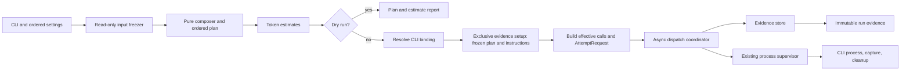
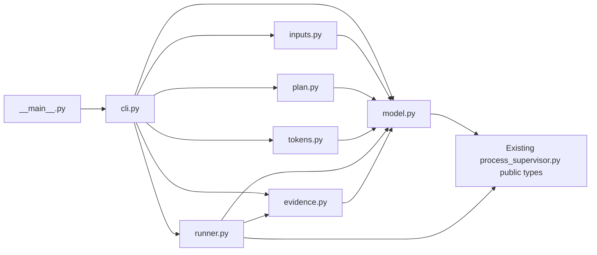

# Generic evaluation harness architecture

**Status: current view for the generic harness Work.** The Work contract in
[README.md](README.md) owns behavior and acceptance. The shared model records
are implemented in
[`script/eval/model.py`](../../../../../../script/eval/model.py), and the input
freezer is implemented in
[`script/eval/inputs.py`](../../../../../../script/eval/inputs.py). Pure
orchestration wiring is implemented in
[`script/eval/plan.py`](../../../../../../script/eval/plan.py), including
grouping, separator decoding, exact-byte composition, and deterministic matrix
expansion. CLI integration, complete token counting, dispatch, and persistence
remain planned. No implementation authorizes model calls. The sibling
[process supervisor](../process-supervisor/README.md) is
implemented and owns one attempt's process lifecycle; this harness owns plans,
dispatch policy, and run evidence around that boundary.

## TL;DR

- The CLI turns ordered options into one validated, frozen plan before any
  Codex process can start.
- The harness composes exact tracked source bytes and estimates them through a
  provider-neutral port with a selected, not-yet-implemented ``tiktoken``
  adapter.
- An async coordinator owns run order, concurrency, stop latching, retries, and
  not-started accounting while calling the existing supervisor once per
  attempt.
- An exclusive evidence store writes immutable run, call, and attempt records;
  persistence failure stops dispatch and leaves the run incomplete.
- Configuration and persisted records use strict, immutable Pydantic models at
  their boundaries; domain decisions and effects stay outside validators.
- Call identity describes effective inputs. Run identity and scheduled
  positions preserve repeated entries and manually selected reruns.
- This boundary stores observations and generic usage telemetry only. The
  caller owns experiment protocol, budgets across runs, ordering claims, and
  interpretation.

## Proposed components

### CLI and ordered settings

**TL;DR:** Parse the public options and preserve their order and positions.

- The CLI owns repeated directory, model, effort, and separator arguments,
  positive concurrency, output destination, dry-run mode, and optional
  `-i FILE` / `--instructions-file FILE`.
- CLI help states that the flag freezes the selected file and passes its staged
  path to Codex using `-c model_instructions_file=PATH`. It replaces Codex's
  native system instructions for that call; it does not add the file to generic
  context directories.
- It turns separators into directory-boundary values only after validating
  exactly one separator per boundary; omitted values mean two LF bytes.
- It rejects missing required values and invalid combinations before handing
  control to preparation.
- Dry run follows preparation and planning but does not create output or invoke
  Codex. It may report token estimates when the estimator can identify their
  method and compatibility.
- Effects: argument parsing and diagnostic output only; it does not perform
  Git, source, process, or evidence effects itself.

### Input freezer

**Implemented:**
[`script/eval/inputs.py`](../../../../../../script/eval/inputs.py) provides the
`RepositoryReader` port and `GitRepositoryReader` adapter. It requires all
inputs to resolve to one non-bare worktree, checks the whole checkout for
staged, unstaged, and untracked changes, and batches tracked-file and
commit-blob queries. It selects immediate regular files in lexical order
without recursion, requires each context directory to contain an immediate
regular file, and strictly decodes selected bytes as UTF-8. Symlink aliases and
parent components in context-directory paths are resolved normally; selected
file entries and the final instructions-file entry must be regular
nonsymlinks, while symlinked directory entries are skipped. A root-directory
context skips the linked-worktree `.git` administrative file. Read bytes must
exactly match pinned commit blobs; filter or line-ending transformations are
reported as mismatches. Empty files are preserved. Instructions remain a
distinct snapshot. Git commands have a finite timeout, use a deterministic
locale, clear all inherited `GIT_*` variables before setting owned Git
environment, and disable replacement objects, ambient global/system config,
fsmonitor, optional index locks, and promisor lazy-fetches. The explicit global
`--no-lazy-fetch` option makes unsupported Git versions fail rather than
silently allowing missing-object fetches. The freezer performs no writes or
model calls. The reviewed
[`inputs.pyi`](design/eval/inputs.pyi) remains the historical port definition.

**TL;DR:** Resolve and freeze exact tracked source bytes; leave composition to
the pure planner.

- This component resolves one repository root and HEAD for all inputs, checks
  the checkout and tracked-file membership in batches, and rejects paths that
  escape the repository.
- It selects immediate regular files in lexical order, strictly decodes UTF-8,
  skips symlinked directory entries, and compares exact selected bytes with
  their corresponding commit blobs before dispatch.
- A configured instructions file passes the same repository containment,
  clean-checkout, tracked-file, strict UTF-8, and commit-blob checks. Its bytes,
  repository path, blob SHA, and content digest form a separate
  `InstructionsSnapshot`; no context file receives an instruction role.
- When the flag is omitted, the plan records that no instruction file was
  configured. Codex keeps its default system instructions, whose automatic
  bytes are unavailable to the harness; omission does not mean there is no
  system context.
- It returns the repository root, HEAD, ordered context snapshots, and the
  optional separately typed instructions snapshot.
- Effects: read-only Git subprocesses and filesystem reads. It does not compose
  prompts or make plans. No CLI process or output writes are permitted during
  preparation.

### Plan and boundary records

**Implemented pure planner:**
[`script/eval/plan.py`](../../../../../../script/eval/plan.py) invokes typed
grouping, context-composition, and call-scheduling functions in order. The
context composer receives grouped source indices and `FrozenInputs`, so it can
read exact frozen context bytes without hidden state or I/O. It does not
compose the optional instructions-file snapshot; the builder forwards that
snapshot separately into `FrozenPlan`. The builder assembles the plan while
forwarding the validated configuration and frozen input provenance. Its public
`PlanBuilder.plan(FrozenInputs,
HarnessConfig)` boundary is pure. A caller supplies `run_id` to the concrete
builder, so identity creation remains caller-owned and planning does not read a
clock, generate randomness, or perform I/O. Grouping preserves configured
directory positions and frozen source order, including repeated directory
options. Composition selects one source per directory in Cartesian order,
uses default two-LF or decoded explicit separator bytes, and hashes scheduled
prompt bytes. Scheduling expands each context over models and efforts in
argument order, preserving repeated entries as distinct zero-based positions.
No implicit headers or instruction bytes enter prompts. This planner behavior
does not establish the CLI matrix, estimate, dispatch, or evidence criteria.
The reviewed type sketch in
[`design/eval/plan.pyi`](design/eval/plan.pyi) is retained as historical
reference; the runtime module is authoritative.

**TL;DR:** Represent validated settings and frozen work as immutable values.

- A pure composer and planner join the frozen source bytes with the ordered
  boundary bytes, then build the Cartesian product of contexts, models, and
  efforts. Duplicate scheduled positions remain distinct.
- The plan records source paths and digests, prompt digests, commit provenance,
  exact separator bytes, and the strict immutable CLI configuration that
  produced them. Ordered option events preserve which separators were explicit;
  omission remains distinguishable from an explicit two-LF separator. The
  configuration also retains concurrency, retry, deadline, grace, and output
  limits. Execution uses these snapshots and never re-reads mutable source
  files.
- Frozen dataclasses represent in-memory preparation and invocation values.
  Pydantic boundary models cover configuration, ordered option events, source
  snapshots, planned calls, the frozen plan, and persisted records. They use
  `ConfigDict(extra="forbid", strict=True, frozen=True)`; nested settings are
  tuples and immutable scalar or byte values rather than mutable mappings.
- Configuration validation enforces unique increasing option positions,
  separator placement and supported escapes, required matrix and output
  settings, and numeric bounds. Typed immutable plan and record schemas retain
  their declared field shapes and serialize the producer's values losslessly;
  they do not recheck producer relationships or recompute producer digests.
  Attempt timestamps and outcome fields preserve raw observations, while
  monotonic elapsed time remains the duration source because wall-clock time
  can move backwards.
- The external input operation owns Git checks, selected-file checks, and
  snapshot digest calculation. Filesystem effects, estimates, directory
  creation, and process execution also belong to explicit operations rather
  than model validators.
- A scheduled position has no effective-call identity until execution resolves
  its CLI binding and invocation settings. The effective identity then includes
  ordered content, exact instruction bytes, model, effort, executable/version,
  and all other settings that can change the invocation. Run identity and
  position distinguish repetitions and duplicate positions. A manual subset
  is a new run; there is no prior-output scan or implicit resume.
- Effects: none. These values describe decisions and observations but do not
  perform them.

### Token estimate port

**TL;DR:** Keep estimation separate from planning and execution.

- **Typed wiring implemented:** `script/eval/tokens.py` defines the
  consumer-owned `TokenEstimator` port, a `TiktokenEstimator` adapter seam,
  and a pure report builder. The report uses each scheduled call's exact frozen
  prompt bytes and model, retains repeated positions, and estimates configured
  instruction bytes separately. Omitted instructions produce no estimate for
  unavailable automatic system bytes. CLI binding and effective call
  identities remain explicitly unknown in the dry-run record.
- The adapter accepts provider-neutral tokenizer-selection and counting
  functions. Its package leaves currently raise `NotImplementedError`; no
  `tiktoken` dependency, encoding mapping, token count, or fallback policy is
  implemented. Injected estimates preserve method, library and tokenizer
  versions, compatibility, and diagnostic metadata. An explicit unknown
  selection skips counting and returns `token_count=None`; adapter errors
  propagate.
- A dry-run report contains one estimate for every scheduled call. Unsupported
  model compatibility is explicit unknown or approximate, never an omitted
  estimate or billing precision.
- Estimates cover supplied composed context only; unavailable automatic CLI or
  system context is excluded and labeled. If no instructions file is
  configured, the report says Codex defaults are preserved and their automatic
  bytes are unavailable; it does not report that no system instructions exist.
- A configured instructions file receives its own separately labeled estimate;
  it is never folded into the supplied-context count without its basis being
  disclosed.
- Effects: local computation only. The port cannot call the model CLI or change
  the frozen prompt. This wiring does not establish actual `tiktoken` counts or
  dry-run CLI behavior.

### CLI binding and request construction

**TL;DR:** Bind runtime settings to frozen call bytes and build the exact
supervisor request.

- Execution resolves the absolute Codex path and observable CLI version and
  settings after the dry-run branch, without probing the CLI during dry run.
- A small request builder consumes the frozen plan and scheduled call, the
  resolved binding, and the staged instruction path returned by evidence
  preparation. When configured, it passes that path to Codex as
  `-c model_instructions_file=PATH`; when omitted, it adds no override and
  leaves Codex's native system instructions in place. It then returns an
  effective-call identity and `AttemptRequest`.
- The builder is pure: the plan supplies run identity and ordered frozen
  inputs, the binding supplies runtime settings, and the evidence result
  supplies the staged path. It hashes those effective inputs without opening
  the staged file or original source path.
- When runtime binding is unavailable during dry run, the report marks its
  binding and effective-call identity unknown. It may show a plan identity,
  clearly labeled as such, but never as the effective invocation identity.
- Effects: the binding resolver performs execution-time CLI path/version
  probes. Request construction has no I/O. Dry run uses neither probe nor
  request construction.

### Async dispatch coordinator

**TL;DR:** Run independent calls concurrently while gating retries and stopping
globally on unsafe outcomes.

- The coordinator schedules calls in plan order under one concurrency limit.
  Distinct planned calls may execute concurrently; completion order does not
  change their identity or evidence association.
- A retry belongs to its call and starts only after that call's previous
  attempt cleanup permits dispatch. Cancellation, overflow, uncertain
  acquisition, unsafe cleanup, or recording failure latches a global stop and
  prevents any later dispatch.
- The default retry count is zero. Only declared infrastructure outcomes can
  be eligible; a completed zero-exit result is never retried based on output
  content. Nonzero exits require explicit caller opt-in and are still not
  evidence that no semantic result exists.
- The stop hook latches stop before any fallible recording. The coordinator
  checks the latch before each call and attempt. Cancellation stops new work
  and waits for bounded supervisor cleanup.
- It owns process signal handlers and not-started accounting. Concurrency,
  retry count, deadlines, grace, and output allowance have one source: the
  validated run configuration.
- Stop reasons and partial observations remain associated with the original
  control flow. The coordinator does not parse reviewer answers or assign
  semantic meaning to output.
- Effects: async tasks, semaphore, signal registration, and calls to the
  existing supervisor. It does not own subprocess creation or cleanup.

### Evidence store

**TL;DR:** Preserve each run, planned call, and attempt without replacing prior
evidence.

- The store exclusively creates a new output directory, after confirming its
  location is outside the input repository or ignored there.
- Before any supervisor process can launch, `create` writes the frozen plan to
  that new area and materializes configured instructions-file bytes as the
  artifact referenced by `model_instructions_file`. It returns that artifact
  path to the request builder. If no instructions file was configured, the
  plan records that Codex defaults are preserved and automatic bytes are
  unavailable. Dry run never calls `create` and writes no artifacts.
- It writes finalized metadata and exact stdout and stderr bytes as separate,
  immutable artifacts. Empty output, unavailable output, partial output, and
  unavailable usage remain distinct; observed exit, termination, cleanup,
  timestamps, and available telemetry retain their source and units.
- Each write is atomic at its artifact boundary. If recording fails, the run is
  incomplete, the stop latch is set, and remaining planned calls stay marked
  not started. A recording failure after an attempt does not replace that
  attempt's original exception or cancellation; if no earlier failure is
  active, the recording error is returned as the run failure. The store does
  not fabricate a successful record.
- Every attempt record carries its run ID, call ID, scheduled position, and
  attempt number explicitly. The in-memory observation reuses the supervisor's
  `AttemptResult`, `AttemptCancelled`, or `AttemptFailureEvidence` value rather
  than copying its output, status, and cleanup fields into a second outcome
  type. The strict Pydantic attempt record is only the persisted projection,
  with structured cleanup observations and separate stream artifact references.
  An unexpected original exception remains in control flow with its supervisor
  evidence snapshot when one is available. Each record also keeps the actual
  request's argv and cwd, plus elapsed time and whether that time came from a
  supervisor observation or is unavailable. Returned outcomes, cancellations,
  and attached failure evidence each provide the supervisor observation basis;
  an exception without attached evidence has no elapsed observation. Each
  record also stores the request's execution timeout, cleanup timeout, grace,
  and output-byte allowance, which are supervisor settings rather than CLI
  arguments.
- A small optional telemetry extractor may preserve generic usage fields while
  retaining raw stdout. It does not validate answer schemas, parse reviewer
  verdicts, inspect labels, or score results.
- Effects: exclusive directory creation and evidence writes. It never scans
  prior runs or overwrites them.

### Entry point composition

**TL;DR:** Wire adapters once and keep policy in the coordinator.

- The entry point connects CLI settings, input freezing, pure composition and
  planning, the selected token estimator, CLI binding, request construction,
  coordinator, supervisor adapter, and evidence store.
- For execution, it resolves the CLI binding, asks the evidence store to
  exclusively create the run area and persist the frozen plan, including its
  original strict CLI configuration, and instruction artifact; it builds
  requests from the returned artifact path, then passes one bound-run value
  and the same evidence-store adapter to the coordinator. That setup step must
  succeed before the first supervisor launch.
- The composition owns the evidence-store adapter once; the coordinator
  receives it for attempt and final-run records. Dry run returns after planning
  and estimation, before CLI binding, output creation, or request construction.
- The existing `script/process_supervisor.py` remains a separate dependency:
  its `AttemptRunner` owns one attempt, while `call_supervisor` forwards the
  outcome and invokes the harness-owned `DispatchStop` hook when cancellation
  or unsafe cleanup requires stopping.
- The composition root owns concrete adapters; domain modules depend on their
  consumer-facing ports. No generic plugin registry or scheduler framework is
  proposed.
- Effects: connects the effects listed above and exposes the CLI entry point.

## Proposed flow

The diagram shows proposed harness boundaries. The existing supervisor, input
freezer, pure planner, and token-estimation wiring are implemented; CLI
integration, actual token counting, dispatch, and persistence remain planned.
The input freezer performs read-only Git and filesystem effects; composition,
planning, and report assembly are pure. Estimation returns one explicit value
for each planned call, including an unknown value when compatibility is not
known. The dry-run branch never resolves or probes the CLI.

## Type boundary

The adjacent [package-shaped type sketch](design/eval/) records the reviewed
boundary from which implementation proceeds. Its `model.pyi` and `plan.pyi` are
historical design references; the active implementations are
[`script/eval/model.py`](../../../../../../script/eval/model.py) and
[`script/eval/plan.py`](../../../../../../script/eval/plan.py). Shared validated
values, persisted record shapes, pure context composition, scheduling, and
token-estimation wiring are implemented. CLI integration, token-counting
adapter implementation, dispatch, persistence, and the remaining harness
behavior are planned. Private helpers and concrete
persistence formats remain flexible; supervisor outcomes and requests continue
to use the existing public types.

| Proposed module | Responsibility |
| --- | --- |
| `script/eval/cli.py` | Ordered arguments, help text, and one-time composition root. |
| `script/eval/model.py` | Shared validated configuration, plan values, observations, and persisted records. |
| `script/eval/inputs.py` | Consumer-owned Git and filesystem snapshot port. |
| `script/eval/plan.py` | Pure source grouping, exact-byte context composition, and call-matrix scheduling. |
| `script/eval/tokens.py` | Consumer-owned token-estimation port, selected `tiktoken` adapter seam, and pure dry-run report assembly. |
| `script/eval/runner.py` | CLI binding, request construction, async scheduling, retry, cancellation, and stop policy. |
| `script/eval/evidence.py` | Exclusive output creation and immutable artifact persistence port. |
| `script/eval/__main__.py` | Thin entry point delegating to the CLI composition. |

The dependency direction stays toward the shared values and consumer-owned
ports. Within this package, `model.py` has no adapter imports and refers to the
supervisor's public attempt types only for observation fields; concrete
adapters are connected in `cli.py`.

These module names are a typed design map only. They do not specify private
file boundaries, create runtime modules, or change the existing supervisor.
