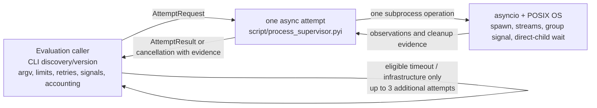

# Process supervisor architecture

**Status: reviewed; implementation pending.** The
[typed contract](../../../../../../script/process_supervisor.pyi) defines the
accepted boundary. No implementation exists, and static checks establish no
runtime behavior.

## TL;DR

- The Evaluation caller owns experiment policy and composes one asynchronous
  process-supervisor attempt per call.
- The supervisor owns subprocess resources, bounded output capture, process
  group signaling, direct-child waiting, and truthful attempt evidence.
- The async framework supplies subprocess, stream, task-cancellation, and wait
  mechanisms, while POSIX supplies process-group, signal, and exit mechanisms.
- The reviewed design does not establish runtime guarantees until implemented
  and supported by evidence.

## Services

### Evaluation caller

- The caller resolves `codex` through `PATH` before every attempt.
- The caller records the resolved executable, actual version, and environment
  configuration and provenance.
- The caller builds the static reviewed argv and finite limits.
- The caller explicitly sets stdin to `DEVNULL`.
- The caller supplies prompt and review context through the reviewed
  argv/context contract rather than an interactive prompt channel.
- The process deliberately inherits the caller-configured environment.
- The caller awaits one supervisor attempt per invocation.
- The caller classifies completed observations and applies Evaluation policy.
- The caller records every attempt and planned call that never started.
- The caller owns signal handling, retry policy, and evidence accounting.
- The caller may retry timeout and eligible infrastructure failures up to three
  additional times, only after cleanup is confirmed.
- A nonzero exit is retry-eligible infrastructure failure only when the caller
  establishes that no semantic result exists.
- Overflow, malformed output, and semantic results prohibit retry for that
  planned call, but do not by themselves stop global dispatch.
- Failed, expired, or unknown signal/wait evidence, uncertain acquisition, and
  cancellation stop new dispatch immediately and mark the run incomplete.
- Other global stops and remaining budgets stay with the caller.
- No retry loop, signal handler, global scheduler, authentication, output
  writing, or scoring belongs to the supervisor.

### One-attempt supervisor

- `AttemptRequest` describes one attempt with finite timeout, cleanup timeout,
  and combined-output limits.
- The supervisor starts one subprocess operation and performs no hidden retry.
- `CapturedOutput` retains stdout and stderr separately as per-stream prefixes
  whose total bytes obey the single combined allowance.
- Exceeding the combined output allowance is visible and terminates the
  invocation rather than silently truncating successful output.
- Captured output makes no claim about ordering between stdout and stderr.
- Keeping stdout separate preserves raw JSONL for the caller to parse without
  diagnostic stderr.
- Exit status and elapsed time remain optional when an incomplete attempt could
  not observe them.
- `Completed` always carries the actual exit status, including a nonzero
  status.
- Infrastructure diagnostics retain the original exception type and message.
- A completed child observation does not itself authorize another dispatch.
- A leader's zero exit cannot turn timeout, cancellation, or overflow into
  success.
- For every launched process, the supervisor requests a signal to its owned
  POSIX process group.
- For every launched process, the supervisor waits for the direct CLI within
  the cleanup deadline.
- `CleanupEvidence` keeps signal and direct-child wait results separate,
  including failed, expired, and unknown outcomes.
- `no_target` records that the OS reported no target for the group-signal
  request, such as when the group had already exited.
- `no_target` is a normal signal observation and does not prove that no group
  member exists.
- The process field distinguishes a safe no-launch startup failure, an acquired
  child, and interrupted acquisition whose ownership is uncertain.
- Signal cleanup is confirmed by `sent` or `no_target` together with a reaped
  direct child.
- No-launch is safe only when no child was acquired and no creation operation
  remains able to acquire one.
- Uncertain acquisition is incomplete cleanup and forbids further dispatch.
- The design trusts OS signal/exit semantics and ordinary resource reclamation.
- The design does not enumerate group members, prove group absence, inspect
  zombies, or contain escaped processes.
- Process creation itself may block beyond the async deadline, and the boundary
  discloses this limit to the caller.
- Cancellation triggers the same bounded cleanup and then propagates as
  `AttemptCancelled`.
- `AttemptCancelled` is a `CancelledError` subtype that carries partial
  observation and cleanup evidence.
- Cancellation is never represented as infrastructure failure and must not be
  retried.
- If cancellation interrupts process creation before ownership is known, the
  boundary reports acquisition uncertainty in the cancellation evidence.
- The boundary must not leave an unawaited creation operation that can later
  acquire an unowned child.

### Async framework and POSIX operating system

- Asyncio supplies subprocess creation, stream access, task cancellation, and
  direct-process waiting through the awaitable boundary.
- The supervisor bounds stream reading and owns cancellation cleanup.
- POSIX supplies the dedicated process group and the signal and exit mechanisms
  used to clean up the invocation's owned group.
- A small direct-kill policy is sufficient without a mandatory
  TERM/grace/KILL sequence.

## Boundary

## Evidence still required

- Static checks can verify declared relationships and imports only.
- Runtime work must establish bounded combined output and truthful completion
  status.
- Runtime work must establish timeout when a leader exits while an owned child
  keeps output open.
- Runtime work must establish overflow termination instead of successful
  truncation.
- Runtime work must establish signal/wait reporting and cancellation
  propagation with cleanup evidence.
- Runtime work must establish caller stop/retry accounting.
- No such behavior is claimed by this design.
