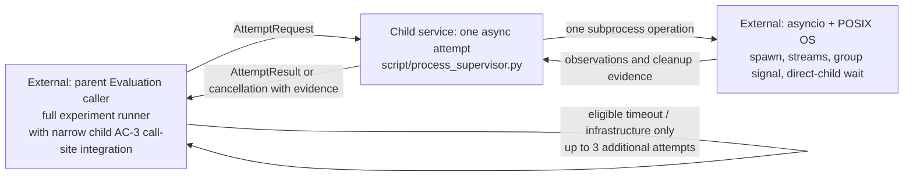

# Process supervisor architecture

**Status: reviewed boundary; typed wiring implemented, process behavior
pending.** The retained [reviewed interface](design/reviewed-interface.pyi)
records the original agreed types. The active
[`script/process_supervisor.py`](../../../../../../script/process_supervisor.py)
defines the importable records, effect seam, one-attempt composition, and narrow
caller stop hook. Its native process adapter still raises `NotImplementedError`;
the wiring tests use fake collaborators and establish no OS lifecycle behavior.

## TL;DR

- The Evaluation caller owns experiment policy and calls the narrow stop hook
  around one asynchronous process-supervisor attempt.
- The supervisor owns subprocess resources, output capture, process
  group signaling, direct-child waiting, and truthful attempt evidence.
- This child delivers the supervisor and minimal AC-3 call-site integration,
  while the parent Evaluation Work owns the full experiment runner.
- The async framework supplies subprocess, stream, task-cancellation, and wait
  mechanisms, while POSIX supplies process-group, signal, and exit mechanisms.
- The reviewed design does not establish runtime guarantees until implemented
  and supported by evidence.
- The scope in the [Work contract](README.md#additional-context) governs typed
  wiring and implementation.
- The supervisor is the child's sole service, with only the call-site
  integration needed to meet AC-3 added at the external caller boundary.
- Private helpers and incidental signatures remain flexible.

## Services

### One-attempt supervisor

- `AttemptRequest` describes one attempt with positive finite execution and
  cleanup timeouts and a nonnegative integer `output_limit_bytes`.
- Zero disables the output byte cap, while a positive value caps the total
  retained stdout and stderr bytes.
- Invalid or nonfinite timeouts and negative output limits refuse launch.
- The supervisor starts one subprocess operation and performs no hidden retry.
- `CapturedOutput` retains stdout and stderr separately as observed per-stream
  prefixes whose total bytes obey any positive combined allowance.
- Exceeding a positive combined output allowance is visible and terminates the
  invocation rather than silently truncating successful output.
- Zero-limit capture has no byte cap and cannot terminate for output overflow.
- Cancelled or interrupted attempts can retain partial prefixes even with a
  zero output limit.
- Captured output makes no claim about ordering between stdout and stderr.
- Keeping stdout separate preserves raw JSONL for the caller to parse without
  diagnostic stderr.
- Exit status and elapsed time remain optional when an incomplete attempt could
  not observe them.
- `Completed` always carries the actual exit status, including a nonzero
  status.
- Infrastructure diagnostics retain the original exception type and message.
- A completed child observation does not itself authorize another dispatch.
- A leader's zero exit cannot turn timeout, cancellation, or overflow into
  success.
- For every launched process, the supervisor requests a signal to its owned
  POSIX process group.
- For every launched process, the supervisor waits for the direct CLI within
  the cleanup deadline.
- `CleanupEvidence` keeps signal and direct-child wait results separate,
  including failed, expired, and unknown outcomes.
- `no_target` records that the OS reported no target for the group-signal
  request, such as when the group had already exited.
- `no_target` is a normal signal observation and does not prove that no group
  member exists.
- The process field distinguishes a safe no-launch startup failure, an acquired
  child, and interrupted acquisition whose ownership is uncertain.
- Signal cleanup is confirmed by `sent` or `no_target` together with a reaped
  direct child.
- No-launch is safe only when no child was acquired and no creation operation
  remains able to acquire one.
- Uncertain acquisition is incomplete cleanup and forbids further dispatch.
- The design trusts OS signal/exit semantics and ordinary resource reclamation.
- The design does not enumerate group members, prove group absence, inspect
  zombies, or contain escaped processes.
- Process creation itself may block beyond the async deadline, and the boundary
  discloses this limit to the caller.
- Cancellation triggers the same bounded cleanup and then propagates as
  `AttemptCancelled`.
- `AttemptCancelled` is a `CancelledError` subtype that carries partial
  observation and cleanup evidence.
- Cancellation is never represented as infrastructure failure and must not be
  retried.
- If cancellation interrupts process creation before ownership is known, the
  boundary reports acquisition uncertainty in the cancellation evidence.
- The boundary must not leave an unawaited creation operation that can later
  acquire an unowned child.

## Wired composition (behavior pending)

- `run_attempt` starts its monotonic clock immediately before acquisition and
  derives the execution deadline from that same instant.
- The acquisition effect receives the caller's request unchanged, including
  the recorded absolute CLI path in `argv[0]`.
- Acquisition returns an owned handle or an explicit `NotLaunched` with a
  normalized error type and diagnostic.
- External cancellation waits for acquisition to settle before deciding
  whether cleanup is required.
- A raw acquisition error remains visible and the caller stops conservatively.
- The capture effect receives the acquired handle and absolute execution
  deadline, then supplies one of the reviewed tagged attempt results.
- Composition preserves the leaf's concrete result variant, exit status,
  output, and diagnostic while adding final cleanup and elapsed observations.
- After acquisition, `run_attempt` requests cleanup after capture success,
  capture failure, or capture cancellation.
- Capture cancellation retains its partial output in the same
  `AttemptCancelled` object while adding final cleanup and elapsed evidence.
- The capture effect translates cancellation while it owns stream buffers into
  `AttemptCancelled` with those partial bytes.
- If raw cancellation escapes, composition records empty bytes as “none
  observed here,” not proof of empty child output.
- Unexpected capture exceptions keep their original type, message, traceback,
  and identity.
- A typed `AttemptFailureEvidence` value is attached to that exception for the
  caller's stop hook.
- Unexpected capture errors remain exceptions and never become retryable
  `InfrastructureFailure` results.
- Cleanup returns signal/wait evidence and an optional direct-child exit status
  observed after termination.
- A missing result status may be filled from cleanup without changing its
  terminal variant.
- Composition retains and shields one cleanup task through repeated external
  cancellation.
- The cleanup adapter owns enforcement of its positive finite timeout.
- Composition cannot promise a hard deadline for a cancellation-resistant
  collaborator and does not detach its cleanup task.
- Elapsed time ends after cleanup evidence returns, and the clock boundary is
  covered by fake-effect wiring tests.
- `NativeProcessEffects` leaves acquisition, stream capture, direct-child wait,
  process-group signaling, and bounded cleanup unimplemented, and acquisition's
  `NotImplementedError` remains visible to its caller.
- Acquisition interruption before a handle is returned is reported as
  uncertain ownership, while absence of a late unowned child remains unproven.
- `call_supervisor` forwards attempt results unchanged and calls the
  parent-owned stop hook when signal or direct-child wait evidence is unsafe.
- On cancellation, `call_supervisor` calls the stop hook and re-raises the same
  cancellation object.
- A safe no-launch observation and an owned process with an accepted signal
  result plus a reaped direct child allow dispatch to continue.
- These signal and direct-child observations do not prove whole-group or
  descendant absence.
- The parent Evaluation owns process signals, undispatched-call accounting,
  retries, budgets, classification, and evidence persistence.
- The caller owns CLI resolution, and this module does not discover or
  version-probe Codex.
- Fake-effect tests establish request flow, cleanup order on error and
  cancellation, tagged-result forwarding, status reconciliation, stop gating,
  repeated task cancellation, acquisition settlement, and elapsed-time
  boundaries only.
- Timeout enforcement, output capture, acquisition ownership, and OS cleanup
  behavior still require implementation and boundary evidence.

## External collaborators

### Evaluation caller (parent Evaluation Work)

- The parent owns the full caller, trial scheduling, retry policy, budgets,
  scoring, and evidence persistence.
- This child integrates the supervisor only far enough to establish the
  [AC-3 stop and accounting guarantees](README.md#ac-3-todo-stop-handling-prevents-further-experimental-dispatch).
- The narrow integration handles signals and cancellation, stops dispatch on
  failed or uncertain cleanup, preserves retry ownership without overlap, and
  retains active-call status and not-started accounting.
- The caller resolves `codex` through `PATH` before every attempt.
- The caller records the resolved executable, actual version, and environment
  configuration and provenance.
- The caller builds the static reviewed argv and protocol limits, including
  the positive 1 MiB combined-output allowance rather than zero-limit capture.
- The caller explicitly sets stdin to `DEVNULL`.
- The caller supplies prompt and review context through the reviewed
  argv/context contract rather than an interactive prompt channel.
- The process deliberately inherits the caller-configured environment.
- The caller awaits one supervisor attempt per invocation.
- The caller classifies completed observations and applies Evaluation policy.
- The caller records every attempt and planned call that never started.
- The caller owns signal handling, retry policy, and evidence accounting.
- The caller may retry timeout and eligible infrastructure failures up to three
  additional times, only after cleanup is confirmed.
- A nonzero exit is retry-eligible infrastructure failure only when the caller
  establishes that no semantic result exists.
- Overflow, malformed output, and semantic results prohibit retry for that
  planned call, but do not by themselves stop global dispatch.
- Failed, expired, or unknown signal/wait evidence, uncertain acquisition, and
  cancellation stop new dispatch immediately and mark the run incomplete.
- Other global stops and remaining budgets stay with the caller.
- No retry loop, signal handler, global scheduler, authentication, output
  writing, or scoring belongs to the supervisor.

### Async framework and POSIX operating system (external mechanisms)

- Asyncio supplies subprocess creation, stream access, task cancellation, and
  direct-process waiting through the awaitable boundary.
- The supervisor applies any positive output byte cap and owns cancellation
  cleanup.
- POSIX supplies the dedicated process group and the signal and exit mechanisms
  used to clean up the invocation's owned group.
- A small direct-kill policy is sufficient without a mandatory
  TERM/grace/KILL sequence.

## Boundary

## Evidence still required

- Static checks can verify declared relationships and imports only.
- Runtime work must establish combined-output capping for positive limits,
  capture without a byte cap for zero, rejection of negative limits, and
  truthful completion status.
- Runtime work must establish timeout when a leader exits while an owned child
  keeps output open.
- Runtime work must establish overflow termination for positive output limits
  instead of successful truncation.
- Runtime work must establish signal/wait reporting and cancellation
  propagation with cleanup evidence.
- Runtime work must establish caller stop/retry accounting.
- No such behavior is claimed by this design.
