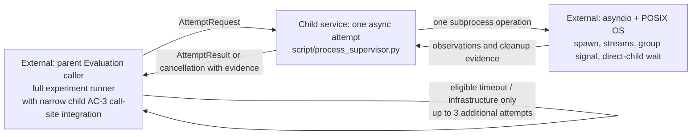
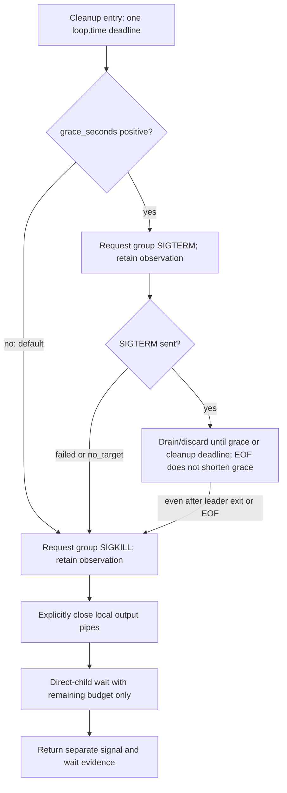

# Process supervisor architecture

**Status: immediate-SIGKILL boundary accepted for AC-1 and AC-2; optional grace
is implemented and accepted for AC-4.**
Representative caller scenarios exercise the child AC-3 boundary, while actual
parent Evaluation harness integration remains pending. The retained
[reviewed interface](design/reviewed-interface.pyi)
records the original agreed types. The active
[`script/process_supervisor.py`](../../../../../../script/process_supervisor.py)
defines the importable records, effect seam, one-attempt composition, narrow
caller stop hook, and native process adapter. Disposable process regressions
exercise native lifecycle and a representative caller pattern; actual AC-3
integration in the parent Evaluation harness remains pending.

The [grace typed delta](design/grace-interface.pyi) records only the affected
public shapes and cleanup seam. It does not replace the active module or alter
the historical reviewed interface. Focused native and controlled effect-boundary
regressions cover the AC-4 lifecycle, which has passed independent acceptance.

## TL;DR

- Zero grace uses immediate SIGKILL; positive grace requests TERM, drains
  discarded output, then requests final SIGKILL within one cleanup deadline.
- The Evaluation caller owns experiment policy and calls the narrow stop hook
  around one asynchronous process-supervisor attempt.
- The supervisor owns subprocess resources, output capture, process
  group signaling, direct-child waiting, and truthful attempt evidence.
- This child delivers the supervisor and minimal AC-3 call-site integration,
  while the parent Evaluation Work owns the full experiment runner.
- The async framework supplies subprocess, stream, task-cancellation, and wait
  mechanisms, while POSIX supplies process-group, signal, and exit mechanisms.
- Runtime claims remain limited to the specific disposable process scenarios
  exercised by focused regressions.
- The scope in the [Work contract](README.md#additional-context) governs typed
  wiring and implementation.
- The supervisor is the child's sole service, with only the call-site
  integration needed to meet AC-3 added at the external caller boundary.
- Private helpers and incidental signatures remain flexible.

## Services

### One-attempt supervisor

- `AttemptRequest` describes one attempt with positive finite execution and
  cleanup timeouts and a nonnegative integer `output_limit_bytes`.
- `AttemptRequest` construction enforces those timeout and output-limit
  invariants before native acquisition begins.
- Zero disables the output byte cap, while a positive value caps the total
  retained stdout and stderr bytes.
- Invalid or nonfinite timeouts and negative output limits refuse launch.
- The supervisor starts one subprocess operation and performs no hidden retry.
- `CapturedOutput` retains stdout and stderr separately as observed per-stream
  prefixes whose total bytes obey any positive combined allowance.
- `AttemptObservation.output` is absent when no byte observation is available;
  observed empty streams use empty byte prefixes.
- Exceeding a positive combined output allowance is visible and terminates the
  invocation rather than silently truncating successful output.
- Zero-limit capture has no byte cap and cannot terminate for output overflow.
- Cancelled or interrupted attempts can retain partial prefixes even with a
  zero output limit.
- Captured output makes no claim about ordering between stdout and stderr.
- Keeping stdout separate preserves raw JSONL for the caller to parse without
  diagnostic stderr.
- Exit status and elapsed time remain optional when an incomplete attempt could
  not observe them.
- `Completed` always carries the actual exit status, including a nonzero
  status.
- Exit status follows asyncio's POSIX convention: nonnegative values are exit
  codes and negative values identify the terminating signal.
- Infrastructure diagnostics retain the original exception type and message.
- A completed child observation does not itself authorize another dispatch.
- A leader's zero exit cannot turn timeout, cancellation, or overflow into
  success.
- For every launched process, the supervisor requests a signal to its owned
  POSIX process group.
- For every launched process, the supervisor waits for the direct CLI within
  the cleanup deadline.
- `CleanupEvidence` keeps signal and direct-child wait results separate,
  including failed, expired, and unknown outcomes.
- `no_target` records that the OS reported no target for the group-signal
  request, such as when the group had already exited.
- `no_target` is a normal signal observation and does not prove that no group
  member exists.
- The process field distinguishes a safe no-launch startup failure, an acquired
  child, and interrupted acquisition whose ownership is uncertain.
- Signal cleanup permits dispatch by `sent` or `no_target` together with a
  reaped direct child.
- No-launch is safe only when no child was acquired and no creation operation
  remains able to acquire one.
- Uncertain acquisition is incomplete cleanup and forbids further dispatch.
- The design trusts OS signal/exit semantics and ordinary resource reclamation.
- The design does not enumerate group members, prove group absence, inspect
  zombies, or contain escaped processes.
- Process creation itself may block beyond the async deadline, and the boundary
  discloses this limit to the caller.
- Cancellation triggers the same bounded cleanup and then propagates as
  `AttemptCancelled`.
- Cancellation by the owner, capture effect, or cleanup adapter stops
  dispatch; a cleanup adapter's self-cancellation leaves cleanup unknown.
- `AttemptCancelled` is a `CancelledError` subtype that carries partial
  observation and cleanup evidence.
- Cancellation is never represented as infrastructure failure and must not be
  retried.
- If cancellation interrupts process creation before ownership is known, the
  boundary reports acquisition uncertainty in the cancellation evidence.
- The boundary must not leave an unawaited creation operation that can later
  acquire an unowned child.

## Wired composition and native behavior

- `run_attempt` starts its monotonic clock immediately before acquisition and
  derives the execution deadline from that same instant.
- `run_attempt` passes the same clock to capture so the native adapter
  compares the deadline in the same clock domain.
- The execution timeout budget begins at acquisition, not capture.
- The acquisition effect receives the caller's request unchanged, including
  the recorded absolute CLI path in `argv[0]`.
- Acquisition returns an owned handle or an explicit `NotLaunched` with a
  normalized error type and diagnostic.
- External cancellation waits for acquisition to settle before deciding
  whether cleanup is required.
- A raw acquisition error remains visible and the caller stops conservatively.
- The capture effect receives the acquired handle, absolute execution deadline,
  and the same clock used to construct it, then supplies one of the reviewed
  tagged attempt results.
- Composition preserves the leaf's concrete result variant, exit status,
  output, and diagnostic while adding final cleanup and elapsed observations.
- After acquisition, `run_attempt` requests cleanup after capture success,
  capture failure, or capture cancellation.
- Capture cancellation retains its partial output in the same
  `AttemptCancelled` object while adding final cleanup and elapsed evidence.
- Cancellation during reader settlement keeps both the cancellation and the
  original capture error inspectable.
- The capture effect translates cancellation while it owns stream buffers into
  `AttemptCancelled` with those partial bytes.
- If raw cancellation escapes or capture fails before exposing buffers, output
  is unavailable; an observed empty stream remains distinct.
- Unexpected capture exceptions keep their original type, message, traceback,
  and identity.
- Capture-time control-flow exceptions such as `SystemExit` or
  `KeyboardInterrupt` trigger retained cleanup before they propagate.
- A typed `AttemptFailureEvidence` value is attached to that exception for the
  caller's stop hook.
- Unexpected capture errors remain exceptions and never become retryable
  `InfrastructureFailure` results.
- Cleanup returns signal/wait evidence and an optional direct-child exit status
  observed after termination.
- A missing result status may be filled from cleanup without changing its
  terminal variant.
- Composition retains and shields one cleanup task through repeated external
  cancellation.
- Owned-attempt finalization requests cleanup once and applies this precedence:
  owner cancellation, leaf or adapter cancellation, capture error, cleanup
  error, then result.
- Cleanup adapter self-cancellation is a cancellation outcome with unknown
  cleanup evidence and stops dispatch.
- The cleanup adapter owns enforcement of its positive finite timeout.
- Composition cannot promise a hard deadline for a cancellation-resistant
  collaborator and does not detach its cleanup task.
- Elapsed time ends after cleanup evidence returns, and the clock boundary is
  covered by fake-effect wiring tests.
- `NativeProcessEffects` launches the supplied argv in a new session and
  captures separate streams under a combined cap and execution deadline.
- It SIGKILLs the owned group before awaiting the direct child under the
  cleanup deadline and records signal and wait failures.
- Disposable regressions observe completion, nonzero status, exact and
  overflowing caps, zero-cap capture, descendant-held pipes, repeated
  cancellation output retention, delayed acquisition settlement, and signal
  exit status within those scenarios.
- Scoped asyncio-boundary substitutions exercise direct-wait expiry and error
  accounting without claiming those outcomes from the real OS.
- Acquisition interruption before a handle is returned is reported as
  uncertain ownership, while absence of a late unowned child remains unproven.
- `call_supervisor` forwards attempt results unchanged and calls the
  parent-owned stop hook when signal or direct-child wait evidence is unsafe.
- On cancellation, `call_supervisor` calls the stop hook and re-raises the same
  cancellation object.
- Stop-hook failures on attempt exceptions and cancellations retain a
  diagnostic while the original control flow keeps precedence.
- A stop-hook failure on an unsafe result propagates with that result's evidence
  attached.
- Stop hooks should not raise, and their failures are never retryable
  infrastructure outcomes.
- A safe no-launch observation and an owned process with an accepted signal
  result plus a reaped direct child allow dispatch to continue.
- These signal and direct-child observations do not prove whole-group or
  descendant absence.
- The parent Evaluation owns process signals, undispatched-call accounting,
  retries, budgets, classification, and evidence persistence.
- Before any fallible attempt or run-evidence recording, the parent caller sets
  a stop latch when a stop condition is known.
- The parent caller checks the stop latch before every dispatch so a recording
  failure cannot reopen dispatch.
- The caller owns CLI resolution, and this module does not discover or
  version-probe Codex.
- Fake-effect tests establish request flow, cleanup order on error and
  cancellation, tagged-result forwarding, status reconciliation, stop gating,
  repeated task cancellation, acquisition settlement, and elapsed-time
  boundaries only.
- Native adapter coverage remains limited to the disposable scenarios listed
  in the evidence section and leaves other OS outcomes unestablished.

## External collaborators

### Evaluation caller (parent Evaluation Work)

- The parent owns the full caller, trial scheduling, retry policy, budgets,
  scoring, and evidence persistence.
- The executable `process_supervisor_caller.py` fixture demonstrates one
  representative call-site pattern using public `call_supervisor` and
  `run_attempt` paths.
- Its regressions observe delivered `SIGINT` and `SIGTERM`, task cancellation,
  stop latching before cancellation and recording, unsafe-cleanup dispatch
  prevention, and not-started accounting.
- Stop regressions attempt later real CLI dispatch through the same guard and
  assert its fixture marker is absent when the latch refuses it.
- Its retry scenario observes dispatch after direct-child reaping and no
  overlap by retaining the prior child PID, exit status, and direct-wait
  evidence before the retry dispatch event.
- These representative tests do not verify wiring in the absent Evaluation
  harness; parent-owned integration remains necessary before AC-3 assessment.
- The caller resolves `codex` through `PATH` before every attempt.
- The caller records the resolved executable, actual version, and environment
  configuration and provenance.
- The caller builds the static reviewed argv and protocol limits, including
  the positive 1 MiB combined-output allowance rather than zero-limit capture.
- The caller explicitly sets stdin to `DEVNULL`.
- The caller supplies prompt and review context through the reviewed
  argv/context contract rather than an interactive prompt channel.
- The process deliberately inherits the caller-configured environment.
- The caller awaits one supervisor attempt per invocation.
- The caller classifies completed observations and applies Evaluation policy.
- The caller records every attempt and planned call that never started.
- The caller owns signal handling, retry policy, and evidence accounting.
- The caller may retry timeout and eligible infrastructure failures up to three
  additional times, only after cleanup permits dispatch.
- A nonzero exit is retry-eligible infrastructure failure only when the caller
  establishes that no semantic result exists.
- Overflow, malformed output, and semantic results prohibit retry for that
  planned call, but do not by themselves stop global dispatch.
- Failed, expired, or unknown signal/wait evidence, uncertain acquisition, and
  cancellation stop new dispatch immediately and mark the run incomplete.
- Other global stops and remaining budgets stay with the caller.
- No retry loop, signal handler, global scheduler, authentication, output
  writing, or scoring belongs to the supervisor.

### Async framework and POSIX operating system (external mechanisms)

- Asyncio supplies subprocess creation, stream access, task cancellation, and
  direct-process waiting through the awaitable boundary.
- The supervisor applies any positive output byte cap and owns cancellation
  cleanup.
- POSIX supplies the dedicated process group and the signal and exit mechanisms
  used to clean up the invocation's owned group.
- A small direct-kill policy is sufficient without a mandatory
  TERM/grace/KILL sequence.

## Boundary

## Optional grace extension

The
[AC-4 contract](README.md#ac-4-done-optional-grace-preserves-bounded-accountable-cleanup)
owns the new guarantees. Native cleanup keeps immediate SIGKILL as its default
and supports a positive-grace TERM/drain/KILL branch inside the same supervisor;
there is no additional service or general signal-policy abstraction.

The typed delta describes the affected public boundary:

- `AttemptRequest` adds `grace_seconds = 0.0`.
- `ProcessEffects.cleanup(handle, timeout_seconds, grace_seconds, /)` receives
  both validated limits unchanged from `run_attempt`.
- The native adapter owns the shared cleanup deadline in the running loop's
  clock domain under AC-4.
- The existing execution clock and capture deadline remain unchanged.
- `SignalAttempt` is a small immutable observation with signal identity,
  outcome and diagnostic.
- An ordered tuple replaces the old single signal fields on `CleanupEvidence`.
- The revised evidence flows through the existing `CleanupOutcome`,
  `AttemptObservation`, result and exception evidence paths while their other
  fields and tagged variants remain as in the active module.
- Public callers and fake effects use the changed cleanup signature and
  evidence shape.

Capture and cleanup retain distinct resource ownership:

- Capture owns the retained output prefix and original terminal reason.
- Settled capture transfers stream ownership to cleanup without concurrent
  readers or detached draining tasks.
- Cleanup drains and discards during grace and settles its drain operations
  within the same lifecycle as AC-4's pipe closure.
- EOF does not end the configured grace early. An unexpected drain read error
  is propagated only after final KILL, explicit pipe closure and the bounded
  direct-child wait have settled.
- Exact private reader mechanics remain implementation choices.

`CleanupEvidence.dispatch_permitted` applies these rules:

- Owned cleanup accepts only the exact ordered signal identities
  `("SIGKILL",)` or `("SIGTERM", "SIGKILL")`.
- Every signal outcome must be `sent` or `no_target`, and `direct_wait` must be
  `reaped`.
- Missing final KILL, unknown outcomes, duplicates and reordered sequences
  forbid dispatch.
- A failed TERM forbids dispatch even when the following KILL succeeds.
- The adapter selects the expected sequence from validated grace; the evidence
  property needs no new request or configuration field.
- Proven no-launch remains safe only with empty signal evidence, no direct wait
  and no diagnostic.
- Uncertain acquisition remains unsafe.
- Cancellation independently stops dispatch under the existing caller contract.

The AC-4 implementation and its focused disposable-process regressions have
passed independent review and acceptance. AC-4 is DONE; AC-3 integration in
the parent Evaluation harness remains pending.

- The new file is outside active module resolution and describes deltas rather
  than a second full API.
- It contains no executable helpers or static test fixtures.
- The opportunity to react to TERM and the limits on guarantees and scope remain
  owned by AC-4 and the Work's Non-Goals.

## Evidence and remaining integration

- Static checks can verify declared relationships and imports only.
- Disposable-process tests observe combined-output capping for positive limits,
  uncapped capture at zero, and truthful completion status.
- A disposable-process test observes timeout when a leader exits while an
  owned child keeps output open.
- Disposable-process tests observe overflow termination for positive output
  limits instead of successful truncation.
- Disposable-process tests observe signal/wait reporting and cancellation
  propagation with cleanup evidence.
- AC-4 regressions observe cooperative and ignored TERM, output draining without
  retained-prefix growth, a TERM-ignoring pipe holder, repeated cancellation,
  signal failures, no-target grace skipping, and cleanup-budget exhaustion.
- Representative caller tests exercise the public stop hook, signal delivery,
  cleanup-failure stop, accounting, and retry ordering.
- Actual Evaluation-harness signal wiring, accounting, and scheduling remain
  pending parent-owned integration and review.
- Closing a suspended attempt coroutine cannot await asynchronous finalization.
- Cleanup guarantees require the supported cancellation and awaiting lifecycle;
  raw closure alone does not establish OS cleanup.
