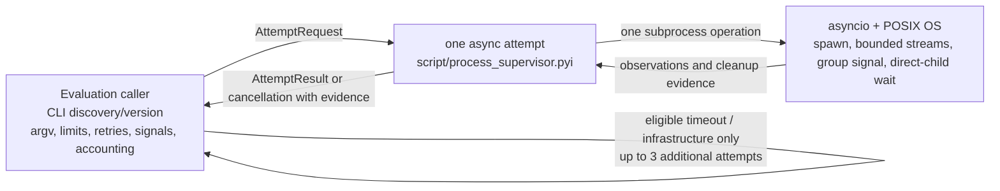

# Process supervisor architecture

**Status: reviewed; implementation pending.** The
[typed contract](../../../../../../script/process_supervisor.pyi) defines the
accepted boundary. There is no implementation, and static checks establish no
runtime behavior.

## Boundary

The Evaluation caller owns experiment policy and all CLI provenance. Before
each attempt it resolves `codex` through `PATH`, records the resolved path and
the actual version, and builds the static reviewed argv and limits. It then
awaits exactly one attempt. Stdin is explicitly `DEVNULL`; prompt and review
context are supplied by the caller through the reviewed argv/context contract,
not an interactive prompt channel.
The process inherits its environment deliberately; the caller owns the
configuration and provenance recorded for that environment.

`AttemptRequest` describes one attempt and carries finite timeout, cleanup
timeout, and combined output limits. `CapturedOutput` retains stdout and stderr
separately as per-stream prefixes whose total bytes obey that single allowance;
it makes no claim about ordering between streams. Keeping stdout separate
preserves raw JSONL for the caller to parse without diagnostic stderr. Exit
status and elapsed time remain optional
when an incomplete attempt could not observe them. `Completed` always carries
the actual exit status, including nonzero status. Infrastructure diagnostics
retain the original exception type and message. A completed child observation
does not itself authorize another dispatch: the caller classifies the result
and applies evaluation policy.

For every launched process, the boundary requests a signal to its owned POSIX
group and waits for the direct CLI within the cleanup deadline.
`CleanupEvidence` keeps signal and direct-child wait results separate, including
failed, expired, and unknown outcomes. `no_target` records that the OS reported
no target for the group-signal request (for example, because the group had
already exited); it is a normal signal observation, not proof that no group
member exists. Its process field distinguishes a safe no-launch startup failure,
an acquired child, and interrupted acquisition whose ownership is uncertain.
Signal cleanup is confirmed by `sent` or `no_target`, together with a reaped
direct child; the no-launch case is safe when no creation operation remains.
No-launch means no child was acquired and no creation operation remains able to
acquire one. Uncertain acquisition is incomplete cleanup and forbids further
dispatch. The design trusts OS signal/exit semantics and ordinary resource
reclamation; it does not enumerate group members, prove group absence, inspect
zombies, or contain escaped processes. Process creation itself may block
beyond the async deadline; this limit is disclosed to the caller.

Cancellation triggers the same bounded cleanup, then propagates as
`AttemptCancelled`, a `CancelledError` subtype constructed with and carrying
partial observation and cleanup evidence. It is never represented as
infrastructure failure and must not be retried. If cancellation interrupts
process creation before ownership is known, the boundary reports that
acquisition uncertainty in the cancellation evidence; it must not leave an
unawaited creation operation that can later acquire an unowned child.

The caller classifies each completed observation using the protocol: a nonzero
exit is retry-eligible infrastructure failure only when the caller establishes
that no semantic result exists. Timeout and eligible infrastructure failures
may receive up to three additional attempts, only after cleanup is confirmed.
Overflow, malformed output, and semantic results prohibit retry for that
planned call; by themselves they do not globally stop dispatch. Failed, expired,
or unknown signal/wait evidence, uncertain acquisition, and cancellation stop
new dispatch immediately and mark the run incomplete. Other global stops and
remaining budgets stay with the caller. The caller retains every attempt and
planned-but-undispatched accounting. No retry loop, signal handler, global
scheduler, authentication, output writing, or scoring belongs in this boundary.

## Evidence still required

Static checks can verify the declared relationships and imports only. Runtime
work must still establish bounded combined output, truthful completion status,
timeout despite a leader exiting with an owned child holding output open,
signal/wait reporting, cancellation propagation and cleanup evidence, and
caller stop/retry accounting. No such behavior is claimed by this design.
