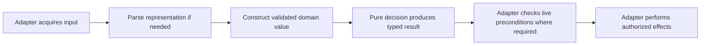

# Validated models and pure core guidance

## Purpose

Make engineering guidance explain how to turn external data into valid domain
values, apply pure rules, and perform effects without confusing model validity
with live resource safety.

## Goals

- Define complete consumed-record validation and immutable core inputs/results.
- Separate pure decisions from parsing, input acquisition, and effects.
- Define consumer-owned collaborator contracts and adapter responsibilities.
- Demonstrate these boundaries with compact examples in the existing
  [engineering conventions](../../engineering.md).

## Glossary

- **Consumed record:** the fields and relationships an operation relies on,
  including ownership, persistence, and security requirements.
- **Domain value:** a typed value whose construction from inputs satisfying its
  declared type contract establishes the invariants required by its consumers.
- **Core:** the domain values and pure rules, separate from input acquisition
  and effects.
- **Port and adapter:** a consumer-defined collaborator contract and its
  concrete implementation; see the
  [shared glossary](../../ubiquitous-language.md).

## Non-Goals

- Migrate production code, redesign the computation graph, or change resource
  ownership and module dependency rules.
- Introduce a framework, tool dependency, executable enforcement, or a second
  testing policy.
- Require a separate file, class, wrapper, or Protocol for every responsibility.
- Resolve the representation question owned by the
  [algebraic data type Investigation](../algebraic-data-types/README.md).

## Mechanisms

- Frozen dataclasses and focused constructors establish runtime invariants for
  domain values.
- Pure functions compute typed results from valid explicit inputs.
- Consumer-defined `typing.Protocol` ports describe collaborator contracts;
  injected concrete adapters implement effects and resource management.

## Visuals

Proposed responsibility flow; the boxes do not prescribe separate files or
classes, and external checks remain at the points required by each operation.

## Acceptance criteria

### **AC-1 TODO** Complete record validation

[Engineering conventions](../../engineering.md) requires domain value
construction from inputs satisfying its declared type contract to establish
every consumed-field and cross-field invariant it owns through `__post_init__`
checks or focused constructors before core logic runs. Validation follows the
input contract:

- Raw external representations and untyped input, including persisted records,
  JSON, CLI/network input, and untyped plugin data, require consumed structure,
  types, and owned relationships to be validated once at the owning boundary.
- Supported, documented typed library APIs supply their documented type, shape,
  and structural guarantees; adapters check our contract gaps, such as required
  data upstream makes optional, unsupported variants, representation conversion,
  and domain invariants, without revalidating guarantees merely because the
  library is third party.
- Typed internal constructors may rely on declared argument types and already
  validated child domain values; they enforce owned semantic, value,
  cross-field, and immutability invariants without promising schema validation
  of arbitrary untyped arguments or repeatedly inspecting validated children.

Type and ownership checks remain appropriate where they establish an owned
invariant, such as requiring tuple storage or excluding `bool` from an integer
value domain. Popularity, annotations, and freezing alone do not establish
validity; typed API guarantees do not extend to raw or untyped inputs, which
must be validated at their actual ingress before construction. Validated domain
values follow [AC-3](#ac-3-todo-pure-decisions-over-valid-inputs); live resource
checks follow
[AC-5](#ac-5-todo-effects-and-live-resource-safety-owned-by-adapters).
Rejection may stop at the first error using simple guards. Expected boundary
failures get contextual errors; programming errors surface rather than being
blanket-wrapped as input errors.

Consumed fields include ownership, persistence, and security requirements.
Unrelated extension data remains opaque and is preserved when required by the
transport/persistence contract. A compact constructor example shows valid typed
construction and rejection of invalid values and field combinations, with raw
input validation at ingress, including finite string-domain validation with one
authoritative `Literal` member inventory under the existing
[type-precision guidance](../../engineering.md#preserve-type-precision).

#### What exists

Engineering already requires external-boundary adaptation. The historical
sandbox validator linked below checks lifecycle, identity, and extension data;
this Work makes complete record invariants explicit in general guidance.

### **AC-2 TODO** Immutable core values and valid state transitions

Engineering guidance requires core inputs/results to use frozen dataclasses or
immutable value variants, with immutable or explicitly owned containers. It
explains that freezing is shallow and that annotations do not establish
invariants. New results and state transitions pass through validated
construction without mutating existing values or bypassing construction with
`object.__setattr__`. The constructor example extends to a valid new result or
state, showing how fields required together form a record. Stateful runners and
resource holders retain their explicit mutable ownership where needed.

#### What exists

Engineering already prefers frozen values. At planning baseline
`cd3cb5e6a7abfbb91533c1b14be37b26ff05927a`,
[BrokerRunner and Position](../../../src/ataraxia/broker.py) show why
declarations alone are insufficient: the runner holds mutable containers and
Position mutates frozen fields with `object.__setattr__`.

### **AC-3 TODO** Pure decisions over valid inputs

Engineering guidance requires pure core rules to return the same results for the
same valid explicit inputs, without I/O, environment/time/random/global-state
dependence, or argument mutation. Rules consume validated domain values without
reparsing, repeated defensive input checks, or filesystem/process probes. They
may construct new outputs under [AC-1](#ac-1-todo-complete-record-validation)
and transform typed path values; output construction enforces its own invariants
without revalidating child domain values. Calling an effectful collaborator
remains effectful even through an injected Protocol. The constructor example
includes a pure decision with typed inputs/results and clear error behavior.

#### What exists

[SmaRunner and sma](../../../src/ataraxia/feature.py) already separate runner
parameters from calculation; this is a starting point rather than evidence of
repository-wide purity or immutable inputs.

### **AC-4 TODO** Collaborator contracts owned by consumers

Engineering guidance defines reusable collaborator ports through
`typing.Protocol` from consumer needs, with precise inputs, outputs, errors, and
lifecycle ownership. Concrete adapters implement these contracts and are
injected by the host or composition root. Dependencies point toward the
consumer contract; core does not import concrete adapters. Protocols are not
required for every value or helper, and `runtime_checkable` is used only for an
actual runtime conformance need. A compact wiring example shows the typed port,
its adapter, and how the consumer receives it.

#### What exists

Engineering already uses structural Protocols and injected dependencies.
[Provider](../../../src/ataraxia/provider.py) and
[SourceNode](../../../src/ataraxia/source.py) demonstrate collaborator contracts
and delegated resource ownership that this guidance can build on.

### **AC-5 TODO** Effects and live resource safety owned by adapters

Engineering guidance assigns acquisition, parsing, validation, pure decisions,
and output/effects clear typed input/output, error, and effect responsibilities.
Adapters coordinate pure decisions and own processes, filesystem/persistence,
locks, and cleanup on success or failure; cohesive functions may share a module.

Record validation follows the input categories in
[AC-1](#ac-1-todo-complete-record-validation) at the actual ingress; adapters
separately recheck live preconditions where an operation requires them. The
wiring example makes this distinction concrete: raw persisted data is validated
before domain construction, and a valid persisted sandbox record does not prove
current generation, device/inode identity, or held-lock freshness. Adapter
checks under lock preserve fail-closed behavior, protection against changes
between checking and use, and required effect ordering. Schema and ownership
fields remain part of record validity even when a pure decision does not read
them. Accepted/rejected inputs, documented errors/causes, and state invariants
remain contracts; validation order and branch organization may change when those
outcomes do not.

## Dependencies

This Work has no prerequisite Work. The
[complexity adoption Work](../conditional-complexity/adopt/README.md) consumes
these boundary rules and must follow this Work's integration before editing the
shared engineering owner; it owns measurable condition prevention. The
[complexity Investigation](../conditional-complexity/investigate/README.md) and
ADT Investigation may proceed independently.

## Links

- [PR #328 comment](https://github.com/msitarz/ataraxia/pull/328#discussion_r4272687628)
  and historical
  [`_validate_record` at 47779e4](https://github.com/msitarz/ataraxia/blob/47779e4dbf3df31d0c4ebcffd9d074ba493ccff3/script/sandbox.py#L465-L550):
  the original sandbox seed validates lifecycle/diagnostics, identity, and
  extensions in one external record validator; its read-only ProcessSupervisor
  is another collaborator example to inspect. PR #328 is independent and need
  not merge for this Work.
- [ADR 2](../../adr/0002-strategy-and-features-as-pure-functions.md),
  [ADR 8](../../adr/0008-stateful-callable-class-instead-of-a-generator.md),
  [ADR 10](../../adr/0010-provider-for-graph-source-instead-of-bare-type.md),
  [ADR 16](../../adr/0016-source-manages-its-own-provider-lifecycle.md), and
  [ADR 17](../../adr/0017-enforce-module-dependencies-with-tach.md):
  existing pure-function, runner, provider, resource-ownership, and dependency
  contracts that this guidance elaborates.

## Additional context

The delivery is compact guidance and two supporting examples at the engineering
owner: a constructor/pure-decision example and a port/adapter wiring example.
Together they contrast raw input validation with documented typed library API
adaptation. At least one uses ordinary application logic outside sandbox
lifecycle; sandbox locks and native identity checks stay contextual. Examples
describe proposed behavior with typed signatures and input/output/error/effect
contracts, without introducing production APIs. Existing, historical, and
proposed behavior are distinguished against then-integrated source; the
historical ProcessSupervisor is absent at the planning baseline.

The guidance integrates existing composition, dataclass, Protocol, and
type-precision rules and links to [testing guidance](../../testing.md) for test
ownership. Upstream OS and Ruff algorithm assertions are outside this Work.
