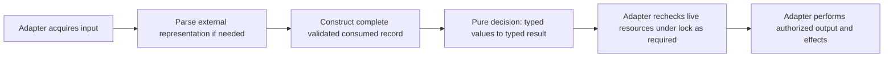

# Validated models and pure core guidance

Adopt lasting engineering guidance for complete consumed-record validation,
immutable values and pure core rules, with clear module responsibilities and
consumer-defined Protocol ports/adapters. This is a small guidance delivery with
compact examples, not a recommendation-only Investigation or a repository-wide
source migration. Integrate it at
[engineering conventions](../../engineering.md), reviewing the existing
composition, dataclass, Protocol and type-precision rules as a whole. Link to
[testing guidance](../../testing.md) for test ownership rather than creating a
second testing policy.

At planning baseline `cd3cb5e6a7abfbb91533c1b14be37b26ff05927a`, engineering
already prefers frozen values, structural collaborator protocols, injected
dependencies and external-boundary adaptation.
[SmaRunner and sma](../../../src/ataraxia/feature.py) separate runner parameters
from a calculation, while [Provider](../../../src/ataraxia/provider.py) and
[SourceNode](../../../src/ataraxia/source.py) own input and delegated resource
lifecycle. [BrokerRunner](../../../src/ataraxia/broker.py) is frozen but holds
mutable account/position containers, and `Position` mutates frozen fields with
`object.__setattr__`: frozen declarations alone do not prove value immutability.
These are verified examples of current behavior, not blanket compliance. The
remaining guidance gap is explicit complete record invariants, pure/effect
separation and precise collaborator contracts.

The historical seed is the maintainer's
[PR #328 comment](https://github.com/msitarz/ataraxia/pull/328#discussion_r4272687628)
and frozen
[`_validate_record` at reviewed head 47779e4](https://github.com/msitarz/ataraxia/blob/47779e4dbf3df31d0c4ebcffd9d074ba493ccff3/script/sandbox.py#L465-L550).
It validates lifecycle/diagnostics, identity and extensions in one external
record validator. Its read-only ProcessSupervisor pattern is another
collaborator example to inspect at execution; it is absent at the planning
baseline. PR #328 remains independent and need not merge for this Work. Inspect
then-integrated source before drafting examples; label historical and proposed
examples clearly.

The proposed boundary flow below describes responsibilities, not required files,
classes or wrappers. Current examples above separate some responsibilities but
do not establish this complete boundary for every module.

The compact guidance must require the following outcomes:

- Parse external representations and validate the complete consumed record at an
  explicit boundary before exposing a truthful domain value. Use frozen
  dataclasses with runtime `__post_init__` checks or focused constructors for
  consumed-field and cross-field invariants. Annotations and freezing are not
  runtime validation. Validate fields used by domain behavior or required by
  ownership, persistence or security; generation/schema/owner/device/inode
  remain relevant even when a pure decision does not read them. Preserve
  unrelated extension data opaquely under the required transport/persistence
  contract, without speculative validation of unused external schema.
- Use frozen dataclasses or immutable value variants for core inputs/results
  and pure functions for core rules. The same explicit inputs produce the same
  outputs without I/O, environment/time/random/global-state dependence or
  argument mutation. Establish actual immutable or owned input containers;
  `frozen=True` is shallow and a frozen list field remains mutable. Product
  records express fields required together; lifecycle sum variants are the
  distinct [ADT Investigation's](../algebraic-data-types/README.md) question,
  without requiring broad variant rewrites here.
- Give applicable Python modules/functions clear responsibilities for input
  acquisition, output/effects, parsing if needed, validation if needed and pure
  decisions, with typed input/output and documented error/effect contracts.
  Pure decisions consume valid domain values instead of raw JSON/disk paths or
  repeated defensive type checks. Cohesive small modules can separate functions
  within one file; do not prescribe five files, functions or classes per module
  or retain wrappers without a useful contract. Shells/adapters own locks,
  processes, filesystem/persistence and coordinate pure functions. Mutable
  resource holders and stateful runner orchestration retain explicit ownership
  at those boundaries; no blanket freezing of runners/lease handles or graph
  redesign is included.
- Define reusable collaborator `typing.Protocol` contracts as ports from
  consumer/domain needs, with precise inputs, outputs, errors and lifecycle
  ownership. Concrete adapters implement ports and the composition root/host
  injects them; dependency direction points inward and core does not import
  concrete adapters. Reuse Provider/Source and the historical ProcessSupervisor
  patterns where they fit. Values, helper functions and every module do not need
  a Protocol; use `runtime_checkable` only for an actual runtime conformance
  need. A function calling an effectful port is effectful even when injected.
- Validate the input record once per boundary crossing. Mutable filesystem
  generation/inode and held-lock freshness still require adapter revalidation
  under lock at the lifecycle's required points. Preserve fail-closed behavior,
  TOCTOU protection and necessary side-effect ordering; frozen persisted values
  cannot guarantee live resource safety. Observable accepted/rejected inputs,
  relevant documented errors/causes and state invariants remain contracts;
  validation order and branch organization can change when those outcomes do
  not. Discourage clever compound short-circuit validation while permitting
  Python Boolean semantics and simple guards.

Provide one compact proposed consumed-record constructor/pure-decision example
and one compact port/adapter wiring example. Describe their signatures and
input/output/error/effect responsibilities, show valid construction and a
cross-field rejection, and distinguish model validity from live resource safety.
Examples demonstrate guidance, not new production APIs or executable
enforcement. Pure public-function units use valid typed values;
boundary/constructor tests cover whole consumed records, invalid fields and
cross-field cases; parsing tests cover roundtrip compatibility.
Adapter/wiring/integration tests own our effects and resource management. Link
to existing testing guidance and avoid upstream OS or Ruff algorithm assertions.

This guidance elaborates
[ADR 2](../../adr/0002-strategy-and-features-as-pure-functions.md),
[ADR 8](../../adr/0008-stateful-callable-class-instead-of-a-generator.md),
[ADR 10](../../adr/0010-provider-for-graph-source-instead-of-bare-type.md),
[ADR 16](../../adr/0016-source-manages-its-own-provider-lifecycle.md) and
[ADR 17](../../adr/0017-enforce-module-dependencies-with-tach.md). It changes
neither graph resource ownership nor module dependency rules. Do not invent an
ADR to rename an existing pattern; a discovered consequential boundary change
requires [ADR eligibility review](../../adr-workflow.md) and maintainer steering
before expanding this Work.

No tool dependency, production source migration or new architecture framework is
included. Aim for one short sitting: compact owner edits and examples only.
Larger future migrations require separately approved bounded Works. The
[complexity investigation](../conditional-complexity/investigate/README.md) and
ADT Investigation may proceed independently; this Work must integrate before
[complexity adoption](../conditional-complexity/adopt/README.md) edits the
shared engineering owner. Adoption links to these boundary rules and owns
measurable condition prevention. This serialization avoids competing policy
copies.

- **AC-1 TODO** Engineering guidance requires complete consumed-record runtime
  validation and truthful immutable domain models before pure core decisions,
  with a compact constructor/decision example covering valid inputs,
  consumed-field and cross-field rejection, opaque extensions and live-resource
  safety distinctions. It requires public-function unit coverage of pure rules,
  whole-record constructor/boundary coverage and parsing roundtrip compatibility
  under existing testing guidance. Frozen containers and annotations are
  explained honestly.

  Validation: independently review the whole affected owner section and example
  signatures against the seed, existing type contracts and ADRs; walk through
  valid/malformed records, constructor bypass risks, shallow freezing,
  extension roundtrips and under-lock resource revalidation. Confirm existing
  testing guidance is linked for separate pure-rule/boundary/adapter coverage.
  Run documentation and acceptance checks through Make.

- **AC-2 TODO** Engineering guidance defines applicable module/function
  input/output/effect/parsing/validation/pure-decision responsibilities and
  consumer-defined Protocol ports/adapters with a compact wiring example,
  precise typed/error/lifecycle contracts, inward dependency direction and
  explicit effect ownership. Existing stateful runners and resource lifecycle
  decisions remain supported without artificial layers or blanket Protocols.

  Validation: independently review example flow and contracts against current
  Provider/Source, historical ProcessSupervisor and accepted ADR boundaries;
  check the pure function performs no effects or argument mutation and adapter
  ownership covers success/failure cleanup. Review documentation ownership,
  bounded scope and serialization with complexity adoption. Run documentation
  and acceptance checks through Make; production adoption remains a later Work.
