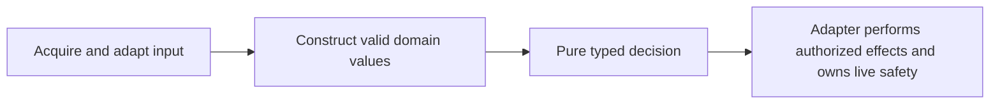

# Validated models and pure core guidance

## Purpose

Make engineering guidance explain how valid domain models, pure decisions, and
effect ownership keep application logic readable.

## Goals

- Define complete validation at the owning input and construction boundaries.
- Explain immutable product records, distinct variants, and pure typed
  decisions.
- Define consumer-owned ports and operation-first effect handling.
- Make readable decision logic discoverable at the existing engineering owner.

## Glossary

- **Consumed record:** the fields and relationships an operation relies on,
  including ownership, persistence, and security requirements.
- **Domain value:** a typed value whose construction from inputs satisfying its
  declared type contract establishes the invariants required by its consumers.
- **Core:** domain values and pure rules, separate from input acquisition and
  effects.
- **Algebraic data type, pure function, port and adapter:** use the
  [shared glossary](../../ubiquitous-language.md).

## Non-Goals

- Migrate production code or change computation, resource ownership, or module
  dependency contracts.
- Adopt tools, dependencies, a validation framework, or a second testing policy.
- Require a separate file, class, wrapper, Protocol, or variant for every helper
  or optional field.

## Mechanisms

- [Engineering conventions](../../engineering.md) own the delivered guidance,
  integrated with existing dataclass, composition, and type-precision rules.
- Frozen product records and unions of distinct record variants express valid
  values without a new modeling framework.
- Pure functions and consumer-owned `typing.Protocol` contracts separate
  decisions from injected effectful adapters.

## Visuals

At verified definition baseline `bce76e5`, engineering guidance covers boundary
adaptation, frozen values, injection, and single-value selection separately; the
proposed guidance connects those responsibilities without prescribing separate
files or classes.

## Acceptance criteria

### **AC-1 DONE** Complete record validation

Engineering guidance makes construction establish every owned consumed-field,
semantic, cross-field, and ownership invariant before core logic runs.

- Raw external or untyped representations, including persisted data, receive
  consumed structure, type, and relationship validation at their actual ingress.
- Documented typed library APIs supply their documented guarantees; adapters
  check project contract gaps and domain invariants without repeating upstream
  guarantees merely because the library is third party.
- Trusted typed internal construction relies on declared argument types and
  validated child domain values while enforcing its own invariants, without
  claiming arbitrary untyped schema validation or repeatedly inspecting
  children.
- Type checks remain appropriate for owned value or storage restrictions,
  including excluding `bool` where an integer domain requires it.
- Internal invariant errors are concise, external input errors provide
  actionable context, and programming errors are not blanket-wrapped as input
  failures.

Rejection may stop at the first error; distinct failure paths serve useful
caller responses. Ownership, persistence, and security fields remain consumed
even when a particular pure decision does not read them. Unused extension data
stays opaque and is preserved when required by transport or persistence
compatibility.

### **AC-2 DONE** Immutable core values and valid state transitions

Engineering guidance explains how immutable product records and distinct union
variants express valid core inputs, results, and transitions.

- Fields required together form product records; variant-specific fields belong
  to the corresponding alternative when that makes invalid combinations harder
  to express, while ordinary flat records remain appropriate when they fit.
- Frozen declarations are shallow and annotations do not establish runtime
  validity; containers are immutable or have explicit ownership.
- New values pass through validated construction rather than mutation or
  `object.__setattr__`, while stateful runners and resource holders retain their
  explicit mutable ownership.
- Closed variant handling preserves useful narrowing and makes missing cases
  visible through a supported exhaustive-handling mechanism such as
  `assert_never`, without claiming Python `match` is inherently exhaustive or
  erasing types through casts, broad types, or suppressions.

### **AC-3 DONE** Pure decisions over valid inputs

Engineering guidance defines pure decisions as typed functions whose same valid
explicit inputs produce the same results without I/O, environment, time, random,
or global-state dependence, or argument mutation.

Rules consume valid domain values without reparsing, repeated defensive child
checks, or filesystem/process probes; newly constructed results enforce their
own invariants. Calling an effectful collaborator remains an effect even through
a Protocol. Substantial per-item decisions are separated from traversal and
cross-item state when that clarifies the contract, keeping that state visible
in the loop rather than hiding it in a comprehension. Standard Python protocols
are preferred where their semantics naturally fit, with named methods retained
for distinct domain meaning.

### **AC-4 DONE** Collaborator contracts owned by consumers

Engineering guidance defines precise reusable ports from consumer needs, with
typed inputs, outputs, errors, and lifecycle ownership.

Concrete adapters implement consumer-owned `typing.Protocol` contracts and are
injected by composition. Dependencies point toward the consumer contract and
core does not import concrete adapters. Guidance does not require a Protocol or
module for every helper; `runtime_checkable` serves an actual runtime
conformance need.

### **AC-5 DONE** Effects and live resource safety owned by adapters

Engineering guidance assigns acquisition, adaptation, decisions, and effects
clear input/output, error, and resource responsibilities.

Adapters attempt operations and handle expected failures at the owning boundary,
normalize inputs once, reuse observations, and rely on documented API behavior
instead of routine preflight probes. They own cleanup on success and failure.
Essential live ownership, security, lifecycle, and safety checks remain at the
operation that needs them, including synchronization and protection against
changes between checking and use; valid persisted values alone do not establish
current resource safety. Supported inputs, documented errors and causes, state
invariants, persistence compatibility, and necessary effect ordering remain
contracts, while incidental validation order and branch organization may change.

### **AC-6 DONE** Readable decision logic

Engineering guidance makes case selection and independent constraints readable
without a framework or numeric refactoring quota.

- One stable value selecting mutually exclusive cases can use `match`, retaining
  supported cases and required unmatched-input behavior.
- Independent constraints use short guards or a small local collection of
  conditions and diagnostics when multiple findings must accumulate, preserving
  type prerequisites and useful caller distinctions.
- A lookup suits a simple mapping from keys to fixed values; neither tables nor
  variants are mandatory for every decision.
- Dense predicates are not hidden in guards, comprehensions, or extracted
  helpers merely to lower a metric or statement count.

## Dependencies

This Work has no prerequisite Work. The
[complexity Investigation](../conditional-complexity/investigate/README.md) may
proceed independently; its
[adoption Work](../conditional-complexity/adopt/README.md) and
[engineering review Work](../engineering-review/README.md) consume this guidance
after integration.

## Links

- [Testing](../../testing.md) owns testing policy and boundaries.
- [ADR 2](../../adr/0002-strategy-and-features-as-pure-functions.md),
  [ADR 8](../../adr/0008-stateful-callable-class-instead-of-a-generator.md),
  [ADR 10](../../adr/0010-provider-for-graph-source-instead-of-bare-type.md),
  [ADR 16](../../adr/0016-source-manages-its-own-provider-lifecycle.md), and
  [ADR 17](../../adr/0017-enforce-module-dependencies-with-tach.md) retain
  existing pure-function, runner, provider, ownership, and dependency contracts.

## Additional context

The former algebraic-data-type Investigation is superseded by the delivered
modeling guidance; its comparison, probe, and recommendation deliverables were
removed rather than completed.

Delivery is compact guidance with two supporting examples across these outcomes:
one connects construction, product/variant modeling, and pure decisions; the
other connects a consumer port, adapter wiring, and operation/failure handling.
Together they distinguish raw ingress from documented typed API guarantees and
show useful narrowing, valid construction, and rejection of invalid
relationships. At least one uses ordinary application logic outside sandbox
lifecycle. Accepted Markdown and Work-check changes can supply illustrative
sources rather than mandatory designs; examples are checked against
then-integrated source and distinguish historical, current, and proposed
behavior. No exhaustive tutorial, representation comparison, or standalone
checker-probe deliverable is required.

Python 3.14 native deferred annotation evaluation is an explicit delivery
constraint: guidance prohibits `from __future__ import annotations`; this is not
an immutability guarantee. This guidance does not establish repository-wide
implementation compliance.
