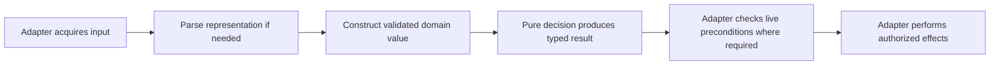

# Validated models and pure core guidance

## Purpose

Make engineering guidance explain how to turn external data into valid domain
values, apply pure rules, and perform effects without confusing model validity
with live resource safety.

## Goals

- Define complete consumed-record validation and immutable core inputs/results.
- Separate pure decisions from parsing, input acquisition, and effects.
- Define consumer-owned collaborator contracts and adapter responsibilities.
- Demonstrate these boundaries with compact examples in the existing
  [engineering conventions](../../engineering.md).

## Non-Goals

- Migrate production code, redesign the computation graph, or change resource
  ownership and module dependency rules.
- Introduce a framework, tool dependency, executable enforcement, or a second
  testing policy.
- Require a separate file, class, wrapper, or Protocol for every responsibility.
- Resolve the representation question owned by the
  [algebraic data type Investigation](../algebraic-data-types/README.md).

## Mechanisms

- Frozen dataclasses and focused constructors establish runtime invariants for
  domain values; freezing alone does not validate fields or nested containers.
- Pure functions compute typed results from valid explicit inputs.
- Consumer-defined `typing.Protocol` ports describe collaborator contracts;
  injected concrete adapters implement effects and resource management.

## Visuals

Proposed responsibility flow; the boxes do not prescribe separate files or
classes, and external checks remain at the points required by each operation.

## Acceptance criteria

### **AC-1 TODO** Validated immutable values for pure rules

[Engineering conventions](../../engineering.md) explains how complete runtime
validation establishes every consumed field and cross-field invariant before
core logic receives a domain value. Parsing converts representations; validation
establishes invariants, even when a parser calls a validating constructor.
Frozen dataclasses use `__post_init__` checks or focused constructors;
annotations and freezing alone do not establish validity. Fail-fast rejection is
permitted: success guarantees complete validation, without requiring collection
of all errors. Simple guards remain appropriate; clever compound short-circuit
validation is discouraged.

Consumed fields include those required for ownership, persistence, or security,
not just fields read by a pure decision. Unrelated extension data is preserved
opaquely when transport/persistence requires it, without speculative validation
of unused external schema.

Core inputs/results use frozen dataclasses or immutable value variants, with
immutable or explicitly owned containers. The guidance explains shallow
freezing and requires valid construction of new results and state transitions,
without mutating core values or bypassing construction with
`object.__setattr__`. Pure functions return the same outputs for the same
explicit inputs, without I/O, environment/time/random/global-state dependence,
or argument mutation. They may validate newly constructed outputs; they do not
reparse or defensively revalidate already valid inputs. Typed path values and
pure transformations of them are allowed.

A compact proposed constructor/pure-decision example shows typed signatures,
valid construction, consumed-field and cross-field rejection, and construction
of a valid new result/state. It distinguishes model validity from live resource
safety and explains opaque extension preservation. Links to
[testing guidance](../../testing.md) establish where coverage belongs: pure
public-function units use valid typed inputs; constructor/boundary tests cover
whole records and invalid fields/cross-field combinations; parsing tests cover
roundtrip compatibility.

#### What exists

At planning baseline `cd3cb5e6a7abfbb91533c1b14be37b26ff05927a`, engineering
already prefers frozen values and external-boundary adaptation.
[SmaRunner and sma](../../../src/ataraxia/feature.py) separate runner parameters
from calculation. [BrokerRunner and Position](../../../src/ataraxia/broker.py)
show why frozen declarations are insufficient: the runner holds mutable
containers and Position mutates frozen fields with `object.__setattr__`.
These are existing examples, not evidence of repository-wide compliance.

### **AC-2 TODO** Explicit effect ownership and consumer-defined ports

Engineering conventions assigns clear typed input/output, error, and effect
contracts to acquisition, parsing, validation, pure decisions, and
output/effects. Cohesive functions may share a module. Pure decisions consume
valid domain values; adapters coordinate them and own filesystem/persistence,
locks, processes, and cleanup on success or failure. Stateful runners and
mutable resource holders retain explicit ownership; blanket freezing is not
required. Calling an effectful port remains effectful even when the port is
injected.

Reusable collaborator ports use `typing.Protocol` contracts defined by consumer
needs, including inputs, outputs, errors, and lifecycle ownership. The host or
composition root supplies concrete adapters; dependencies point toward the
consumer contract, and core does not import concrete adapters.
`runtime_checkable` is used only for an actual runtime conformance need.

Record validation occurs once per boundary crossing. Adapters separately recheck
live preconditions at the operation's required points. The sandbox example
preserves generation/inode identity, held-lock freshness, fail-closed behavior,
TOCTOU protection, and required effect ordering. Schema, owner, and identity
fields remain relevant even when a pure decision does not read them; a frozen
persisted value cannot establish current resource safety. Accepted and rejected
inputs, documented errors/causes, and state invariants remain contracts, while
validation order and branch organization may change when those outcomes do not.

A compact proposed port/adapter wiring example describes typed signatures and
input/output/error/effect responsibilities. Across the two ACs' examples, at
least one uses ordinary application logic outside sandbox lifecycle, drawing on
SmaRunner/sma or Provider/Source where useful. Sandbox locking and native
identity safeguards stay contextual. Examples illustrate guidance rather than
introduce production APIs. Adapter/wiring/integration coverage follows existing
testing guidance for our effects and resource management, without upstream OS
or Ruff algorithm assertions.

#### What exists

Engineering already uses structural Protocols and injected dependencies.
[Provider](../../../src/ataraxia/provider.py) and
[SourceNode](../../../src/ataraxia/source.py) demonstrate collaborator and
delegated resource-lifecycle contracts. These patterns provide a starting point;
this Work makes consumer ownership, pure/effect separation, and complete
collaborator contracts explicit.

## Dependencies

This Work has no prerequisite Work. The
[complexity adoption Work](../conditional-complexity/adopt/README.md) consumes
these boundary rules and must follow this Work's integration before editing the
shared engineering owner; it owns measurable condition prevention. The
[complexity Investigation](../conditional-complexity/investigate/README.md) and
ADT Investigation may proceed independently.

## Links

- [PR #328 comment](https://github.com/msitarz/ataraxia/pull/328#discussion_r4272687628)
  and historical
  [`_validate_record` at 47779e4](https://github.com/msitarz/ataraxia/blob/47779e4dbf3df31d0c4ebcffd9d074ba493ccff3/script/sandbox.py#L465-L550):
  the original sandbox seed validates lifecycle/diagnostics, identity, and
  extensions in one external record validator; its read-only ProcessSupervisor
  is another collaborator example to inspect. PR #328 is independent and need
  not merge for this Work.
- [ADR 2](../../adr/0002-strategy-and-features-as-pure-functions.md),
  [ADR 8](../../adr/0008-stateful-callable-class-instead-of-a-generator.md),
  [ADR 10](../../adr/0010-provider-for-graph-source-instead-of-bare-type.md),
  [ADR 16](../../adr/0016-source-manages-its-own-provider-lifecycle.md), and
  [ADR 17](../../adr/0017-enforce-module-dependencies-with-tach.md):
  existing pure-function, runner, provider, resource-ownership, and dependency
  contracts that this guidance elaborates.

## Additional context

Deliver compact edits and examples at the engineering owner, integrating its
existing composition, dataclass, Protocol, and type-precision rules. Inspect
then-integrated source before drafting examples and distinguish existing,
historical, and proposed behavior. The historical ProcessSupervisor is absent
at the planning baseline. This Work adopts guidance; production adoption is
separate future work.
