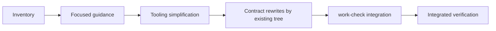

# Adopt readable Work contracts

## Purpose

Make all active Works understandable from their contracts while reducing the
instructions and acceptance bookkeeping needed to define and deliver them.

## Goals

- Use the new Work template for every active contract.
- Give contract-writing instructions one authoritative home.
- Treat prototyping as an Investigation method rather than a separate Work kind.
- Remove pytest acceptance markers and their test-selection commands.
- Replace obsolete acceptance checking with structural checks of active Work
  contracts.
- Preserve Work scope, useful regression tests, observed evidence, and review
  gates.

## Glossary

- **Active contract:** a current Work README that defines required outcomes,
  including planning parents and Investigations.
- **Historical input:** retained past protocols, observations, or decisions
  used as context rather than as current execution instructions.

## Non-Goals

- Implement the outcomes of the Works being rewritten or authorize their trials.
- Change delegation, publication, merge, or verification/cleanup commit gates.
- Purge regression tests or adopt another test-to-criterion mapping system.
- Rewrite historical observations or accepted decision rationale as current
  policy.

## Mechanisms

- [Work contract template](../../work-contract-template.md) defines the
  authoring structure and focused outcome prompts.
- Existing Make documentation and focused test commands provide checks without
  a separate acceptance-test selector.
- Git diffs and existing evidence records support review of scope preservation.

## Visuals

Before this migration, the new template coexisted with list-based contracts,
mandatory validation plans, and marker-based acceptance tooling. Migration
sequence:

## Acceptance criteria

### **AC-1 TODO** One contract format across active Works

Every active contract identified by the inventory follows the new template,
with one coherent outcome per criterion. Scope, dependencies, safety boundaries,
status, and unresolved decisions survive the rewrite. Historical inputs remain
clearly distinguished from live requirements.

### **AC-2 TODO** One discoverable authoring route

Agents reach the template from current guidance without conflicting format,
mandatory Validation-clause, or pytest-marker instructions. Feasibility work
routes to Investigation rather than a separate Prototype kind. Necessary
evidence and independent review requirements remain, without replacement mapping
reports.

### **AC-3 TODO** Acceptance bookkeeping removed without losing regression coverage

The covers marker, its registration, and ac-collect/ac-test/ac-check are
retired. Ordinary focused test commands remain usable, and removal of marker
infrastructure preserves unrelated tests.

### **AC-4 TODO** Structural Work checking follows migration

The delivered `work-check` tooling discovers active contracts independently of
their contents and reports actionable structural errors through `doc-check`
after the contract migration. The delivered checker includes the selected
parser and reusable Markdown boundary; checks do not infer semantic quality or
completion.

## Children

- **DONE** [Migration inventory](inventory.md): established the contract,
  guidance, tooling, and reference scope.
- **DONE** [Guidance alignment](../../work-contract-template.md): established
  README-only outcome contracts, source-based evidence, and Investigation
  prototyping, with decisions in [WDRs 23–27](../../wdr/README.md).
- **DONE** Acceptance tooling simplification retired marker selection,
  declaration-only ac-check, and orphan helpers while preserving ordinary
  regression coverage.
- **DONE** Active contract migration rewrote all five groups of existing Work
  contracts, preserving their scope, ownership, and dependencies.
- **DONE** Structural Work checking: implemented typed Markdown parsing,
  content-independent Work discovery, and structural enforcement through
  doc-check
  ([current interface and discovery convention](../../work-definition.md)).
- **TODO** [Integrated migration verification](verification/README.md): assess
  complete coverage, preserved scope, and consistency across the final tree.

## Links

- [Migration inventory](inventory.md): baseline paths, conflicts, and supporting
  artifacts for this migration.
- [Validated core](../validated-core/README.md) and
  [sandbox discovery](../evaluation-sandboxes/lifecycle/listing/README.md):
  the reviewed guidance and implementation examples for outcome writing.

## Additional context

This migration changes contracts, aligns shared guidance, and updates
supporting tooling; it does not implement outcomes of rewritten Works or
authorize their trials. Existing Works remain owned at their current paths, and
migration children own migration changes rather than implementation of those
Works. The migration's own contracts use the new format and remain in scope for
final consistency review. Inventory, guidance, tooling, contract groups, and
work-check integration are delivered; integrated verification remains pending.
Shared guidance edits remain at their authoritative owners; children report
conflicts to the migration owner rather than create copies.
