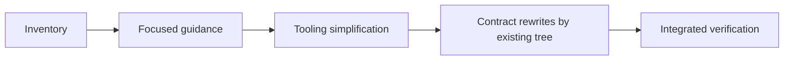

# Adopt readable Work contracts

## Purpose

Make all active Works understandable from their contracts while reducing the
instructions and acceptance bookkeeping needed to define and deliver them.

## Goals

- Use the new Work template for every active contract.
- Give contract-writing instructions one authoritative home.
- Remove pytest acceptance markers and their test-selection commands.
- Preserve Work scope, useful regression tests, observed evidence, and review
  gates.

## Glossary

- **Active contract:** a current Work README and any linked specification that
  defines required outcomes, including planning parents and Investigations.
- **Historical input:** retained past protocols, observations, or decisions
  used as context rather than as current execution instructions.

## Non-Goals

- Implement the outcomes of the Works being rewritten or authorize their trials.
- Change delegation, publication, merge, or verification/cleanup commit gates.
- Purge regression tests or adopt another test-to-criterion mapping system.
- Rewrite historical observations or accepted decision rationale as current
  policy.

## Mechanisms

- [Work contract template](../../work-contract-template.md) defines the
  authoring structure and focused outcome prompts.
- Existing Make documentation and focused test commands provide checks without
  a separate acceptance-test selector.
- Git diffs and existing evidence records support review of scope preservation.

## Visuals

Before this migration, the new template coexists with list-based contracts,
mandatory validation plans, and marker-based acceptance tooling. Proposed:

## Acceptance criteria

### **AC-1 TODO** One contract format across active Works

Every active contract identified by the inventory follows the new template,
with one coherent outcome per criterion. Scope, dependencies, safety boundaries,
status, and unresolved decisions survive the rewrite. Historical inputs remain
clearly distinguished from live requirements.

### **AC-2 TODO** One discoverable authoring route

Agents reach the template from current guidance without conflicting format,
mandatory Validation-clause, or pytest-marker instructions. Necessary evidence
and independent review requirements remain, without replacement mapping reports.

### **AC-3 TODO** Acceptance bookkeeping removed without losing regression coverage

The covers marker, its registration, and ac-collect/ac-test are retired. Any
retained ac-check validates declarations only. Ordinary focused test commands
remain usable, and removal of marker infrastructure preserves unrelated tests.

## Children

- **TODO** [Migration inventory](inventory/README.md): establish the complete
  affected contract, guidance, tooling, and reference scope.
- **TODO** [Guidance alignment](guidance/README.md): make the template the
  authoring owner and remove conflicting or duplicated instructions.
- **TODO** [Acceptance tooling simplification](tooling/README.md): retire marker
  selection and reduce acceptance tooling to useful declaration checks.
- **TODO** [Active contract migration](contracts/README.md): rewrite existing
  Works in separately reviewable groups.
- **TODO** [Integrated migration verification](verification/README.md): assess
  complete coverage, preserved scope, and consistency across the final tree.

## Links

- [Initial inventory](inventory.md): baseline paths, conflicts, and supporting
  artifacts for this migration.
- [Validated core](../validated-core/README.md) and
  [sandbox discovery](../evaluation-sandboxes/lifecycle/listing/README.md):
  the reviewed guidance and implementation examples for outcome writing.

## Additional context

This is contract preparation only. Existing Works remain owned at their current
paths; migration children own their rewrites, not their implementation. The
migration Work tree itself already uses the new format and is included in final
consistency review. Inventory, guidance, tooling, contract groups, and final
verification proceed in dependency order. Shared guidance edits belong to the
guidance child; other children report conflicts there rather than create copies.
