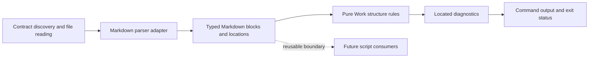

# Check active Work contracts structurally

## Purpose

Give authors actionable feedback on malformed Work contracts through a reusable
Markdown parsing boundary and the ordinary documentation check.

## Goals

- Discover every active contract even when its required headings are missing.
- Check mechanical structure and criterion declarations using parsed Markdown.
- Select a parser with source locations and precise repository-owned types.
- Enable automatic checking after the active contracts have been migrated.

## Non-Goals

- Judge outcome quality, evidence, semantic coverage, or whether DONE is earned.
- Restore acceptance markers, test selection, Validation clauses, or ac-check.
- Require optional template sections or a new shared script package now.
- Turn parser selection into a benchmark or broad Evaluation project.

## Mechanisms

- `make work-check` exposes structural checking with optional `ARGS` paths.
- `markdown-it-py` supplies structured blocks and source locations.
- A repository-owned parsing boundary separates Markdown representation from
  Work rules and can serve future script tools.
- `make doc-check` invokes work-check after migration, preserving existing
  formatting, link, and Mermaid checks.

## Visuals

Before: ac-check parses legacy list declarations and Validation annotations.
After the separate tooling retirement and contract migration:

## Acceptance criteria

### **AC-1 DONE** Adopt the reviewed parser choice

The maintainer accepted `markdown-it-py` from the
[parser-selection findings](https://github.com/msitarz/ataraxia/blob/ca44e406dc2e3b375dfe8f52dd54819a31e2ec86/doc/feat/work-contract-migration/work-check/parser-selection-evidence/findings.md).
`pyproject.toml` declares the dev tooling dependency as
`markdown-it-py>=4.2.0`, and `uv.lock` records the resolved version satisfying
that requirement.

### **AC-2 DONE** Markdown parsing exposes a reusable typed boundary

The parser adapter returns immutable repository-owned Markdown values with
explicit block kinds, heading levels, relevant text, and source locations.
Its consumed data is validated before consumers receive it; third-party token
objects and untyped dictionaries do not leak into Work rules. Work-specific
section and AC interpretation stays outside this boundary, allowing future
script tools to reuse parsing without importing Work validation. File reading,
third-party adaptation, pure structural decisions, and console effects have
clear typed inputs, outputs, and failure responsibilities. Pure rules consume
valid explicit values without filesystem access or repeated boundary checks.
A separate package under `script/` may become useful for later consumers; this
Work requires a cohesive reusable boundary rather than speculative packaging.

### **AC-3 TODO** Discovery finds malformed contracts without content heuristics

With no paths, `make work-check` checks every `README.md` recursively under
`doc/feat/`. This directory convention identifies active Work contracts
independently of their contents, including parents and Investigations lacking
ACs. The convention is documented at the authoritative
[Work definition](../../../work-definition.md) owner; historical inputs and
supporting artifacts are not Work READMEs under this root. Guidance, templates,
history outside this root, and product/package READMEs are excluded.

Optional `ARGS` accepts one or more repository-local contract files or subtrees
and checks their discovered contracts with the same rules. Invalid, missing,
out-of-root, non-contract, unreadable, or contract-empty explicit selections
produce actionable failures rather than silently passing. Overlapping selections
check each contract once. Discovery and path handling do not escape the Work
root through symlinks or path traversal.

### **AC-4 TODO** Structural errors have precise diagnostics

A contract has a nonempty level-one Work name and exactly one top-level section
at heading level two for each required template heading: Purpose, Goals, and
Acceptance criteria. Purpose and Goals contain nonempty content, and Acceptance
criteria contains at least one criterion. Optional template headings remain
optional. Criteria use `### **AC-N STATUS** Outcome name`, with a positive
decimal ID unique within that contract, a supported status from
[Work acceptance](../../../acceptance-tracing.md#criterion-status), a nonempty
name, and a nonempty outcome body. Missing or malformed declarations, duplicate
IDs, unsupported statuses, empty names/bodies, and criteria outside Acceptance
criteria fail. Nested explanatory headings remain part of their owning outcome.

Real Markdown structure determines headings and section boundaries: fenced code,
HTML comments, and nested block content cannot create false declarations or
required sections. Every finding identifies a repository-relative `path:line`,
the violated rule, and enough context to repair it; a missing construct points
to its owning section or file start. Multiple findings and files can be reported
in a deterministic order. Content failures exit 1, invocation or input-access
failures exit 2, and a successful check exits 0. The command changes no files;
DONE labels never establish acceptance or affect structural pass/fail.

### **AC-5 TODO** Documentation checks enforce the migrated format automatically

After active contract migration, doc-check runs work-check for all active
contracts and fails when structural checking fails, including when doc-check's
`ARGS` focuses its other documentation checks. The existing CI documentation
route inherits this enforcement. Earlier tooling-retirement and contract-rewrite
commits remain usable without premature enforcement against unmigrated Works.
Standalone focused work-check remains available for author feedback. Current
Make help and guidance expose the delivered interface without restoring retired
commands, and existing documentation checks retain their behavior.

## Dependencies

- **DONE** The completed [tooling simplification outcome](../README.md#children)
  retired ac-check and its obsolete scripts/helpers; this Work owns the new
  interface.
- **DONE** [Active contract migration](../README.md#children): supplies the
  migrated tree for automatic doc-check enforcement. Parser selection and
  focused implementation may proceed earlier.
- [Work contract template](../../../work-contract-template.md) and
  [Work acceptance](../../../acceptance-tracing.md): own required structure and
  supported criterion statuses.

## Children

- **DONE** Bounded parser-selection comparison and versioned recommendation
  ([findings](https://github.com/msitarz/ataraxia/blob/ca44e406dc2e3b375dfe8f52dd54819a31e2ec86/doc/feat/work-contract-migration/work-check/parser-selection-evidence/findings.md));
  the maintainer accepted the `markdown-it-py` recommendation.

## Links

- [Validated core guidance Work](../../validated-core/README.md): pending
  guidance for validated immutable values, pure rules, and consumer-owned
  boundaries exercised explicitly by this contract; its delivery is not a
  prerequisite or an assertion that proposed guidance is current policy.
- [Condition complexity adoption](../../conditional-complexity/adopt/README.md):
  pending prevention guidance relevant to readable validation; no unimplemented
  threshold or dependency is adopted here.
- [Algebraic data type Investigation](../../algebraic-data-types/README.md):
  pending representation comparison relevant to typed block/diagnostic variants;
  it does not prescribe a model or block this Work.

## Additional context

The completed parser-selection Investigation records the bounded comparison and
recommendation in its
[findings report](https://github.com/msitarz/ataraxia/blob/ca44e406dc2e3b375dfe8f52dd54819a31e2ec86/doc/feat/work-contract-migration/work-check/parser-selection-evidence/findings.md);
parser integration remains in this Work. Current
[engineering conventions](../../../engineering.md) remain applicable. The
explicit boundary outcomes above exercise the relevant proposed direction
without waiting for unrelated guidance Works or copying their full contracts.
