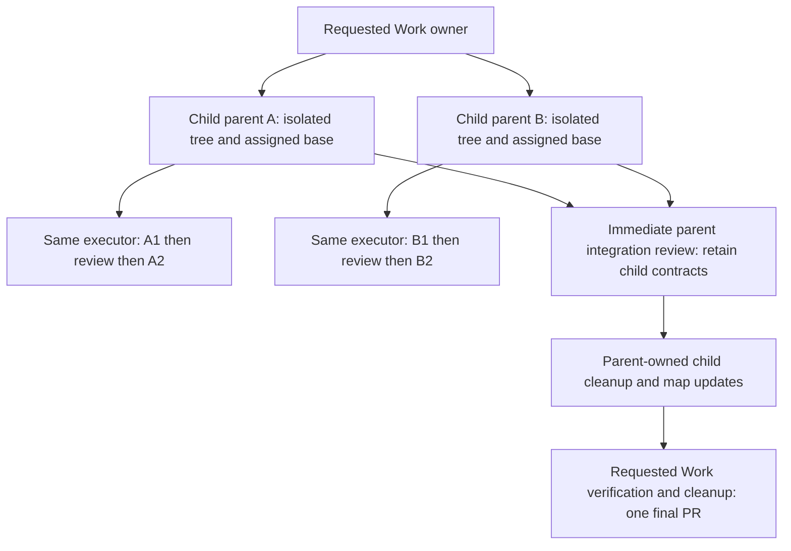

# Orchestrator handoffs

Read when acting as orchestrator for repository changes.

For explicitly approved evaluation sandbox preparation and execution, read
[evaluation sandboxes](evaluation-sandboxes.md) for manual inputs and managed
command status.

## Roles and delegation

The orchestrator owns scope, planning, read-only investigation, and independent
review and evidence assessment, integrates dependencies, and owns maintainer
handoff and final-CI assessment. Select delegated roles by responsibility:

| Role | Model and effort | Responsibility |
| --- | --- | --- |
| Definer | GPT-6.1 Sol, medium | Define Work scope, dependencies, edge cases, architecture fit, acceptance criteria, and validation. |
| Executor | GPT-6 Luna, medium | Implement bounded code, tests, documentation, or other changes under approved contracts. |
| Cleaner | GPT-6 Luna, medium | Perform maintainer-confirmed post-merge cleanup under its procedural owner. |
| Publisher | GPT-6 Luna, medium | Mechanically publish exact independently reviewed inputs under its procedural owner. |

Explicit maintainer task-specific role, model, or effort overrides take
precedence; otherwise use this routing. This changes no orchestrator model
selection or agent-creation authorization. Frozen empirical protocols retain
their declared conditions and require alignment or explicit authorization before
execution. Investigation and Evaluation contract definition uses the definer;
bounded investigation or evaluation execution uses the executor.

The definer owns assigned Work contract changes and serial coordination of
shared parent maps, without implementing code or approving its own definitions.
The executor makes bounded changes directly, returns the artifact and evidence,
and reports contract gaps before expanding scope. Neither recursively delegates
the assigned task. Cleaner and publisher gain no artifact-review or merge
authority.

For post-merge Work cleanup, hand off to the separate operational `cleaner`
subagent after the maintainer confirms the PR merged. Route it through
[branch-cleanup guidance](branch-cleanup.md) with the PR, branch, worktree,
reviewed head, and merge commit IDs.
Review the cleaner's concise report instead of repeating its operations, and
serialize cleanup with worktree creation and other shared Git mutations.

For a Work tree, the orchestrator that owns a Work node with children owns
planning and integration for that subtree and manages its immediate child
agents. Delegate each leaf directly to its responsible definer or executor; the
leaf's owning parent reviews it. A child node with children has its own
orchestrator owner for that subtree. Each leaf has one responsible orchestrator;
do not add a dedicated wrapper around a leaf by default. Work tree nodes
mark responsibility boundaries, not required runtime layers. Parent and
subtree reviews own integration and interfaces, and reuse leaf evidence
instead of repeating a full leaf review. Schedule work by dependency readiness,
available concurrency, and expected shared edits rather than launching the
entire tree at once. Do not invent intermediary Work nodes solely to justify
runtime layers.

The maintainer's requested Work defines the delivery boundary. Delegating a
child does not make it a new publication root. Each child parent uses a separate
isolated branch/worktree at the base ref assigned by its immediate parent owner;
its direct leaves use the sequential execution route below. Independent child
parents may run in parallel when dependencies, capacity, and shared edits
permit. Serialize shared owner/map edits and integrate subtree commits as linear
history without dropping their verification/cleanup pairs.

The immediate parent reviews child-parent interfaces and composition, reusing
valid leaf evidence. Retain the child's verified parent contract through this
integration review; afterward the immediate parent owner records reviewed child
cleanup and its own map update under
[acceptance tracing](acceptance-tracing.md#work-delivery-commits).



After exact-artifact and description review and acceptance assessment, hand
mechanical publication to the separate operational `publisher` with
[its owner](publisher.md), worktree, exact reviewed commit, approved title and
description file plus a digest or immutable copy, and existing PR when updating.
Include authorized repository/base overrides and, for a rewrite, the expected
remote commit captured before rebase. The orchestrator retains publication
accountability, final-CI assessment, and maintainer handoff; assess the
publisher's returned publication state and blockers.

Before requesting new infrastructure or splitting scope, apply the
[Work-definition guidance](work-definition.md) and underlying
[repair and scope rules](change-rules.md#fix-the-underlying-problem): assess
whether simplification and suitable reuse can fulfill the actual required
outcome with less machinery or review scope. Preserve required safeguards.

Before handoff, assess the full
expected change—including behavior, supporting changes, tests, and new
concepts—against the quick maintainer review target in
[Work scope and sizing](workflow.md#scope-and-sizing). If the necessary change
remains too large after that assessment, split it into independently reviewable
nested Works through the
[planning and tree-wide pause rules](workflow.md#decisions-and-new-splits).
For an ad hoc handoff, define a parent Work and child Works; for an existing
Work, nest children and update its parent map. Apply
[contract review guidance](work-definition.md) and the workflow owner’s depth
and planning gates before expanded work.

Before dispatch, identify dependencies and shared edit surfaces. Coordinate
shared owners, parent maps, indexes, exact wording, formatter-valid snippets,
and reserved WDR numbers where needed. If overlap is unavoidable, sequence the
Works or name the remaining merge resolution; do not invent index categories or
ordering to hide a conflict. Start the assigned agent promptly once necessary
preflight is complete; remaining reviewer reading may overlap execution when
it does not defer integration preflight.

A Work README and its linked contracts define acceptance criteria. Give the
definer or executor the Work path and requested action, plus only missing
steering and necessary branch or delivery context. The assigned agent reads the
Work and applicable contracts; consult ancestor READMEs only as needed, without
recursively loading every parent. Without a Work contract, state acceptance
criteria in the handoff. Link background instead of forwarding the full
conversation by default. Routine choices within the agreed contract need no
approval.

Definition returns identify the contract revision, dependencies, risks, and
unverified criteria. The owning orchestrator independently reviews the
completed definitions before implementation begins; execution returns identify
the artifact revision and evidence. Use the same consolidated correction and
review gates below for either responsibility.

Definers and executors use an isolated Git worktree before editing. For a
requested leaf, create its isolated branch/worktree and follow the usual Work PR
flow. When assigning an executor to that leaf, use a fresh session. For each
parent's implementation run, assign a fresh executor session and reuse it only
for that parent's direct leaves and correction cycles, sequentially in one
accumulating isolated branch/worktree. Distinct child parents use distinct fresh
executor sessions even when scheduled sequentially; do not share an executor
session across parents. Reuse the tree for successive leaves rather than
creating a tree per leaf. Retire the executor session when the parent run or
requested leaf delivery and its corrections are complete; never repurpose it for
another Work. Retirement means stop assigning tasks, without requiring teardown,
automatic termination, or cache purging. Before work begins, the handoff names
the destination path, branch, and base ref and gives the creation command, for
example:

```sh
make worktree-create WORKTREE=/private/tmp/ataraxia-example BRANCH=work/example
```

This target creates from local `master`. For an assigned child base, first
prepare the new clean tree with that command, then set its branch to the
assigned ref using a separate ordinary Git operation before editing. Verify the
resulting base and environment; use `make ci-setup` and `make verify-setup` if
dependencies need synchronization. Do not invent a base argument for the
creation target.

If implementation reveals out-of-scope work, stop before expanding and report
the finding and evidence. Route a new split or needed maintainer decision
through the [whole requested-tree pause](workflow.md#decisions-and-new-splits),
including other active subtrees. Apply the split rule when it adds an
independent responsibility or exceeds the review target. A different delegated
agent still requires the maintainer's explicit approval.

## Review and return

For a requested parent's direct leaves, complete the local artifact/evidence
review and any consolidated corrections before assigning the next leaf. Follow
the [local delivery sequence](acceptance-tracing.md#work-delivery-commits) for
each accepted leaf. Within that accumulating branch, local acceptance of a
dependency permits its next dependent leaf without a `master` merge. The parent
owner owns map changes; the executor applies only reviewed updates. Do not
publish child leaf PRs from this requested-parent run. After the leaves, review
the parent's own acceptance and verification/cleanup sequence under its
immediate parent's integration review, or before publication if it is the
requested Work.

After handoff and each correction request, wait for the completed artifact or a
blocker needing maintainer steering before reviewing. Do not poll for routine
status, inspect partial diffs, or send fragmented corrections. Review the
completed diff once against acceptance and owner guidance, using reported
evidence. Send one consolidated finding list to the same active agent session;
review corrections as needed. Reuse reported evidence and rerun focused checks
only when a change, failure, or unresolved concern warrants it. Context reuse
may help token caching, but caching is not guaranteed. If the same finding
remains after a correction attempt, or the session cannot continue, stop and
report attempts, current evidence, and the specific decision or help needed.
Resume only with orchestrator or maintainer steering. If the assigned agent is
unavailable, report that and wait; do not silently switch agents or implement
its changes as a fallback. Keep independent review and maintainer review, merge,
and CI gates.

Before removing a completing Work's contract, independently review its
criterion statuses and evidence using the
[Work delivery commit procedure](acceptance-tracing.md#work-delivery-commits).

If a definer or executor session is cancelled or lost, recover from the Work
contract, parent map, branch or PR, and available evidence. Establish which
changes remain, which evidence applies to the current revision, and which
criteria are unresolved before continuing. If uncertain, state that and ask for
steering rather than treating the handoff as complete. A fresh session in the
same role may continue the same approved scope after recovery. Delayed
corrections after a completed executor run likewise use a fresh session after
recovery; do not repurpose the retired session.

Follow [acceptance tracing](acceptance-tracing.md) for criterion status,
coverage semantics, evidence methods, and the retained verification/cleanup
commits. Follow
[Pull requests](pull-requests.md#descriptions) for executor returns, local
review before new or amended PR publication, description preparation, ready-PR
meaning, and publication ownership.

Before publishing, reassess each complete leaf's actual diff, including tests,
supporting changes, and concepts, under
[Work scope and sizing](workflow.md#scope-and-sizing). If simplification and
reuse cannot meet the target, stop publication and apply the
[planning and tree-wide pause rules](workflow.md#decisions-and-new-splits),
preserving valid implementation and evidence. Integrated parent review assesses
interfaces and composition rather than requiring the entire parent batch to fit
one leaf's review target. Preserve substantive scope requirements and identify
remaining merge resolution. Only the requested Work owner hands off its final
reviewed branch and description for [publication](pull-requests.md#publishing).

Repository merge settings do not replace maintainer review or maintainer
authority. The maintainer reviews the current PR revision and performs the
merge. Agents must not merge autonomously; an agent may merge only with explicit
maintainer instruction. Do not change repository settings, use an admin
override, or bypass review or CI requirements.

Return the reviewable artifact (branch and revision or PR), outcome, acceptance
evidence, commands run, unrun checks, unresolved criteria, and blockers. After
session recovery, include the recovered state.
A blocked return states what remains and what input or decision is needed. A
completed return identifies changes awaiting orchestrator review.
