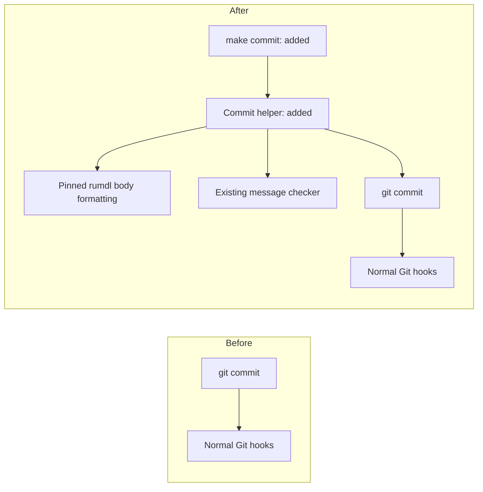
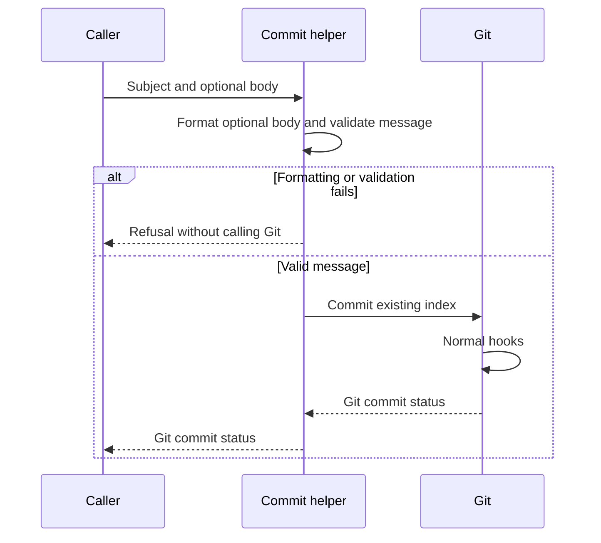

# Work definition

Read when defining, changing, or reviewing a Work contract. When executing an
Investigation, Evaluation, or Prototype, read its applicable section below for
required results. Follow [Work workflow](workflow.md) for scope, sizing, pause,
and delivery lifecycle rules.

Each Work lives in a directory identified by its repository path. Its short
`README.md` states the intended outcome and observable acceptance criteria so
the reviewer can tell when it is complete. Add `spec.md` or `design.md` only
when useful, and link to it from the README.

When defining a Work, apply the
[repair and scope rules](change-rules.md#fix-the-underlying-problem): inspect
current machinery, identify which requirements it already fulfills, and define
the remaining required gap. Reuse suitable existing commands, APIs, helpers,
and evidence. Introduce new machinery only when the existing path cannot
fulfill the required outcome, and explain that limitation. Assess existing
behavior against the required outcome rather than treating it as the intended
contract.

Explain the problem and verified current behavior when relevant. Define
completion with observable examples, including preconditions, action, and
expected outcomes; cover boundaries, failures, or behavior to preserve when
they matter. State scope, non-goals, dependencies, assumptions, and open risks
as useful, separating required contracts from provisional design. Use an
[Investigation](#investigations) or [Prototype](#prototypes) when
feasibility needs checking.

Use standard relative Markdown links. Follow the proportionate descriptions
below for meaningful changes; small changes may need only prose.

Do not require fixed headings, YAML frontmatter, a journal, or separate
human-facing and agent-facing versions of the same contract.

## Describing changes

For meaningful architecture, package/module relationships, interactions or
lifecycle changes, include proportionate before/after visuals. Inspect the
current source or contract first and identify the verified revision; distinguish
that before state from proposed additions, changes and removals. Update a
proposal's description when the verified implementation differs. Label
historical examples and illustrative designs so they cannot be mistaken for
current or approved behavior.

Choose a GitHub-supported Mermaid type suited to the question: flowcharts for
relationships, sequence diagrams for interactions, class diagrams for type
relationships, or state diagrams for lifecycle transitions. Show only the
affected context. Include compact affected public API descriptions for
functions, classes and data structures, with useful signatures, inputs/outputs,
behavior and compatibility changes. Tiny edits may use clear before/after prose.

Put shared context in the parent overview and local detail in the affected leaf;
link between them instead of copying diagrams or API descriptions. These are
content choices, not mandatory headings or a template. Review before/after
accuracy against the source and contract, and run `make doc-check` on real
Mermaid fences for embedded rendering. Rendering checks syntax, not acceptance
or GitHub/browser parity. Visuals support the criterion's method and evidence
under
[acceptance tracing](acceptance-tracing.md#planned-validation-and-evidence).

### Examples

This historical relationship example describes the commit command delivered
between `2a51814` (no `make commit` target) and `25814906` (target and helper
present), verified in their Makefiles and the latter's
[commit helper](../script/commit_command.py). It illustrates an added call path;
the checker and normal Git hooks remain in place.

The same historical change can instead show the interaction relevant to a leaf:
previously the caller supplied the message directly to Git; afterward the added
Make route formats an optional body and validates the message before invoking
Git. Validation failure returns before Git; successful validation reaches the
ordinary hooks. A parent can link to this leaf detail while showing only the
shared relationship overview above.

For that command's public interface, before: no Make commit target. After:
`make commit SUBJECT='fix: describe change' [BODY='Why it matters.']` commits
the existing index after formatting an optional body and checking the message;
SUBJECT must be nonempty and one line. See
[contribution guidance](../CONTRIBUTING.md#commits-and-pull-requests) for its
use.

An illustrative Python API change, unrelated to repository plans, might say:
before `Catalog.find(key: str) -> Item` raises `KeyError` for missing keys;
proposed `Catalog.find(key: str) -> Item | None` returns `None` instead.
Describe the affected `Catalog` class and returned `Item` data structure, and
require callers to handle the optional result. This small signature/behavior
change needs compact prose; add a class diagram only if type relationships also
change.

A tiny edit can say: “Before, the help text misspells `subject`; after, it
spells `subject` correctly. Arguments and behavior are unchanged.” No diagram is
needed.

## Investigations

An Investigation produces a recommendation for a bounded question. Its README
states the question, constraints, and decision needed. For each serious
candidate, record its fit for the problem, pros and cons, and what was checked
versus what remains uncertain. Conclude with a short comparison and
recommendation that explains the choice.

Use one file for a small comparison; use linked candidate files when they make
review easier. A supporting Evaluation can supply empirical evidence; a
Prototype can answer a question that documentation alone cannot resolve. An
Investigation recommends a direction; a Prototype demonstrates feasibility
through exploratory implementation.

Follow the common [Work lifecycle and review rules](workflow.md). On completion,
promote the chosen policy or lasting decision to its authoritative owner. Git
and the PR preserve the comparison artifacts when the finished Work directory is
removed. Do not introduce a separate lifecycle or mandatory template.

## Evaluations

An Evaluation owns empirical evidence for a bounded question from a declared
protocol. It may stand alone or support an Investigation's recommendation;
a small comparison may stay inline without a separate Work. A Prototype
answers feasibility through exploratory implementation. None requires nesting
or agents simply because of its kind.

Follow [empirical evaluation guidance](evaluation.md) for protocol,
observations, and interpretation, and the common
[Work scope and lifecycle rules](workflow.md) and
[review and evidence rules](acceptance-tracing.md). Evaluation completion does
not adopt a recommendation as policy.

## Prototypes

A Prototype answers a bounded question through exploratory implementation.
Its Work contract states the question, limits, and observable
evidence needed to answer it. Record the result in the PR, including when the
Prototype is unsuccessful, and distinguish observed evidence from assumptions.

Promote a Prototype to production Work only after reviewing missing contracts
and integration requirements. Prototype completion does not imply production
readiness.

See
[CONTRIBUTING.md's Work review rules](../CONTRIBUTING.md#work-branches-review-and-merge)
for branch and PR exceptions. Do not introduce a separate tracking system,
journal, or mandatory template.
